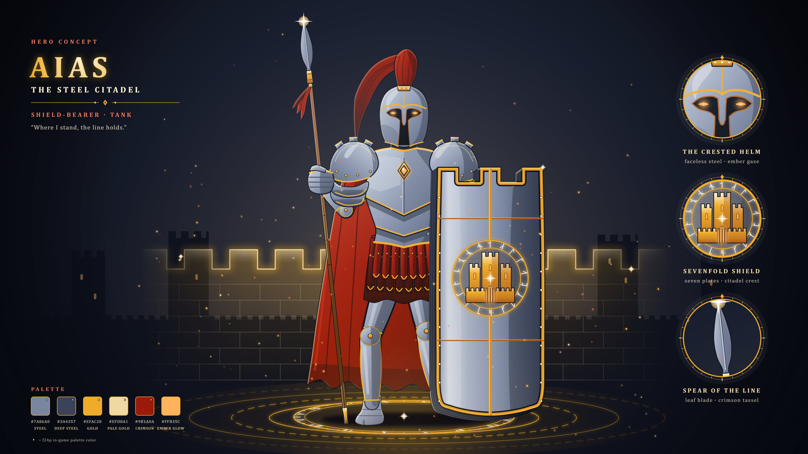

# 아이아스, 강철의 성채 — 영웅 컨셉 아트

탑 방패를 든 탱커 영웅 «Aias, the Steel Citadel»의 전신 컨셉 아트다(2026-10-19, Claude 제작). 방향은 사용자가 고른 결정(아래 «방향 결정»)을 따랐다. 형체를 SVG 벡터로 직접 그리고 Chromium으로 PNG를 찍었다. 생성형 이미지 모델은 쓰지 않았다.



| 파일 | 내용 |
|---|---|
| `aias.svg` · `aias_3840.png` | 컨셉 시트: 그림 + 제목·확대 원 3개(볏 달린 투구·일곱 겹 방패·창날)·팔레트 |
| `aias_clean.svg` · `aias_clean_3840.png` | 그림만 |

- 원본은 SVG다. PNG는 4K(3840×2160)만 넣었다. 8K는 아래 명령으로 다시 굽는다.
- 그림 요소:
  - 투구: 얼굴을 가린 코린트식 투구, 진홍 깃, 투구 속 불씨 눈빛
  - 갑옷: 판금 흉갑(V자 판 이음새·금 테두리·마름모 아케인 코어), 어깨 갑옷, 진홍 망토, 가죽 띠 치마, 철신
  - 자세: 창 쪽 다리를 앞으로 딛고 방패 쪽 다리를 뒤로 뺀 버티기 자세
  - 무기: 비스듬히 꽂은 창(잎 모양 창날·진홍 술), 성가퀴 모양 윗변의 일곱 겹 탑 방패(성채 문장·룬 고리)
  - 배경·효과: 등 뒤의 빛의 성벽, 먼 성채 탑, 발밑 룬 원과 충격파 고리, 불티

## 다시 굽는 법

```
python tools/art/concept/aias.py                      # SVG 2장 + 4K PNG 2장 → art/concept/aias/
python tools/art/concept/aias.py --scale 4 --out 폴더  # 8K(파일 이름 *_7680.png)
```

- 필요한 것·글자·나눠 찍기는 [크로노스 README](../chronos/README.md#다시-굽는-법)와 같다. 그리는 도구를 `chronos.py`에서 가져다 쓴다.

## 설계 메모

- **색:** f24p(`tools/art/palettes.json`)를 뼈대로 썼다. 시트 팔레트에서 ◆ 표시가 f24p 색이다.
  - f24p 색: 강철 `151a26`~`d0d6e0` 램프 7색 전부, 금 `ab5c1c`·`efac28`·`efd8a1`, 진홍 `300f0a`·`550f0a`·`9b1a0a`, 창 자루 `45230d`·`724113`·`a56243`
  - f24p 밖의 색: 불씨 빛 `ffb35c`, 금 중간 `d48b24`, 진홍 밝은 면 `c8361c`·`ef7a5e`
- **SPEC과의 관계:** 아이아스는 SPEC의 3성 탱커다(S157: 종류 `aias`, 이명 «강철의 성채», 기사 자리를 잇는다). 스킬은 S97 표의 칸이고, 오른쪽 열은 컨셉에서 이어 쓸 만한 요소다(Claude 해석).

  | 칸(S97) | 이름 | 컨셉에서 |
  |---|---|---|
  | 패시브 | 요새화 | 탑 방패 |
  | Q | 방패 강타 | 탑 방패 |
  | W | 전장의 포효 | 없음 |
  | E | 반격의 태세 | 발밑 충격파 고리 |
  | R | 절대 방어선 | 등 뒤의 빛의 성벽 |
- **검토:** 첫 시안을 Gemini «4 Argon»에게 검토받았다([feedback_gemini.md](../review/2026-10-19/feedback_gemini.md)). 사용자가 고른 «상» 두 항목(버티기 자세, 흉갑 판금화)을 반영한 뒤 승인받았다(2026-10-19).

## 남은 일

- [x] 사용자 승인(2026-10-19)
- [ ] Gemini 피드백의 «중»·«하» 항목: 빛의 성벽을 반투명으로, 무릎 보호대와 주먹 모양, 어깨 돌기. 고칠지 아직 고르지 않았다
- [ ] 24px 스프라이트로 옮기기(`next/archive/2026-10-19/r3.md` §1)

## 방향 결정

사용자가 고른 결정이다(2026-10-19). 방향을 물을 때 보인 영문 프롬프트 초안은 기록되지 않아 싣지 않았다.

- 고정: 그리스 영웅 × 아케인 강철 / 무기는 창 / 얼굴을 가린 코린트식 투구 + 진홍 깃 / 강철·금·진홍 포인트
- Claude 기본값: 땅에 세운 탑 방패, 등 뒤 빛의 성벽, 발밑 룬 원, 대사 «Where I stand, the line holds.»
