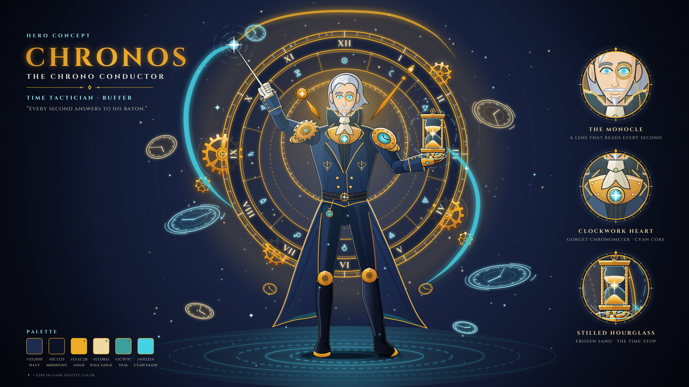

# 크로노스, 시간 지휘자 — 영웅 컨셉 아트

시간을 다루는 전술가·버퍼 영웅 «Chronos, the Chrono Conductor»의 전신 컨셉 아트다(2026-10-18, Claude 제작). 사용자가 준 이미지 프롬프트(아래)를 따랐다. 형체를 SVG 벡터로 직접 그리고 Chromium으로 PNG를 찍었다. 생성형 이미지 모델은 쓰지 않았다.



| 파일 | 내용 |
|---|---|
| `chronos.svg` · `chronos_3840.png` | 컨셉 시트: 그림 + 제목·확대 원 3개(외알 안경·태엽 심장·멈춘 모래시계)·팔레트 |
| `chronos_clean.svg` · `chronos_clean_3840.png` | 그림만 |

- 원본은 SVG다. PNG는 4K(3840×2160)만 넣었다. 8K(7680×4320)는 장당 약 20MB라 넣지 않았고, 아래 명령으로 다시 굽는다.
- 그림 요소:
  - 옷과 갑옷: 남색·금색 연미복, 태엽 갑옷(톱니 견갑·시계 견갑·가슴 시계·무릎 덮개)
  - 광륜: 천문시계(로마 숫자, 천문·원소 기호 12개, 해 원반 시침, 톱니 6개)
  - 소품: 흰 장갑으로 쥔 지휘봉, 손바닥 위에 뜬 모래시계(모래알이 멈춰 있다)
  - 효과: 청록·금색 홀로그램 시계 7개, 바닥·공중의 시간 왜곡 물결, 빛 궤적

## 다시 굽는 법

```
python tools/art/concept/chronos.py                      # SVG 2장 + 4K PNG 2장 → art/concept/chronos/
python tools/art/concept/chronos.py --scale 4 --out 폴더  # 8K(파일 이름 *_7680.png)
python tools/art/concept/shot.py 그림.svg 출력.png --scale 4   # SVG 하나만 찍기
```

- 필요한 것:
  - Python, Pillow
  - Chromium 계열 브라우저: Chrome·Edge도 된다. 못 찾으면 환경 변수 `CHROME`에 실행 파일 경로를 넣는다.
- 글자: Cinzel(OFL, The Cinzel Project Authors)의 윤곽(path)으로 넣어서 SVG에 폰트가 없어도 어디서나 같게 보인다.
  - 윤곽을 뽑으려면 `fontTools`가 필요하다(`pip install fonttools`).
  - 폰트는 처음 돌릴 때 Google Fonts에서 `~/.cache/td-proj/fonts`로 받는다. 저장소에는 넣지 않았다.
  - 둘 중 하나라도 없으면 시스템 세리프 `<text>`로 그린다. 그러면 글자 모양이 달라진다.
- 큰 그림은 나눠 찍는다(`shot.py`).
  - 8K를 한 번에 찍으면 Chromium 타일 메모리 한도(`tile memory limits exceeded`)를 넘어 대부분이 빈 채로 찍혔다.
  - 그래서 장치 픽셀 약 220만 이하 조각으로 찍어 붙인다. 이음매는 원본 픽셀에서 보이지 않았다.
  - 한도 경고가 뜨면 저장하지 않고 멈춘다.

## 설계 메모

- **색:** f24p(`tools/art/palettes.json`)를 뼈대로 썼다. 시트 팔레트에서 ◆ 표시가 f24p 색이다.
  - f24p 색: 금 `efac28`·`efd8a1`, 청록 `3c9f9c`, 남색 강조 `4f78ad`
  - f24p 밖의 색: 코트 남색 `1d2b50`·`0c1325`, 빛나는 청록 `45d2e4`
  - 24px 유닛으로 옮길 때는 남색을 f24p `262d3d`·`3a4357`·`151a26` 램프로 바꾸면 된다(Claude 제안).
- **SPEC과의 관계:** «시간을 다루는 전술가·버퍼»는 SPEC S97의 금 등급 장군(지휘)과 효과 종류가 겹친다. 이것은 Claude의 해석이고 SPEC은 고치지 않았다.

  | 장군 | 크로노스로 읽으면 |
  |---|---|
  | Q: 적 기절 2초 | 시간 정지 |
  | W: 용병 공격력 ×1.3 | 템포 가속 |
  | 오라: 공격력·이동 속도 | 박자 |
- **그리는 방식:**
  - 윤곽은 지나는 점 목록을 매끈한 베지어 곡선으로 잇는다(`smooth`). 꺾이는 점은 `(x, y, 1)`이다.
  - 셀 음영은 부품 모양으로 자른 그늘·빛 조각을 얹는 방식이다(`cel`).
  - 역광은 실루엣 알파를 깎은 가장자리 띠로 만든다(`fRim`). 띠는 외곽선 안쪽에만 둔다. 외곽선 위에 얹었더니 8K에서 선이 회색으로 떴다.

## 남은 일

- [ ] 사용자 검수: 얼굴·손·자세·색
- [x] 장군의 외형으로 쓴다(사용자 2026-10-18). 게임 안 이름은 SPEC S97의 «장군» 그대로다
- [x] B 방식 24px 스프라이트로 옮겼다: `tools/art/general.py` → `art/trial/general/`. 기록은 [insights/2026-10-18_general_sprite.md](../../../insights/2026-10-18_general_sprite.md). 광륜은 24px에서 빼고 오라 원 이펙트로 살리는 안을 냈다

## 원 프롬프트

> Full-body character concept art of Chronos the Chrono Conductor, a time-manipulating tactician and buffer for a fantasy tower defense game. Dressed in a sharp, aristocratic navy blue and gold coat with clockwork armor pieces. Behind his back floats a massive, glowing golden astronomical clock halo with rotating gears. He holds a conductor's baton and an ornate hourglass, surrounded by floating cyan and gold holographic clock faces and time-distortion ripples. Stylized arcane-steampunk fantasy game art style, crisp details, clean concept art background, 8k resolution, --ar 16:9
