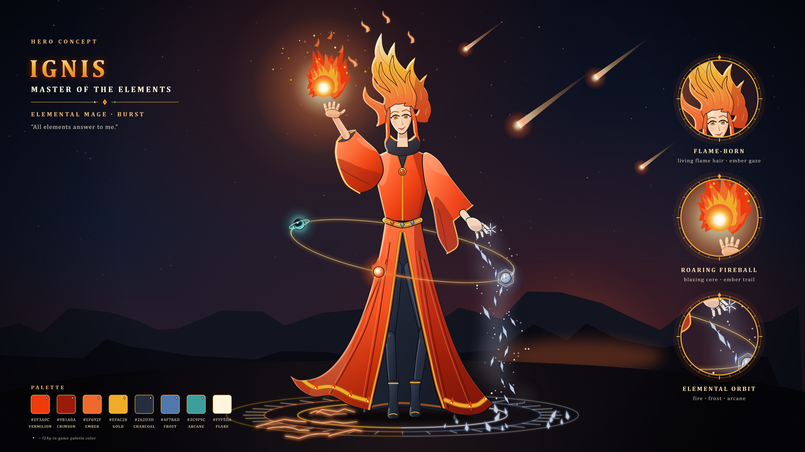

# 이그니스, 원소의 지배자 — 영웅 컨셉 아트

맨손으로 원소를 부리는 마법사 영웅 «Ignis, Master of the Elements»의 전신 컨셉 아트다(2026-10-19, Claude 제작). 방향은 사용자가 고른 결정(아래 «방향 결정»)을 따랐다. 형체를 SVG 벡터로 직접 그리고 Chromium으로 PNG를 찍었다. 생성형 이미지 모델은 쓰지 않았다.



| 파일 | 내용 |
|---|---|
| `ignis.svg` · `ignis_3840.png` | 컨셉 시트: 그림 + 제목·확대 원 3개(불꽃 머리·화염구·원소 궤도)·팔레트 |
| `ignis_clean.svg` · `ignis_clean_3840.png` | 그림만 |

- 원본은 SVG다. PNG는 4K(3840×2160)만 넣었다. 8K는 아래 명령으로 다시 굽는다.
- 그림 요소:
  - 머리: 앞머리 가르마에서 솟아 화염구 쪽으로 감기는 S자 불꽃 결 6개와 흩날리는 불티 4개, 금빛 눈과 한쪽 입꼬리 미소
  - 옷: 주홍 로브(숯빛 안감·금 단), 원소 보석 허리띠. 로브 자락은 불 쪽이 들리고 서리 쪽이 처진 비대칭이고, 넓은 트임 사이로 숯빛 다리와 금 테 장화가 보인다
  - 손: 든 손 위의 화염구, 내린 손에서 흘러내리는 서리 파편
  - 효과: 몸 둘레를 도는 불·서리·비전 구슬 셋과 궤도, 발밑 불·서리 반반 문양
  - 배경: 밤하늘 운석우와 산

## 다시 굽는 법

```
python tools/art/concept/ignis.py                      # SVG 2장 + 4K PNG 2장 → art/concept/ignis/
python tools/art/concept/ignis.py --scale 4 --out 폴더  # 8K(파일 이름 *_7680.png)
```

- 필요한 것·글자·나눠 찍기는 [크로노스 README](../chronos/README.md#다시-굽는-법)와 같다. 그리는 도구는 `chronos.py`, 타원·회전·꺾은선은 `vesper.py`에서 가져다 쓴다.

## 설계 메모

- **색:** f24p(`tools/art/palettes.json`)를 뼈대로 썼다. 시트 팔레트에서 ◆ 표시가 f24p 색이다.
  - f24p 색: 주홍 로브 `300f0a`·`550f0a`·`9b1a0a`·`ef3a0c`, 불꽃 주황 `ef692f`·`efb775`, 금 `ab5c1c`·`efac28`·`efd8a1`, 숯빛 `151a26`~`56607a`, 서리 `4f78ad`·`a4aec2`·`d0d6e0`, 비전 `276468`·`3c9f9c`
  - f24p 밖의 색: 밝은 주홍 `ff6e3c`·`ffa47a`, 빛 `fff5da`, 서리 빛 `eef6ff`, 비전 빛 `7fe6dc`·`e2fffb`
- **SPEC과의 관계:** 이그니스는 SPEC의 3성 마법사다(S157: 종류 `ignis`, 이명 «원소의 지배자», 마도사 자리를 잇는다). 스킬은 S97 표의 칸이고, 오른쪽 열은 컨셉에서 이어 쓸 만한 요소다(Claude 해석).

  | 칸(S97) | 이름 | 컨셉에서 |
  |---|---|---|
  | 패시브 | 마력 과부하 | 없음 |
  | Q | 화염구 작렬 | 든 손 위의 화염구 |
  | W | 서리 고리 | 서리 파편, 발밑 서리 반쪽 문양 |
  | E | 비전 블랙홀 | 청록 비전 구슬 |
  | R | 메테오 스웜 | 밤하늘 운석우 |
- **검토:** 첫 시안을 Gemini «4 Argon»에게 검토받았다([feedback_gemini.md](../review/2026-10-19/feedback_gemini.md)). 사용자가 고른 «상» 두 항목(불꽃 머리 잇기, 로브 비대칭 단)을 반영한 뒤 승인받았다(2026-10-19). 머리가 높아져 «FLAME-BORN» 확대 원도 머리와 얼굴이 함께 들어오게 옮겼다.

## 남은 일

- [x] 사용자 승인(2026-10-19)
- [ ] Gemini 피드백의 «중»·«하» 항목: 원소 구슬 셋의 모양 구분, 얼굴 키우기와 V자 칼라, 소매와 손목. 고칠지 아직 고르지 않았다
- [x] 24px 스프라이트로 옮기기(2026-10-19): `tools/art/ignis.py` → `art/trial/ignis/`. 컨셉에서 남긴 것과 뺀 것은 [영웅 스프라이트 기록](../../../insights/2026-10-19_hero_sprites.md#이그니스)에 있다

## 방향 결정

사용자가 고른 결정이다(2026-10-19). 방향을 물을 때 보인 영문 프롬프트 초안은 기록되지 않아 싣지 않았다.

- 고정: 원소 대마법사(20대 초반 여성) / 몸 둘레를 도는 불·서리·비전 구슬 셋 + 맨손 / 위로 솟은 불꽃 머리 / 주홍 로브·숯빛 안감·금
- Claude 기본값: 든 손 위의 화염구, 내린 손의 서리 파편, 밤하늘 운석우 배경, 금빛 눈과 한쪽 입꼬리 미소, 대사 «All elements answer to me.»
