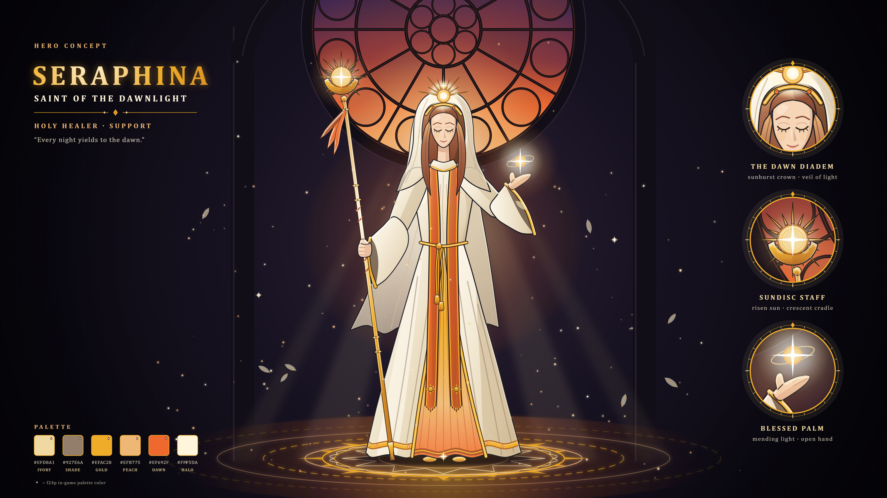

# 세라피나, 새벽빛의 성녀 — 영웅 컨셉 아트

해 원반 지팡이를 든 힐러 영웅 «Seraphina, Saint of the Dawnlight»의 전신 컨셉 아트다(2026-10-19, Claude 제작). 방향은 사용자가 고른 결정(아래 «방향 결정»)을 따랐다. 형체를 SVG 벡터로 직접 그리고 Chromium으로 PNG를 찍었다. 생성형 이미지 모델은 쓰지 않았다.



| 파일 | 내용 |
|---|---|
| `seraphina.svg` · `seraphina_3840.png` | 컨셉 시트: 그림 + 제목·확대 원 3개(새벽 관·해 원반 지팡이·축복하는 손)·팔레트 |
| `seraphina_clean.svg` · `seraphina_clean_3840.png` | 그림만 |

- 원본은 SVG다. PNG는 4K(3840×2160)만 넣었다. 8K는 아래 명령으로 다시 굽는다.
- 그림 요소:
  - 머리: 흰 베일, 해 모양 관, 적갈색 머리, 감은 눈과 옅은 미소
  - 옷: 상아 몸판, 앞자락이 갈라진 겉치마(금 단·주름) 사이로 보이는 금·새벽 주황 속치마, 주황 영대, 종 소매
  - 자세: 대각선으로 기울여 쥔 지팡이, 가슴 높이로 든 손바닥 위의 빛 구슬
  - 소품: 초승달 받침에 해 원반을 얹은 지팡이와 주황 리본
  - 배경·효과: 머리 위로 크게 올린 장미창(윗부분이 화면 밖으로 나간다), 바깥으로 물린 기둥·아치, 빛줄기, 발밑 정화의 성역 문양, 빛 알갱이·깃털

## 다시 굽는 법

```
python tools/art/concept/seraphina.py                      # SVG 2장 + 4K PNG 2장 → art/concept/seraphina/
python tools/art/concept/seraphina.py --scale 4 --out 폴더  # 8K(파일 이름 *_7680.png)
```

- 필요한 것·글자·나눠 찍기는 [크로노스 README](../chronos/README.md#다시-굽는-법)와 같다. 그리는 도구를 `chronos.py`에서 가져다 쓴다.

## 설계 메모

- **색:** f24p(`tools/art/palettes.json`)를 뼈대로 썼다. 시트 팔레트에서 ◆ 표시가 f24p 색이다.
  - f24p 색: 상아 `efd8a1`, 그늘 `927e6a`, 금 `ab5c1c`·`efac28`, 새벽 주황 `ef692f`·`efb775`, 머리 `a56243`·`773421`·`45230d`
  - f24p 밖의 색: 밝은 상아 `f5ecd9`·`fffaf0`, 빛 `fff5da`, 장미창 유리 `1d1838`·`3e2650`·`7a2e3e`
  - f24p에는 흰색이 없다. 24px로 옮길 때 상아는 `efd8a1`, 그늘은 `927e6a`를 쓴다(생성기 머리 주석).
- **SPEC과의 관계:** 세라피나는 SPEC의 3성 힐러다(S157: 종류 `seraphina`, 이명 «새벽빛의 성녀», 사제 자리를 잇는다). 스킬은 S97 표의 칸이고, 오른쪽 열은 컨셉에서 이어 쓸 만한 요소다(Claude 해석).

  | 칸(S97) | 이름 | 컨셉에서 |
  |---|---|---|
  | 패시브 | 넘치는 은총 | 없음 |
  | Q | 성스러운 빛줄기 | 손바닥 위의 빛 구슬 |
  | W | 정화의 성역 | 발밑 정화의 성역 문양 |
  | E | 수호 천사의 날개 | 없음(날개가 없다. 떠다니는 깃털만 있다) |
  | R | 기적의 강림 | 장미창의 빛줄기 |
- **검토:** 첫 시안을 Gemini «4 Argon»에게 검토받았다([feedback_gemini.md](../review/2026-10-19/feedback_gemini.md)). 사용자가 고른 «상» 세 항목(장미창을 위로·크게, 치마 앞자락 가르기, 비대칭 팔 자세)을 반영한 뒤 승인받았다(2026-10-19).
  - 장미창은 Gemini 안(약 140px)보다 많은 266px을 올렸다. 140px에서는 안쪽 고리가 관 바로 위에서 머리를 동심원으로 둘러 후광처럼 읽혔다. 근거는 생성기의 장미창 상수 주석에 있다.

## 남은 일

- [x] 사용자 승인(2026-10-19)
- [ ] Gemini 피드백의 «중»·«하» 항목: 주먹 모양, 빛 구슬 둘레의 파동 고리. 고칠지 아직 고르지 않았다
- [x] 24px 스프라이트로 옮기기(2026-10-19): `tools/art/seraphina.py` → `art/trial/seraphina/`. 컨셉에서 남긴 것과 뺀 것은 [영웅 스프라이트 기록](../../../insights/2026-10-19_hero_sprites.md#세라피나)에 있다

## 방향 결정

사용자가 고른 결정이다(2026-10-19). 방향을 물을 때 보인 영문 프롬프트 초안은 기록되지 않아 싣지 않았다.

- 고정: 새벽 성당의 성녀(여성) / 해 원반 지팡이 / 흰 베일 + 해 모양 관 / 상아·금·새벽 주황
- Claude 기본값: 감은 눈과 옅은 미소, 적갈색 머리, 장미창, 빛 구슬, 대사 «Every night yields to the dawn.»
