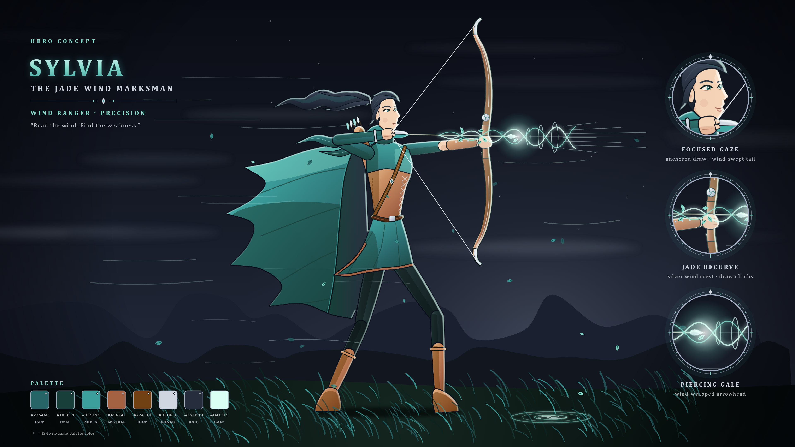

# 실비아, 취풍의 명사수 — 영웅 컨셉 아트

장궁 시위를 당긴 원거리 영웅 «Sylvia, the Jade-Wind Marksman»의 전신 컨셉 아트다(2026-10-19, Claude 제작). 방향은 사용자가 고른 결정(아래 «방향 결정»)을 따랐다. 형체를 SVG 벡터로 직접 그리고 Chromium으로 PNG를 찍었다. 생성형 이미지 모델은 쓰지 않았다.



| 파일 | 내용 |
|---|---|
| `sylvia.svg` · `sylvia_3840.png` | 컨셉 시트: 그림 + 제목·확대 원 3개(조준하는 눈·비취 리커브·바람 화살촉)·팔레트 |
| `sylvia_clean.svg` · `sylvia_clean_3840.png` | 그림만 |

- 원본은 SVG다. PNG는 4K(3840×2160)만 넣었다. 8K는 아래 명령으로 다시 굽는다.
- 그림 요소:
  - 머리: 반측면 얼굴, 바람에 날리는 먹빛 흑발 포니테일, 내린 후드, 스카프
  - 옷: 비취 청록 웃옷과 가죽 코르셋·멜빵, 가죽 띠를 두른 웃옷 자락, 어두운 안감이 보이는 비취 망토, 등의 화살통
  - 자세: 앞 무릎을 굽히고 뒷발을 뺀 런지로 시위를 당긴다
  - 무기: 키만 한 리커브 장궁(은빛 바람 문장), 바람 나선이 감싼 화살
  - 배경·효과: 고원 풀밭과 성긴 별이 뜬 슬레이트 밤하늘, 먼 산, 바람에 눕는 풀, 바람결·잎, 숨긴 폭풍의 덫

## 다시 굽는 법

```
python tools/art/concept/sylvia.py                      # SVG 2장 + 4K PNG 2장 → art/concept/sylvia/
python tools/art/concept/sylvia.py --scale 4 --out 폴더  # 8K(파일 이름 *_7680.png)
```

- 필요한 것·글자·나눠 찍기는 [크로노스 README](../chronos/README.md#다시-굽는-법)와 같다. 그리는 도구는 `chronos.py`, 꺾은선은 `vesper.py`에서 가져다 쓴다.

## 설계 메모

- **색:** f24p(`tools/art/palettes.json`)를 뼈대로 썼다. 시트 팔레트에서 ◆ 표시가 f24p 색이다.
  - f24p 색: 비취 청록 `183f39`·`276468`·`3c9f9c`, 가죽 `45230d`·`724113`·`a56243`, 은 `7a86a0`·`a4aec2`·`d0d6e0`, 흑발 `151a26`·`262d3d`·`3a4357`, 화살대 `392a1c`·`684c3c`
  - f24p 밖의 색: 밝은 비취 `86dccd`·`dafff5`, 밝은 가죽 `c98b5e`·`e9b98e`, 바지 `1a2a2c`
- **배경:** 하늘을 청록에서 슬레이트 밤하늘로 낮췄다. 비취 망토가 배경에 묻히지 않게 하려는 것이다. 운석은 넣지 않았다. 이그니스의 밤하늘 운석우 배경과 겹치지 않게 하려는 것이다(사용자 선택, 2026-10-19).
- **SPEC과의 관계:** 실비아는 SPEC의 3성 원거리 영웅이다(S157: 종류 `sylvia`, 이명 «취풍의 명사수», 궁수 자리를 잇는다). 스킬은 S97 표의 칸이고, 오른쪽 열은 컨셉에서 이어 쓸 만한 요소다(Claude 해석).

  | 칸(S97) | 이름 | 컨셉에서 |
  |---|---|---|
  | 패시브 | 약점 포착 | 대사 «Find the weakness.», 조준하는 눈 |
  | Q | 관통의 바람살 | 바람 나선이 감싼 화살 |
  | W | 돌풍 갈래살 | 없음 |
  | E | 폭풍의 덫 | 풀밭에 숨긴 폭풍의 덫 |
  | R | 천공의 화살비 | 없음 |
- **검토:** 첫 시안을 Gemini «4 Argon»에게 검토받았다([feedback_gemini.md](../review/2026-10-19/feedback_gemini.md)). 사용자가 고른 «상» 항목(런지 자세, 망토·웃옷 명도 분리, 배경)을 반영한 뒤 승인받았다(2026-10-19).

## 남은 일

- [x] 사용자 승인(2026-10-19)
- [ ] Gemini 피드백의 «중»·«하» 항목: 시위 꼭짓점을 당긴 손·화살 끝에 맞추기, 내린 후드의 부피. 고칠지 아직 고르지 않았다
- [x] 24px 스프라이트로 옮기기(2026-10-19): `tools/art/sylvia.py` → `art/trial/sylvia/`. 컨셉에서 남긴 것과 뺀 것은 [영웅 스프라이트 기록](../../../insights/2026-10-19_hero_sprites.md#실비아)에 있다

## 방향 결정

사용자가 고른 결정이다(2026-10-19). 방향을 물을 때 보인 영문 프롬프트 초안은 기록되지 않아 싣지 않았다.

- 고정: 바람의 순찰자(20대 여성) / 키만 한 리커브 장궁 / 내린 후드 + 날리는 포니테일 / 비취 청록·밝은 가죽·은
- Claude 기본값: 반측면으로 시위를 당긴 자세, 바람 나선이 감싼 화살, 고원 풀밭 배경, 먹빛 흑발, 대사 «Read the wind. Find the weakness.»
