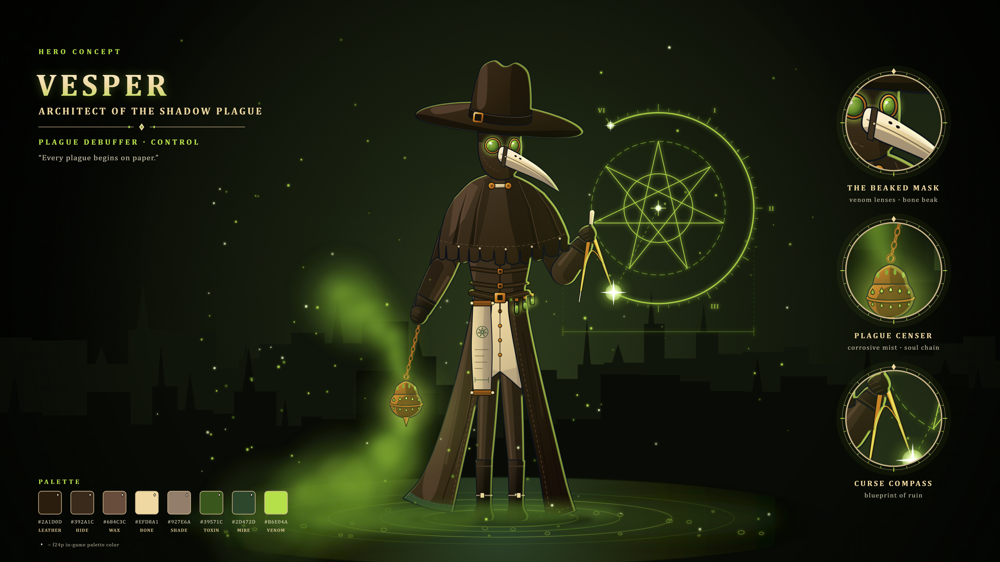

# 베스퍼, 그림자 역병의 설계자 — 영웅 컨셉 아트

독 향로와 컴퍼스를 든 디버퍼 영웅 «Vesper, Architect of the Shadow Plague»의 전신 컨셉 아트다(2026-10-19, Claude 제작). 방향은 사용자가 고른 결정(아래 «방향 결정»)을 따랐다. 형체를 SVG 벡터로 직접 그리고 Chromium으로 PNG를 찍었다. 생성형 이미지 모델은 쓰지 않았다.



| 파일 | 내용 |
|---|---|
| `vesper.svg` · `vesper_3840.png` | 컨셉 시트: 그림 + 제목·확대 원 3개(새부리 가면·역병 향로·저주 컴퍼스)·팔레트 |
| `vesper_clean.svg` · `vesper_clean_3840.png` | 그림만 |

- 원본은 SVG다. PNG는 4K(3840×2160)만 넣었다. 8K는 아래 명령으로 다시 굽는다.
- 그림 요소:
  - 머리: 챙 넓은 모자, 두건, 독녹 렌즈, 뼈색 새부리 가면
  - 옷: 앞이 벌어진 흑갈 가죽 코트(향로 쪽으로 날린 아랫단, 독녹 안감), 그 사이의 뼈색 학자 조끼(놋쇠 단추)와 가죽 바지, 무릎 장화(뼈색 버클)
  - 어깨 망토: 컴퍼스 쪽이 들린 비대칭, 각진 주름, 갈라진 가죽 단, 목의 놋쇠 단추와 뼈 토글 잠금쇠
  - 소품: 사슬 달린 독 향로, 컴퍼스, 허리띠에 매단 양피지 두루마리(독녹 7각 별 도면), 약병
  - 배경·효과: 공중의 저주 도면(7각 별 {7/3}), 역병 도시 첨탑, 늪, 향로 독안개, 앞 안개, 포자

## 다시 굽는 법

```
python tools/art/concept/vesper.py                      # SVG 2장 + 4K PNG 2장 → art/concept/vesper/
python tools/art/concept/vesper.py --scale 4 --out 폴더  # 8K(파일 이름 *_7680.png)
```

- 필요한 것·글자·나눠 찍기는 [크로노스 README](../chronos/README.md#다시-굽는-법)와 같다. 그리는 도구를 `chronos.py`에서 가져다 쓴다.
- `vesper.py`의 `ell`·`rot`·`polyline`은 `ignis.py`·`sylvia.py`도 가져다 쓴다. 고치면 세 그림이 함께 바뀐다.

## 설계 메모

- **색:** f24p(`tools/art/palettes.json`)를 뼈대로 썼다. 시트 팔레트에서 ◆ 표시가 f24p 색이다.
  - f24p 색: 흑갈 가죽 `2a1d0d`·`392a1c`·`684c3c`, 뼈색 `927e6a`·`efd8a1`, 독녹 `1f240a`·`2d472d`·`39571c`, 놋쇠 `724113`·`ab5c1c`
  - f24p 밖의 색: 빛나는 독 연두 `b6e04a`·`6f9a2c`, 밝은 뼈색 `c9b48a`·`fbf0d4`
  - f24p에는 밝은 연두가 없다. 24px로 옮길 때 독빛은 `39571c`, 그늘은 `2d472d`를 쓴다(생성기 머리 주석).
- **도면의 별:** 7각 별({7/3})이다. 육각별은 다윗의 별과 모양이 같아, 역병을 상징하는 그림에 쓰면 오해를 살 수 있어 뺐다(`blueprint()` 주석).
- **SPEC과의 관계:** 베스퍼는 SPEC의 3성 디버퍼다(S157: 종류 `vesper`, 이명 «그림자 역병의 설계자», 축성가 자리를 잇는다). 스킬은 S97 표의 칸이고, 오른쪽 열은 컨셉에서 이어 쓸 만한 요소다(Claude 해석).

  | 칸(S97) | 이름 | 컨셉에서 |
  |---|---|---|
  | 패시브 | 전염성 숙주 | 떠다니는 포자 |
  | Q | 부식의 독안개 | 향로 독안개 |
  | W | 쇠약의 저주 | 공중의 저주 도면 |
  | E | 영혼 사슬 | 향로 사슬 |
  | R | 심연의 늪 | 발밑 늪 |
- **검토:** 첫 시안을 Gemini «4 Argon»에게 검토받았다([feedback_gemini.md](../review/2026-10-19/feedback_gemini.md)). 사용자가 고른 «상» 두 항목(코트 앞 열기, 어깨 망토 다듬기)을 반영한 뒤 승인받았다(2026-10-19). 코트 앞을 연 것은 24px에서 흑갈 몸이 어두운 배경에 묻히지 않게 밝은 면을 내려는 것이다.

## 남은 일

- [x] 사용자 승인(2026-10-19)
- [ ] Gemini 피드백의 «중»·«하» 항목: 상체를 도면 쪽으로 3/4 돌리기, 앞 안개를 낮춰 발 보이기. 고칠지 아직 고르지 않았다
- [ ] 24px 스프라이트로 옮기기(`next/archive/2026-10-19/r3.md` §1)

## 방향 결정

사용자가 고른 결정이다(2026-10-19). 방향을 물을 때 보인 영문 프롬프트 초안은 기록되지 않아 싣지 않았다.

- 고정: 역병 의사 학자 / 사슬 달린 독 향로 / 챙 넓은 모자 + 새부리 가면 / 흑갈 가죽·뼈색·독녹
- Claude 기본값: 컴퍼스로 공중에 저주 도면을 긋는 자세, 역병 도시와 늪 배경, 대사 «Every plague begins on paper.»
