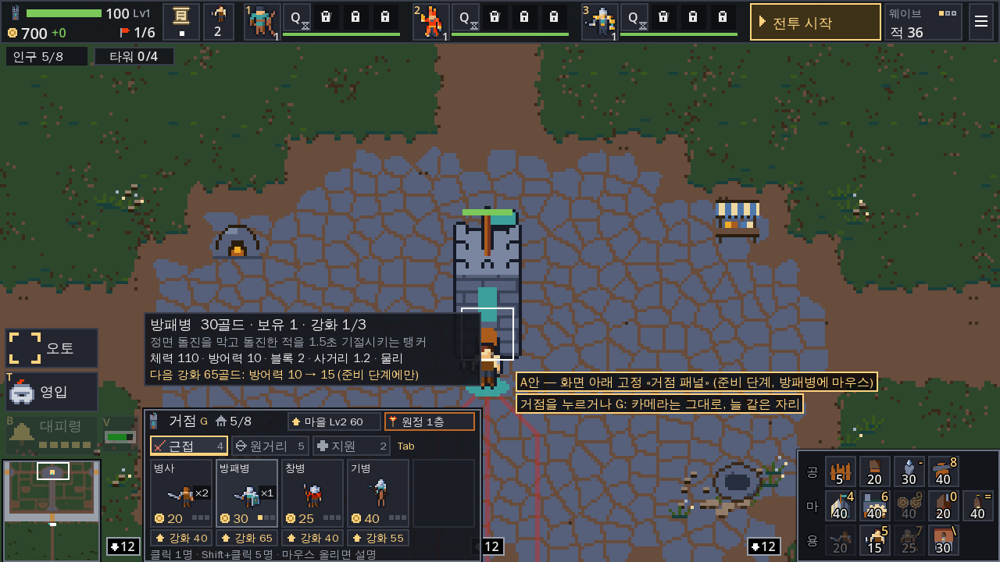
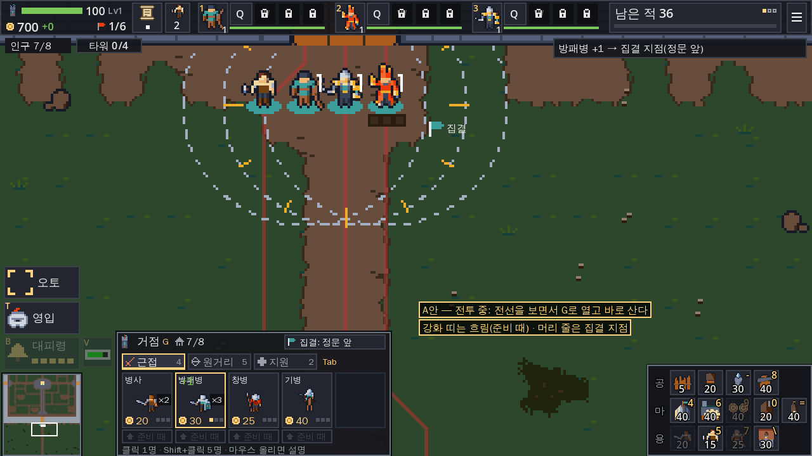
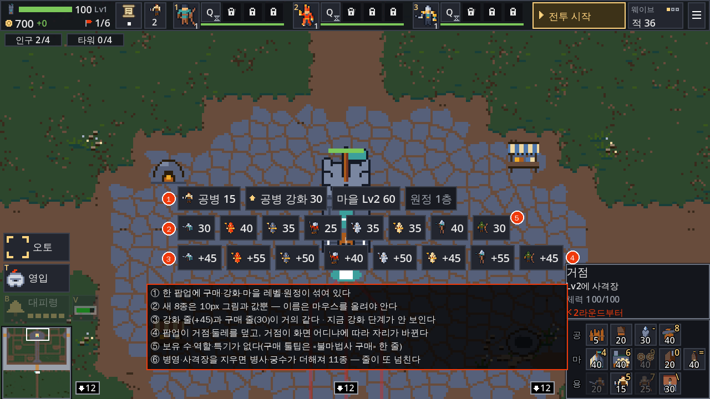
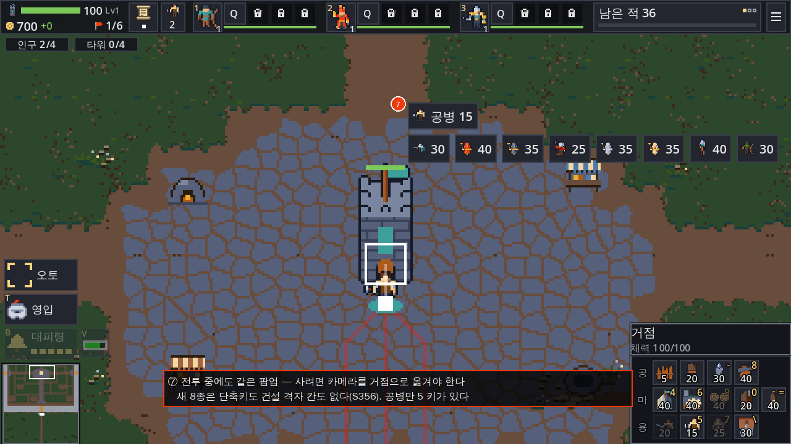
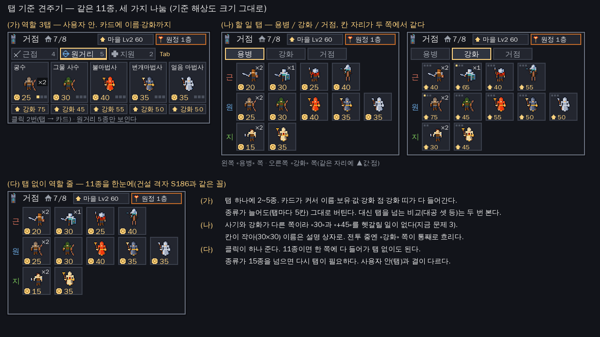
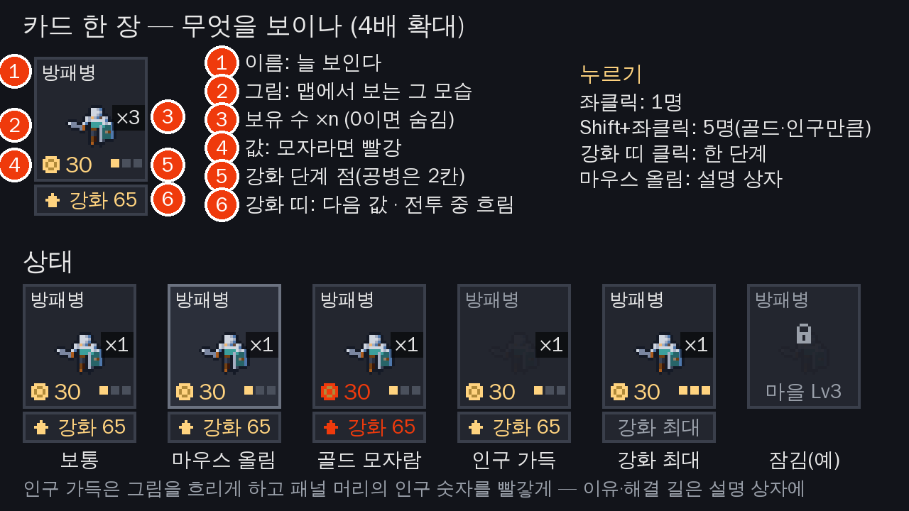
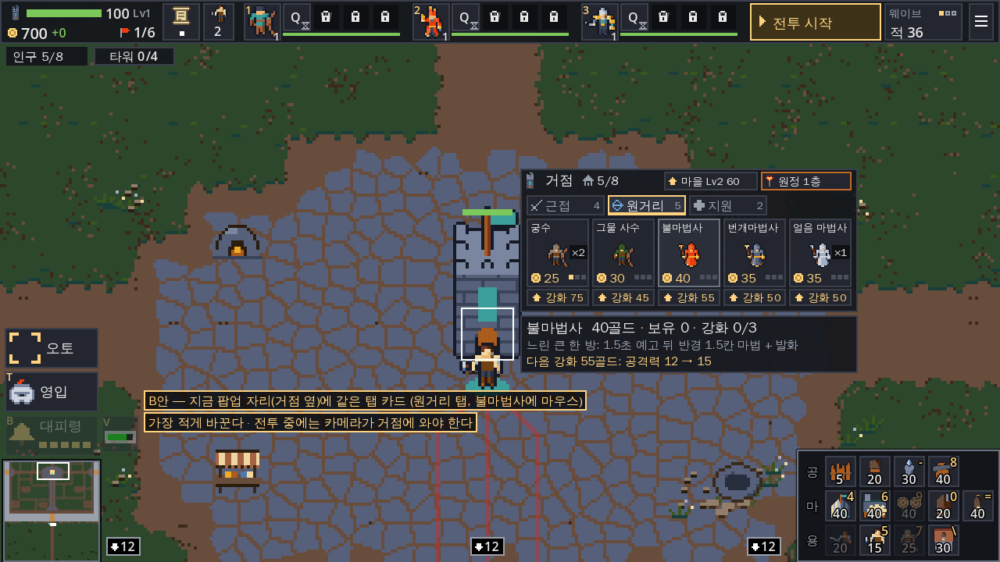
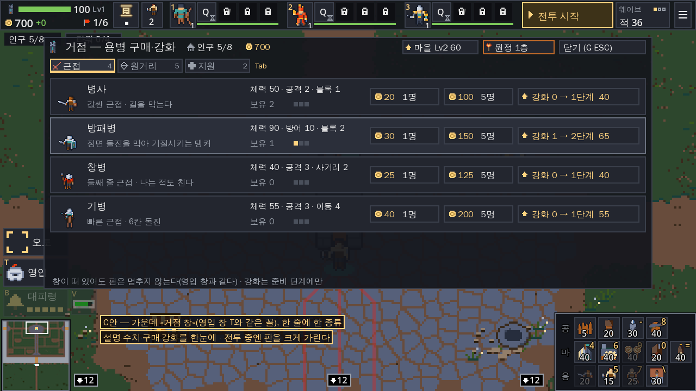
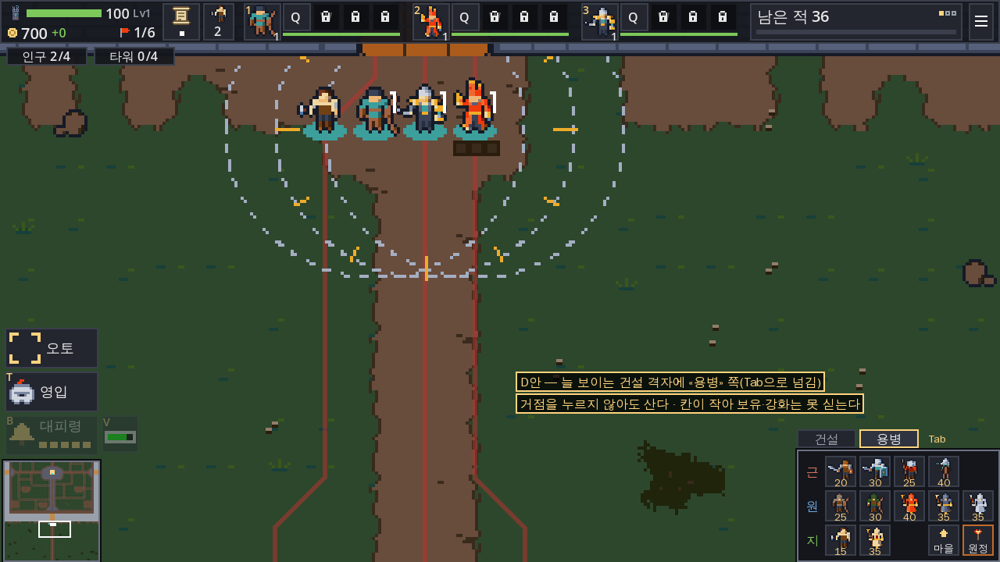

# 거점 탭 구매 UI — 아이디어 조사 (2026-11-12)

요청: 사용자 2026-11-12 «거점 탭 구매 UI 아이디어 조사해봐라. 직관적이고 편리해라한다.»

배경: 사용자 2026-11-11 «생산시설은 중앙 거점으로 통일 할꺼다 … 병영이나 궁수 생산시설은 삭제할꺼다. 중앙거점 클릭하면 오펜스 이동 버튼도 있고 탭으로 나눠서 유닛을 구매토록할 예정이다»(`insights/2026-11-12_new_mercs.md` §0). 지금 거점 팝업의 새 용병 8종 줄은 «거점 탭 UI 전까지의 임시 자리»다(I294 ①, `src/ui/hud.gd:568`).

- 기준: 브랜치 `claude/gracious-goodall-z0mt1x` `af12844`. 줄 번호는 이 판이다. 코드는 고치지 않았다.
- 난이도·밸런스 측정은 하지 않았다(CLAUDE.md). 시안의 값·강화비는 `data/mercs/*.tres`의 지금 값을 옮겨 적었을 뿐이다.
- 근거 표기
  - `[A-nn]`·`[B-nn]`: 이번 웹 조사([evidence/A_rts_td.md](evidence/A_rts_td.md) RTS·디펜스 생산 UI, [evidence/B_shop_ux.md](evidence/B_shop_ux.md) 상점 편의·UX 원칙). 상태는 verified(1차 자료를 직접 읽음) / likely(2차 자료나 두 곳) / unverified.
  - `[ID·상태]`: 예전 UI 조사 근거([ui_research/evidence/web.md](../ui_research/evidence/web.md)). `ORA-Onn`은 [ui_research/evidence/openra.md](../ui_research/evidence/openra.md).
- 시안 그림은 실제 게임 캡처(Godot 4.7.2 리눅스 편집기 빌드, `tools/play` 하네스, 씨앗 7, 1280×720 = 기준 해상도 2배) 위에 게임 그림(`art/units/heroes.png`)과 HUD 색(`src/ui/hud_theme.gd`)으로 그렸다. 좌표는 640×360 기준이고 모두 임시값이다. 그리는 스크립트는 저장소에 넣지 않았다.

---

## 0. 결론

**추천: «화면 아래 거점 패널»(A안) + 역할 탭 셋(근접·원거리·지원) + 카드 한 장에 구매와 강화.**

핵심 열 가지:

1. **늘 같은 자리.** 거점 패널은 화면 아래 [92,262,216,98]에 뜬다. 거점을 누르거나 **G**로 열고 닫는다. G로 열면 카메라도 고른 유닛도 그대로다(S204의 «시설을 골라도 선택 유지»와 같다). 그래서 전투 중에 전선을 보면서 산다.
2. **탭은 사용자 안대로 셋.** 근접 4(병사·방패병·창병·기병) / 원거리 5(궁수·그물 사수·불마법사·번개마법사·얼음 마법사) / 지원 2(공병·사제). **Tab**으로 넘기고, 다시 열면 마지막 탭이다.
3. **카드 한 장에 다 보인다.** 카드(40×44)에 이름·그림·보유 수·값·강화 단계 점이 있다. 지금처럼 마우스를 올려야 이름을 아는 일이 없다.
4. **강화는 카드 바로 아래 띠.** «강화 65»가 그 유닛 카드 밑에 붙어 있어, 어느 유닛의 강화인지 헷갈리지 않는다. 전투 중에는 흐리게 자리만 지킨다(강화는 준비 단계에만, S255).
5. **좌클릭 1명, Shift+좌클릭 5명**(골드·인구가 되는 만큼만).
6. **못 사는 이유는 그 자리에서.** 골드가 모자라면 값이 빨갛고, 인구가 가득이면 머리 줄 인구 숫자가 빨갛고 그림이 흐리다. 설명 상자에 이유와 해결 길(«집을 지으면 4명 늘어난다», I225 ④)이 있다.
7. **마우스를 올리면 패널 바로 위에 설명 상자**(지연 없음, 건설 격자 정보 칸과 같다): 역할 한 줄, 수치, 다음 강화 효과.
8. **거점 기능은 머리 줄에.** 인구, 마을 레벨 올리기, **원정**(오펜스 이동). 원정은 횃불을 쓰니 테두리 색을 달리하고 두 번 눌러 확정한다(철거? S74와 같은 꼴).
9. **산 것이 바로 보인다.** 산 카드에 «+1», 전투 중엔 토스트 «방패병 +1 → 집결 지점». 전투 중 머리 줄은 «집결» 버튼(누르고 맵을 눌러 정한다).
10. **칸 자리는 단계·상태와 상관없이 같다.** 위 띠(S185)·건설 격자(S186)가 이미 지키는 규칙이다. 빈 칸도 자리를 지킨다.

**왜 A안인가**
- **전투 중 사기가 가장 빠르다.** 지금은 카메라를 거점으로 옮기고(새 8종은 단축키도 건설 격자 칸도 없다, S356), 10px 그림 8개 가운데 하나를 찾아야 한다. A안은 G → 카드 클릭, 두 번이면 되고 화면은 전선에 그대로 있다.
- **늘 같은 자리라 손에 익는다.** 지금 팝업(그리고 B안)은 거점이 화면 어디에 있느냐에 따라 자리가 바뀐다(I58·I137).
- **RTS 관습과 같다.** 고른 건물이 만드는 것을 화면 가장자리의 정해진 칸에 띄운다. 워크3 명령 카드 12칸 `[blizzard-01·verified]`과 They Are Billions `[tab-03·verified]`는 화면 아래, C&C·OpenRA는 오른쪽 사이드바다(ORA-O6·O13~O17). 2장 참고.

**사용자에게 물을 것**은 8장에 모았다. 가장 큰 셋은 ① 자리(A·B·C·D) ② 탭 기준(역할 3탭 / 할 일 탭 / 탭 없이 역할 줄) ③ 강화 자리(카드 아래 띠 / 따로 «강화» 탭)이다.

---

## 1. 지금 거점 팝업

| 무엇 | 지금 | 근거 |
|---|---|---|
| 거점이 파는 것 | 공병 + 새 8종(`HQ_MERCS`) | `src/sim/battle.gd:58-59`, S98, S356, I294 ① |
| 팝업 줄(준비 단계) | 1줄 공병 구매·공병 강화·마을 Lv2·원정 / 2줄 새 8종 구매(그림+값) / 3줄 새 8종 강화(그림+«+값») | `src/ui/hud.gd:568-591` |
| 팝업 줄(전투 단계) | 공병 구매 / 새 8종 구매. 강화·마을·원정은 숨는다 | `hud.gd:802-820`, `:857-870` |
| 버튼 글 | 새 8종은 값만. 이름은 툴팁(0.2초 뒤) | `hud.gd:807`, I294 ①, S187 |
| 구매 툴팁 | «불마법사 구매» 한 줄. 역할·수치 없음 | `hud.gd:909-916` `_pop`, [캡처](img/now_prep_buy_tip.png) |
| 강화 툴팁 | «불마법사 강화 / 공격력 12 → 15». 지금 몇 단계인지는 없음 | S255, `hud.gd:812-820`, [캡처](img/now_prep_rank_tip.png) |
| 자리 | 고른 칸의 바깥쪽 모서리. 겹치면 다른 모서리 | I58·I137, `hud.gd:950` `_place_popup` |
| 전투 중 사기 | 거점을 누르려면 카메라가 거점에 있어야 한다. 5(공병) 키로 고르면 카메라가 시설로 간다. 새 8종은 키·건설 격자 칸이 없다 | S81, I164, S356 |
| 못 사는 경우 | 골드 모자람·인구 가득·나올 빈 칸 없음. 이유를 보이는 것은 인구 가득뿐 | `battle.gd:3037-3054` `recruit`, I225 ④ |
| 이름 | 병사의 화면 이름이 «용병»이다. 11종이 다 용병이라 헷갈린다 | `hud.gd:21` `NAMES` |
| 앞으로 | 병영·사격장을 지우면 병사·궁수도 거점에서 판다 → 11종, 강화 32단계 | `insights/2026-11-12_new_mercs.md` §5 |

문제(그림의 번호):

1. **할 일이 한 팝업에 섞여 있다.** 사기·강화하기·마을 레벨·원정(판 단계가 바뀌는 큰 결정)이 같은 모양의 버튼으로 나란히 있다.
2. **새 8종은 무엇인지 안 보인다.** 아이콘이 10px(`icon_max_width` 10)이고 글은 값뿐이다. 이름을 알려면 마우스를 올리고 0.2초 기다려야 한다.
3. **강화 줄이 구매 줄과 거의 같다.** «30»과 «+45»의 차이뿐이다. 지금 강화 단계(0/3, 1/3 …)는 어디에도 없다.
4. **팝업이 거점과 둘레를 덮는다.** 산 용병이 나오는 거점 옆 칸(I61)이 팝업 밑이다. 자리도 거점이 화면 어디냐에 따라 바뀐다.
5. **고를 정보가 없다.** 보유 수·역할·특기(대공·마법·탱커·회복)가 없다. 11종을 처음 보는 사람은 무엇을 사야 할지 모른다.
6. **11종이 되면 또 넘친다.** 지금도 한 줄에 몰려 화면 밖으로 넘쳐 줄을 나눈 임시 처방이다(`insights/2026-11-12_new_mercs.md` §6.1).
7. **전투 중에는 카메라를 거점으로 가져와야 한다.** 전선에서 눈을 떼고, 사고 나서 다시 돌아가야 한다.

---

## 2. 다른 게임은 어떻게 하나

### 2.1 범주(탭)를 어떻게 나누나

| 게임 | 나눔 | 자리·모양 | 근거 |
|---|---|---|---|
| C&C(OpenRA cnc) | 건물·지원·보병·차량·항공 5범주. 한 범주에 생산 건물이 여럿이면 건물마다 번호 탭 | 오른쪽 사이드바 위 가로 줄(38×26 버튼 5개), 그 아래 3열 생산 칸 | ORA-O13~O17·O34 |
| Red Alert(OpenRA ra) | 범주 6개 | 생산 칸 왼쪽 세로 줄(28×28). 고른 범주는 강조, 만들 것이 없는 범주는 흐린 아이콘, 다 만든 것이 있으면 알림 아이콘 | ORA-O7·O32·O33 |
| They Are Billions | 주거·자원·에너지·산업·군사·방어 | 사령부를 고르면 하단 가운데에 범주 버튼 → 그 범주 건물 버튼(2단계) | `[tab-11·verified]` `[tab-03·verified]` |
| Age of Empires IV | 시대(1·2·3시대) | 일꾼을 고르면 시대 키(Q·W·E)로 묶음을 열고 격자 키로 고른다 | `[aoe_northgard-05·verified]` |
| Beyond All Reason | 경제·전투·유틸리티·생산 | 3줄×4칸 고정 격자를 키보드 자리(ZXCV·ASDF·QWER)에 맞추고, 분류도 Z·X·C·V | `[p_wave_menu-13·verified]` |
| Mindustry | 블록 범주 10여 개 | 격자 오른쪽 2열 범주 토글(글자 없음). 범주마다 마지막 블록·스크롤을 기억하고, 빈 범주도 자리를 지킨다. 숫자 두 키 잇기(범주 → 400ms 안에 블록) | MD-M2·M4~M8 |
| Kingdom Rush | 나눔 없음(4종) | 빈 건설 자리를 누르면 그 자리에 4가지 고리 메뉴. 구매·업그레이드는 두 번째 탭으로 확정 | `[ironhide-01·verified]` `[ironhide-02·partly]` |

### 2.2 칸·못 쓰는 칸·여러 개 사기

| 게임 | 무엇 | 근거 |
|---|---|---|
| Warcraft III | 명령 카드는 화면 아래 12칸(3줄×4칸) 고정 격자이고, 고른 것이 바뀌면 같은 칸에 그 명령이 다시 채워진다 | `[blizzard-01·verified]` |
| OpenRA | 좌클릭 = 대기열에 넣기(Shift = 5개), 우클릭 = 멈춤·취소. 대기열 수는 2개 이상일 때만 아이콘 왼쪽 위에 | ORA-O23·O24 |
| OpenRA | 못 만드는 항목은 데이터에 따라 숨기거나, 제자리에 둔 채 어둡게 한다. 못 누르는 것을 누르면 «못 누름» 소리 | `[p_disabled_modal-02·verified]` `[p_disabled_modal-04·partly]` |
| OpenRA | 단축키는 아이콘에 그리지 않고 툴팁에만 노란 «(키)». 툴팁은 이름·(키)·선행 조건·설명, 오른쪽에 비용·시간 | ORA-O25·O27 |
| StarCraft II | 조건이 안 되는 버튼을 숨길지 회색으로 둘지 데이터로 정한다. 툴팁 이름 뒤 괄호에 단축키 | `[blizzard-23·verified]` `[blizzard-22·verified]` |
| Stronghold Crusader DE | Shift+클릭으로 같은 종류 건물 전체를 한 번에 바꿀 수 있다는 것을 패널에 분명히 보이게 고쳤다 | `[castle-13·likely]` |
| Bloons TD 6 | 타워를 누르면 업그레이드 패널이 타워 반대편에 열린다. 업그레이드 칸 배경은 색·잠김 변형이 따로 있다 | `[td_bars-bt-05·verified]` `[td_bars-bt-14·verified]` |

<!-- WEB-A -->

---

## 3. 원칙 → 우리 규칙

| # | 규칙 | 왜 | 근거 |
|---|---|---|---|
| U1 | **칸 자리를 고정한다.** 단계·상태·골드에 따라 칸을 숨기거나 옮기지 않고 흐리게 둔다. 빈 칸도 자리를 지킨다 | 손이 자리를 외운다. 자리가 바뀌면 매번 다시 찾는다 | 이 게임의 S185·S186, 워크3 `[blizzard-01·verified]`, Mindustry MD-M6, OpenRA 제자리 어둡게 `[p_disabled_modal-02·verified]` |
| U2 | **이름과 그림을 칸에 보인다** | 마우스를 올려 떠올리는 것보다 보고 알아보는 것이 빠르다 | 지금 문제 2 |
| U3 | **못 쓰면 원인마다 다르게 보이고, 이유와 해결 길을 그 자리에서** | 회색 하나로는 왜 안 되는지 모른다 | I128·I132·I225 ④, `ui_research/README.md` 1.1 문제 3 |
| U4 | **누르면 바로 반응한다**(«+1», 토스트, 못 누르면 번쩍) | 산 것이 맞는지, 왜 안 됐는지 바로 안다 | OpenRA 못 누름 소리 `[p_disabled_modal-04·partly]`, 건설 격자 거부 번쩍(S186) |
| U5 | **되돌리기 어려운 것은 두 번, 자주 하는 것은 한 번** | 원정(횃불)은 실수 막기, 구매는 속도 | S74 철거?, Kingdom Rush 두 번째 탭 확정 `[ironhide-02·partly]` |
| U6 | **빠른 손 길을 따로 둔다**(G·Tab·Shift). 마우스만으로도 다 된다 | 처음 하는 사람과 익숙한 사람 모두 | OpenRA Shift 5개(ORA-O24), BAR 격자 키 `[p_wave_menu-13·verified]` |
| U7 | **색만으로 가르지 않는다.** 탭은 그림 + 글 + 색 | 색을 못 가리는 사람도 있다 | — |
| U8 | **탭은 적게, 이름은 짧게, 마지막 탭을 기억한다** | 탭을 넘는 것도 한 번의 고르기다 | Mindustry 범주마다 기억(MD-M4·M7) |

<!-- WEB-B -->

---

## 4. 아이디어 목록

번호 앞 ★는 추천안(A안)에 넣은 것이다.

### 4.1 어디에 띄우나

| # | 아이디어 | 좋은 점 | 걸리는 점 |
|---|---|---|---|
| ★P1 | **화면 아래 고정 패널**(미니맵 오른쪽 빈자리 [92,262,216,98]) | 늘 같은 자리, 카메라 그대로, 전투 중 빠름 | 화면 아래 9%를 더 덮는다. 힌트 칸 [68,300,200,40](S191)과 겹쳐 힌트 자리를 옮겨야 한다 |
| P2 | 거점 옆 팝업(지금 I58 자리) | 바꿀 것이 가장 적다. 거점과 붙어 있어 «거점이 판다»가 바로 읽힌다 | 카메라가 거점에 있어야 한다. 자리가 바뀐다. 거점 둘레를 덮는다 |
| P3 | 가운데 창(영입 창 T와 같은 꼴) | 설명·수치·구매·강화를 한 줄씩 넉넉히 | 전투 중 판의 절반을 덮는다(판은 멈추지 않는다, S272) |
| P4 | 늘 보이는 건설 격자에 «용병» 쪽 | 거점을 누르지 않아도 된다. 덮는 것이 거의 없다 | 칸 20×20이라 이름·보유·강화를 못 싣는다. 오른쪽 아래 UI 재작업(사용자 예정)과 겹친다 |
| P5 | 선택 패널 자리(S206 [312,288,196,72])에 거점 패널 | «고른 것은 여기»라는 자리 규칙과 맞는다 | 유닛을 고른 채 G로 열면 둘이 한 자리를 다툰다 |

### 4.2 탭을 무엇으로 나누나

| # | 아이디어 | 나뉨 | 좋은 점 | 걸리는 점 |
|---|---|---|---|---|
| ★T1 | **역할 3탭** | 근접 4 · 원거리 5 · 지원 2 | 사용자 안 그대로. 종류가 늘어도 탭 안에 칸이 남는다(탭마다 5칸) | 대공(창병·궁수·그물·마법사)처럼 탭을 넘는 쓰임은 한 탭에 안 모인다 |
| T2 | 할 일 탭 | 용병 · 강화 · 거점 | 구매와 강화를 칸 자리가 같은 두 쪽으로 가른다. 지금 문제 3을 근본적으로 없앤다 | 11종을 한 쪽(5×3칸)에 넣어야 해 칸이 작아진다 |
| T3 | 탭 없이 역할 줄 | 줄 머리 근·원·지(건설 격자 S186과 같은 꼴) | 클릭 한 번이 줄고 모두 한눈에 보인다. 11종이면 한 쪽에 들어간다 | 종류가 15종을 넘으면 다시 탭이 필요하다 |
| T4 | 마을 레벨 탭(AoE IV 시대 묶음식) | Lv1 · Lv2 · Lv3 | 해금이 생기면 «다음에 열릴 것»이 보인다 | 지금은 유닛 해금 규칙이 없다(새 규칙이 먼저) |

### 4.3 카드에 무엇을 싣나

- ★C1 **이름**을 카드 위에 늘 쓴다(6.5px, 가장 긴 «얼음 마법사»가 34px로 카드 폭 40 안에 든다).
- ★C2 **그림**은 맵에서 보는 그 모습(남쪽을 보는 정지 그림, `HudBuild.icon`과 같은 자르기). 그림이 가장 큰 것(기병)도 높이 20px다.
- ★C3 **보유 수** «×3». 0이면 숨긴다.
- ★C4 **값**: 동전 + 숫자. 골드가 모자라면 빨강.
- ★C5 **강화 단계 점** ●●○ (공병은 2칸). 지금 몇 단계인지가 늘 보인다.
- ★C6 **강화 띠**(카드 아래 11px): «▲ 강화 65». 최대면 «강화 최대», 전투 중엔 흐린 «준비 때».
- C7 (선택) **쓰임 표식**: 대공(창병·궁수·그물 사수·마법사 셋), 마법 피해(마법사 셋), 막기(방패병), 회복(사제). 칸이 좁아 그림 한 개(8px)씩만 된다. 설명 상자 첫 줄에 글로 넣는 것으로 대신할 수 있다.
- C8 (선택) **단축키 글자**: 카드에 키를 붙인다면 왼쪽 위. 다만 빈 키가 모자라다(4.4).
- 순서는 탭 안에서 데이터에 정한 차례로 고정한다(값으로 정렬하지 않는다 — 값을 고치면 자리가 바뀐다).

### 4.4 사고 강화하는 손

| # | 아이디어 | 설명 |
|---|---|---|
| ★H1 | 좌클릭 1명 | 지금과 같다(S81) |
| ★H2 | Shift+좌클릭 5명 | 골드·인구·나올 칸이 되는 만큼만 산다. 덜 샀으면 설명 상자·토스트에 «3명만 샀다 — 인구 가득» |
| ★H3 | G: 패널 열기·닫기 | 빈 키다(지금 쓰는 키: Q W E R A S H F V B C T 1~0 - = \ ` Space). 카메라는 그대로, 고른 유닛도 그대로 |
| ★H4 | Tab / Shift+Tab: 탭 넘기기 | 탭 줄 위 휠도 된다. 다시 열면 마지막 탭(Mindustry도 범주마다 마지막 블록·스크롤을 기억한다, MD-M4·M7). Tab은 Godot 기본 포커스 이동(`ui_focus_next`)에도 묶여 있으나, HUD 버튼은 포커스를 받지 않는 지금 규칙(`hud.gd` `_button`의 `FOCUS_NONE`)이면 부딪히지 않는다 |
| ★H5 | 강화 띠 클릭: 한 단계 | 준비 단계에만 |
| H6 | 우클릭 카드: 그 종류 한 명 팔기(준비 단계만, 전액) | 잘못 산 것을 바로 무른다. 지금도 준비 단계 판매는 체력 비율만큼 돌려준다(`battle.gd:3894` `refund`). 다만 실수로 누르기 쉬워 넣는다면 확정 한 번 |
| H7 | 카드 단축키 | 패널이 열려 있는 동안만 숫자 키를 카드로 바꾸는 «모드»는 영웅 키 1·2·3과 부딪혀 권하지 않는다. 남는 키(Z·X …)로 칸 자리 단축키를 두려면 다섯 개가 모자란다. 넣는다면 Mindustry식 «두 키 잇기»가 낫다: G를 누르고 0.4초 안에 1~5를 누르면 그 칸을 산다(MD-M8, 범주 키 → 400ms 안에 블록 키). 0.4초가 지나면 1~5는 지금처럼 영웅 키다 |
| H8 | 길게 누르면 계속 산다 | 모바일 관습이다. 마우스·키보드에서는 Shift 5명으로 충분하다 |

### 4.5 이유와 알림

- ★R1 **골드 모자람**: 값 빨강. 설명 상자 빨간 줄 «✕ 골드 12 모자람».
- ★R2 **인구 가득**: 머리 줄 인구 빨강, 카드 그림 흐림(0.35, 건설 격자 흐림과 같은 값), 설명 상자 «✕ 인구 가득 — 집을 지으면 4명 늘어난다»(지금 I225 ④ 글 그대로).
- R3 **해결 길 버튼**: 인구 가득일 때 설명 상자에 [집 짓기] → 집 놓기 모드(건설 격자 흐린 칸을 누르면 거점 팝업을 띄우는 I132와 같은 생각).
- ★R4 **나올 칸 없음**: 지금은 말없이 실패한다(`recruit`가 null). «✕ 거점 둘레가 막혀 나올 칸이 없다».
- ★R5 **흐린 카드를 누르면** 테두리가 번쩍이고 이유 줄이 뜬다(건설 격자 S186과 같다).
- ★R6 **산 직후**: 카드에 «+1», 거점 옆에 새 유닛, 전투 중이면 토스트 «방패병 +1 → 집결 지점».
- R7 **탭 표시**: 그 탭에 «지금 살 수 있는 것이 없다»면 탭 글을 흐리게. 새로 열린 유닛이 있으면 탭에 점.

### 4.6 거점 기능(원정·마을·집결)

- ★K1 **원정 버튼은 머리 줄 오른쪽**, 횃불 그림과 주황 테두리로 사기 버튼과 갈라 놓는다. 지금 «원정 1층» 글과 못 누르는 이유(«2라운드부터»·«횃불 없음»)는 그대로.
- ★K2 **원정은 두 번 눌러 확정**: 첫 클릭 «원정? 횃불 1», 2초 안에 다시 누르면 들어간다(S74 철거?와 같은 꼴). 횃불은 돌아오지 않는다(S316).
- ★K3 **마을 레벨 올리기**도 머리 줄. 툴팁에 열리는 것(지금 «Lv2에 사격장» — 사격장을 지우면 무엇이 열리는지는 새로 정할 일).
- ★K4 **집결**: 전투 중 머리 줄 «집결: 정문 앞» 버튼 → 누르고 맵을 누르면 집결 지점(S82). 유닛을 고른 채 G로 열었을 때 우클릭은 유닛 명령이라(I173) 버튼이 필요하다. 패널이 열려 있는 동안 집결 깃발과 길을 맵에 보인다.
- K5 거점 체력·수리는 머리 줄에 숫자만(수리는 지금처럼 팝업 수리 버튼, I58).

### 4.7 판 단계마다

| 단계 | 패널 |
|---|---|
| 준비 | 머리 줄: 인구 · 마을 Lv · 원정. 강화 띠 밝음 |
| 전투 | 머리 줄: 인구 · 집결. 강화 띠 흐림(자리는 그대로) |
| 원정 | 패널을 닫는다(원정 중엔 집 명령을 받지 않는다, S316). G도 받지 않는다 |
| 라운드 사이·끝 | 닫는다 |

### 4.8 더 해 볼 만한 것(선택)

- X1 **즐겨찾기 칸**: 자주 사는 2종을 왼쪽 아래 버튼 줄(오토·영입·대피령, S313·S272·S230) 근처에 작은 칸으로 고정 — Dota 2 퀵바이·Clash of Clans 빠른 훈련처럼. 11종이면 아직 없어도 된다.
- X2 **편성 저장**: «방패병 2·궁수 3·사제 1»을 한 번에. 판이 짧아 쓸 일이 적다.
- X3 **마지막 구매 다시**(Shift+G 같은 키). 같은 것을 거듭 살 때.

---

## 5. 조합안 A~D

### A안 — 화면 아래 거점 패널 (추천)

0장 그림 두 장. 자리 [92,262,216,98], 머리 줄(14) · 탭 줄(13) · 카드 줄(44) · 강화 띠(11) · 안내 줄.

- 여는 법: 거점 클릭(유닛 선택은 비워진다, S204) 또는 G(유닛 선택 유지). 닫기: G·ESC·빈 땅 클릭.
- 덮는 넓이: 216×98 = 화면의 9.2%. 설명 상자(216×62)는 마우스를 올린 동안만.
- 걸리는 점: 처음 하는 사람 힌트 칸 [68,300,200,40](S191, `hints.gd:10`)과 겹친다. 패널이 열린 동안 힌트를 패널 위로 올리는 식으로 자리를 다시 정해야 한다. 화면 아래 가장자리의 출현 지점 표식(«✚12», `hud.gd:1231` `_make_edges`)도 패널 폭 안에 들면 가려진다.
- 만들 것: 새 패널 `src/ui/hud_keep.gd`(hud_build·hud_select처럼 좌표로 칸을 놓는 Panel), G·Tab 키(`controls.gd`), 지금 팝업의 공병·새 8종 줄 걷기.

### B안 — 거점 옆 팝업, 탭 카드로

A안 패널과 같은 몸을 지금 팝업 자리(I58)에 띄운다. 설명 상자는 팝업 아래(S187 팝업 툴팁 자리).

- 좋은 점: 바꿀 것이 가장 적다. 거점을 누르면 그 옆에 «거점이 파는 것»이 뜬다(Kingdom Rush가 탑 자리에 고리 메뉴를 띄우는 것과 같은 결 `[ironhide-01·verified]`).
- 걸리는 점: 전투 중엔 카메라가 거점에 와야 한다(지금 문제 7이 그대로). 자리가 거점의 화면 위치에 따라 바뀐다. 팝업이 216×92로 커져 거점 둘레를 더 덮는다.

### C안 — 가운데 «거점 창»

영입 창(T, S272)과 같은 꼴의 창 [40,34,560,232]. 한 줄에 한 종류: 그림 · 이름 · 역할 한 줄 · 수치 · 보유 · 강화 점 · [1명] [5명] [강화 n→n+1].

- 좋은 점: 설명이 가장 넉넉하다. 준비 단계에 무엇을 살지 따져 보기 좋다.
- 걸리는 점: 화면의 56%를 덮는다. 판이 멈추지 않으니(S272) 전투 중에는 쓰기 어렵다. 준비 단계 전용으로 두고 전투 중엔 A안 패널을 쓰면 같은 일을 두 UI가 나눠 맡아 익힐 것이 늘어난다.

### D안 — 건설 격자에 «용병» 쪽

늘 보이는 건설 격자(S186) 위에 [건설][용병] 쪽 전환을 두고, «용병» 쪽은 근·원·지 세 줄에 11종 + 마을·원정 칸.

- 좋은 점: 거점을 누를 필요가 없다. C&C 사이드바(건물·지원·보병·차량·항공 범주 줄, ORA-O13~O17)·Mindustry(격자 옆 범주 토글, MD-M2·M5)처럼 «짓기와 뽑기를 한 판에 범주로» 둔 꼴이다.
- 걸리는 점: 칸 20×20에 그림과 값만 들어간다(이름·보유·강화는 정보 칸으로). 사용자가 오른쪽 아래 UI를 다시 짤 예정이라 그 일과 같이 정해야 한다. «거점을 누르면 탭이 있는 UI»라는 사용자 안과 결이 다르다.

### 견주기

| | A 아래 패널 | B 거점 옆 팝업 | C 가운데 창 | D 격자 쪽 |
|---|---|---|---|---|
| 전투 중 한 명 사기 | G → 클릭 | 카메라 옮김 → 거점 클릭 → 클릭 | G → 클릭(판을 가림) | Tab → 클릭 |
| 카메라 | 그대로 | 거점으로 | 그대로 | 그대로 |
| 자리 | 늘 같음 | 거점 따라 바뀜 | 늘 같음 | 늘 같음 |
| 카드에 싣는 것 | 이름·그림·보유·값·강화 점·강화 띠 | A와 같음 | 가장 많음(역할·수치까지) | 그림·값 |
| 덮는 넓이(열렸을 때) | 9.2% | 8.6%(맵 가운데) | 56% | +0.4%(쪽 전환 줄) |
| 바꿀 코드 | 새 패널 + 키 | 팝업 고침 | 새 창 + 키 | 격자 고침 |
| 사용자 안과 | 맞음(거점 클릭 → 탭) | 맞음 | 맞음 | 다름(늘 보임) |

---

## 6. 추천과 만드는 순서

A안을 권한다. 이 프로젝트 순서대로 SPEC·EVAL 초안을 먼저 쓰고 승인받은 뒤 만든다. 묶음은 이렇게 나누면 PR이 작다.

1. **패널 골격**: 자리·머리 줄(인구·마을·원정)·탭 셋·카드(이름·그림·보유·값). G·Tab. 지금 팝업의 공병·새 8종 줄과 강화 줄을 걷는다(I294 ① 임시 자리 끝).
2. **강화 띠와 설명 상자**: 강화 점·띠(준비 단계에만), 지연 없는 설명 상자(역할·수치·다음 강화), 이유 줄(골드·인구·나올 칸).
3. **손과 알림**: Shift 5명, 산 직후 «+1»·토스트, 원정 두 번 눌러 확정, 집결 버튼.
4. **병영·사격장 지우기**: 병사·궁수를 거점으로 옮기고(11종), 건설 격자 3줄의 용병 칸을 정리한다. 오른쪽 아래 UI 재작업(사용자 예정)과 같이 한다.

---

## 7. 만들 때 바뀌는 SPEC 문장(미리 보기)

| 문장 | 지금 | 바뀔 것 |
|---|---|---|
| S81 | 전투 중 구매는 시설 팝업 버튼·3·5·7 키, 키는 카메라를 시설로 | 거점 패널 카드·G. 카메라는 그대로 |
| S98·S356 | 거점이 공병·새 8종을 팔고 팝업에 버튼 | 거점 패널 탭으로. 병영·사격장 삭제와 함께 11종 |
| S255 | 시설 팝업에 «이름 강화 N» 버튼 | 카드 아래 강화 띠 |
| S316 | 거점 팝업의 «원정» 버튼 | 패널 머리 줄, 두 번 눌러 확정 |
| S100 | 거점 팝업의 «마을 레벨 올리기» | 패널 머리 줄 |
| I58·I137 | 거점 팝업 줄 구성·자리 | 거점은 팝업 대신 패널(다른 시설·성곽 팝업은 그대로) |
| I225 ④ | 인구 가득이면 팝업 구매 버튼을 끄고 툴팁에 이유 | 카드 흐림·머리 줄 빨강·설명 상자 이유 |
| I294 ① | 새 8종 구매·강화 두 줄(임시 자리) | 지운다 |
| S186 | 건설 격자 3줄에 용병·공병·궁수 | 병영·사격장 삭제와 함께 정리(오른쪽 아래 재작업) |
| S191 | 힌트 칸 [68,300,200,40] | 패널과 겹치지 않는 자리로 |
| 새 문장 | — | 거점 패널 자리·탭·카드·키(G·Tab·Shift)·설명 상자·이유 |

---

## 8. 사용자에게 물을 것

| # | 물음 | 보기(추천 먼저) |
|---|---|---|
| Q1 | 패널 자리 | **A 화면 아래 고정** / B 거점 옆 팝업 / C 가운데 창 / D 건설 격자 쪽 |
| Q2 | 탭 기준 | **역할 3탭(근접·원거리·지원)** / 할 일 탭(용병·강화·거점) / 탭 없이 역할 줄 |
| Q3 | 강화 자리 | **카드 아래 강화 띠** / 따로 «강화» 탭 / 설명 상자 안 버튼 |
| Q4 | 여는 키 | **G** / 다른 빈 키(D·Z·X…) / 키 없음 |
| Q5 | 여러 명 사기 | **Shift+클릭 5명** / Shift+클릭 «되는 만큼 다» / 없음 |
| Q6 | 원정 확정 | **두 번 눌러 확정** / 한 번(지금) |
| Q7 | 병사 화면 이름 «용병» | **«병사»로 바꾼다** / 그대로 |
| Q8 | 카드 쓰임 표식(대공·마법·막기·회복) | **설명 상자 첫 줄 글로** / 카드에 작은 그림 / 없음 |

---

## 9. 출처

- 예전 UI 조사: [ui_research/evidence/web.md](../ui_research/evidence/web.md)(웹 근거, 이 문서의 `[ID·상태]`), [ui_research/evidence/openra.md](../ui_research/evidence/openra.md)(ORA-Onn), [ui_research/evidence/mindustry.md](../ui_research/evidence/mindustry.md)(MD-Mnn).
- 우리 코드·문서: `src/ui/hud.gd`, `src/ui/hud_build.gd`, `src/ui/hud_select.gd`, `src/ui/hints.gd`, `src/ui/controls.gd`, `src/sim/battle.gd`, `data/mercs/*.tres`, `SPEC.md`, `insights/2026-11-12_new_mercs.md`.
- 캡처: `img/now_*.png`(이번에 찍은 것), 시안: `img/a_*`·`b_*`·`c_*`·`d_*`·`card_anatomy`·`tab_axis_compare`.

<!-- SOURCES -->
