# 2026-10-27(화) 밤 — 플레이 후기 1

- 판: Claude가 콘솔판 `godot --path .`로 띄운 게임(23:04 시작, 진행 저장 23:23). main `5f103fc`(fx-1 #222, 늑대 ② #221 병합 뒤). 창 모드 5배(3200×1800)였다(항목 6).
- 확인 방법: 항목마다 코드 조사 → 다른 에이전트의 반박 검증 → 관찰 하네스 캡처(항목 3·4·5·7). 캡처는 `img/2026-10-27/`에 있다.
- 사용자 말은 받아쓰기 그대로다. «이번 우선»은 «2번, 우선»으로 읽었다(1번·3번 사이 번호).
- 처리 순서와 질문은 `next/2026-10-28/r1.md`에 있다. 사용자는 같은 날 «이제 wbs 일정은 무시하도록»이라 했다.

## 요약

| # | 후기 | 확인(Claude) | 처리 |
|---|---|---|---|
| 1 | 영웅 스킬에 피해·범위·사거리 정보 | 스킬 툴팁이 «요약 2~9자 · 재사용» 한 줄뿐. 수치는 data와 SPEC 표에만 | skill-tip-1 |
| 2 | 시작 골드 늘리기, 난이도 높음 | 220은 10/19 값. 그 뒤 1라운드 처치 수입이 262 → 195로 줄고 웨이브가 바뀜 | gold-1 (금액은 사용자) |
| 3 | 성벽 위 이동이 들썩임 | 캡처로 확인: 남북으로 0.3초마다 16px 순간 이동, 문루·탑 칸에서 10·27px 튐 | wall-walk-1 |
| 4 | 타워 칸이 3칸인데 4칸처럼, 벽에도 지어지나, 올라감 | 판정은 3줄 그대로. 성벽 그림이 4.8줄로 보이고, 지은 것이 미리보기보다 위에 그려짐. 성벽 가운데 줄 대포는 흰 미리보기인데 «닿는 공병 없음» | place-1 |
| 5 | 무너진 성문 잔해가 몸을 덮음 | 캡처로 확인: 잔해 판이 3줄 칸 위 유닛을 덮음(가운데 줄 100%) | rubble-1 |
| 6 | 전체 화면, 듀얼 모니터에서 커서가 나감 | F11 전체화면은 있지만 콘솔판은 창으로 시작하고 안내가 없음. 커서 가두기는 없음 | cursor-1 |
| 7 | 하단 UI 테두리, 미니맵을 못 알아봄 | 캡처·픽셀로 확인: 미니맵 테두리와 풀 대비 1.03:1, 미니맵 안 들판 = 뒤 들판 색 | hud-frame-1 |
| 8 | 들판(출현 ~ 성벽) 키우기 | 들판 33줄은 성이 60줄로 커질 때도 그대로였음. 늑대는 11~15초에 성문 | field-1 (줄 수는 사용자) |

---

## 1. 영웅 스킬 설명

**사용자 말:** «오늘 후기 1번 영웅 스킬 설명이 좀 필요하다. 해당 스킬의 데미지라든가 공격 범위라든가 사거리라든가 하는 상세 정보가 필요해 보인다.»

**확인(Claude)**

- 스킬 설명은 전투 위 띠 스킬 칸 툴팁 하나뿐이다(`src/ui/hud.gd:237`). 본문은 «요약 · 재사용 N초» 한 줄이다(`hud.gd:1171`). 요약은 `hud.gd:25-32` SKILLS의 2~9자 글이다(«부채꼴 기절», «처형»).
- SPEC S187(SPEC.md:373)이 툴팁을 «그 아래 한 줄 설명»으로 정해 두었다. 10/21 툴팁을 처음 만들 때(106b537) S97 표의 짧은 요약을 그대로 넣었다.
- 피해·반경·지속은 `data/heroes/*.tres`(24칸, 숫자 칸 153개)와 SPEC S151~S158 표에만 있다. 시전 사거리 6칸은 `src/sim/battle.gd:71` CAST_RANGE다. 화면 글로는 한 번도 나오지 않는다.
- 패시브·오라 글은 UI 어디에도 없고, SPEC에도 둘 자리가 없다(S187·I129). 영입 카드도 이름·이명·등급뿐이다.
- 맵에 피해 숫자도 뜨지 않는다. 피해를 짐작할 다른 길이 없다.
- 실제와 어긋나는 표시가 있다.
  - 실비아 W 머리 줄 «마나 8»: 켤 때는 쓰지 않고 한 방마다 8을 쓴다(battle.gd:1183-1185·3338-3340).
  - 이그니스 패시브로 강화된 Q·W·E는 반경 ×1.3, 대기 −2초인데, 툴팁과 조준 원은 기본값이다.
  - 이그니스 R은 운석 셋(가로 약 5칸)이 떨어지는데 조준 원은 1.5칸 하나다.
  - 즉시 칸(아이아스 W·E, 크로노스 E)은 쓰기 전 범위 미리보기가 없다. 쓴 뒤 흔적은 실제 반경으로 그린다.
- 스킬 사전은 저장에 들어간다(`src/sim/save.gd:106-115`). data를 고쳐도 옛 저장을 이으면 옛 수치를 쓴다.

**안**

- **B(추천)** 스킬마다 설명 틀(«반경 %s칸 부채꼴 적에게 물리 %s, 기절 %s초»)을 두고 data 값으로 채운다. 숫자는 data 한 곳에만 있어 사용자가 수치를 바꿔도 설명이 따라간다. 영어는 지금 번역 방식(locale.gd 틀 맞추기) 그대로다. SPEC S187 변경, EV319~321 개정 행, 새 EV 하나.
- A 데이터 키마다 이름표를 붙여 자동으로 나열한다. 같은 키가 스킬마다 뜻이 달라(burn이 초·비율 둘) 예외가 많고, 조건부 효과가 사라진다.
- C SPEC 표 문장을 손으로 붙인다. 숫자가 data·hud.gd·en.po 세 곳에 생겨 추천하지 않는다.

**처리:** `next/2026-10-28/r1.md` skill-tip-1. 범위(패시브·오라, 영입 창, 범위 그림)는 질문으로 남겼다.

## 2. 시작 골드

**사용자 말:** «이번 우선 시작 골드들 좀 늘리자. 난이도가 너무 높다.»

**확인(Claude)**

- 시작 골드는 `src/main.gd:200`의 `"gold": 220` 한 곳이다. 판을 시작할 때만 읽는다(battle.gd:462). 라운드마다 주는 골드는 없다(한 주머니, S61·U16).
- 220은 10/19에 정했다(S111 10/19 변경). 근거는 «영웅(100)을 산 뒤 120이 남는다»와 봇 패널이었다. 그 뒤 판이 바뀌었다.
  - 1라운드 처치 수입: 10/19 판 262 → 10/25(적 10배, 보상 0.1배, 보스 보상도 0.1배) 217 → 10/27 슬라임 195. 약 26% 줄었다.
  - 10/25 준비 단계가 실시간이 되었다. 공병이 시간을 들여 짓고, 시작 공병 2명이 배치 상한 10에 든다.
  - 플레이 직전(10/27)에 1라운드 슬라임(갈라짐까지 90·116·175마리, 킹 도약)과 2라운드 늑대(320~521마리, 체력 1.6배, 밤)가 들어왔다. 체감 난이도가 골드보다 새 웨이브에서 왔을 수도 있다.
- 영웅을 산 뒤 남는 골드(영웅은 모두 100):

| 시작 | 영웅 1 | 영웅 2 | 영웅 3 |
|---|---|---|---|
| 220(지금) | 120 | 20 | 못 삼 |
| 300 | 200 | 100 | 0 |
| 400 | 300 | 200 | 100 |
| 500 | 400 | 300 | 200 |

  - 120 = 타워 4, 또는 병영 + 병사 4. 200 = 병영 + 병사 8(배치 상한에 닿음).
- 220이 박힌 평가: EV144(`tests/eval/gd/units.gd:250`), EV192(`tests/eval/gd/hire.gd:62·71`).

**안**

- **B(추천)** 금액만 바꾸고, EV192를 «시작 골드 − 영입 비용» 상대값으로 고친다. 다음에 금액을 다시 바꿀 때는 main.gd 한 줄·S111·EV144만 고치면 된다. 저장 판(VERSION 7)은 그대로다.
- C-1 «골드들»이 수입까지라면 처치 보상 배율 0.1(`main.gd:202`, I176)도 올린다. 6라운드까지 모든 수입이 늘어난다.

**처리:** gold-1. 금액은 사용자가 정한다(CLAUDE.md 난이도 손잡이).

## 3. 성벽 위 이동

**사용자 말:** «3번 성벽에서 이동하는 게 많이 좀 어색해. 성벽은 문이 높은데, 이동할 때 뭔가 들썩이면서 움직이니까 자연스럽게 이동한다는 느낌이 안 들거든. 그 점도 확인해야 되고»

**확인(Claude, 캡처로 확인)**

1. **줄 스냅:** 성벽 위 그림 높이는 `src/ui/battle_view.gd:1215` `_lift`가 `roundf(p.y)`로 줄마다 고정한다. 남북으로 걸으면 0.3초 제자리에 있다가 칸 경계에서 16px 순간 이동한다. 성벽 1줄 시절(4.1c) 공식이 3줄 성곽 뒤에도 남았다.
   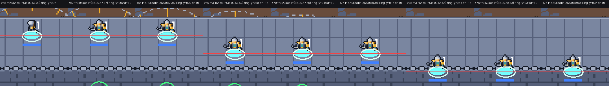
2. **문루·탑 단차:** 높이 더하기(`rise_at`, battle_view.gd:1017-1025)가 칸 단위다. 정문 일대를 동서로 지나면 탑 27px·문루 10px를 순간적으로 오르내린다(5칸 안에서 네 번).
   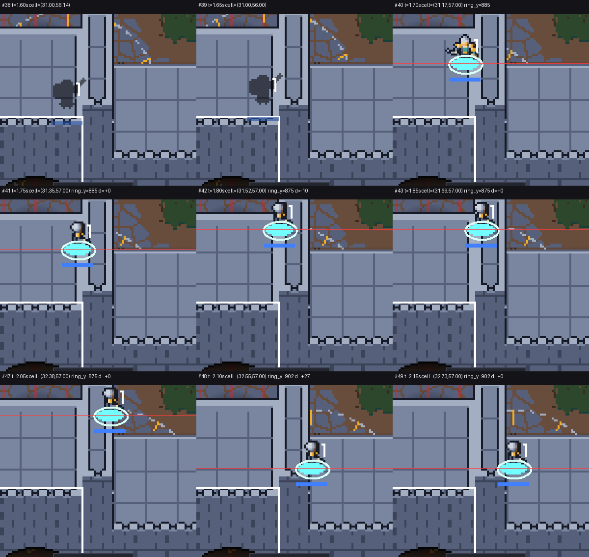
3. **땅↔성벽 오르내리기:** 순간 이동이다(battle.gd:3257-3261, S198 «미끄러지지 않는다»). 정문 20px, 동·서문 27px + 옆 16px, 북문 52px다.

- 적 쪽 후보도 있다. 기어오르기를 마치는 순간 약 8px 튀며 앞층이 하체를 가린다. 성벽에서 마을로 내려오는 순간 1프레임 16px 위로 튄 뒤 27px 내려간다.
- 별건: 그려진 성벽 윗면을 우클릭하면 그 아래 마을 칸으로 간다(탑 윗면 전부, 정문 문루 윗면 85%).

**안**

- **B(추천)** `_lift` 한 함수에서 줄 스냅을 없애고 칸 사이 높이를 고르게 잇는다(탑은 한 칸 걷는 동안 비탈처럼). 칸 가운데 값은 지금과 같아 서 있는 장면·대포는 그대로다. SPEC S170 변경, 새 EV 하나.
- A 줄 스냅만 없앤다(단차는 남음).
- C B + 오르내리기도 0.15초 미끄러지게(S198 변경, EV539·540 개정).

**처리:** wall-walk-1(B). C와 우클릭 별건은 질문.

## 4. 타워 설치 칸

**사용자 말:** «타워를 짓는데 세 칸인데 네 칸만큼 인식이 되는 것 같다고. 벽에도 설치 판정이 되는지는 모르겠는데, 이게 올라가니까 좀 불편하다고.»

**확인(Claude, 캡처로 확인)**

- 판정은 4줄이 아니다. 성곽은 정확히 3줄이 금지·허용 칸이고(battle.gd:1837), 미리보기와 클릭은 같은 칸이다(battle_view.gd:875, controls.gd:138). 타워·대포는 1×1이다.
- 어긋나는 것은 그림이다.
  - 남벽 그림은 약 77맵px(≈4.8줄)라 마을 55~56행까지 덮는다. 그 칸은 마을 칸이라 빨강이다. 놓기 격자선은 성벽 그림 밑에 깔려 성벽 부근 칸을 셀 수 없다.
    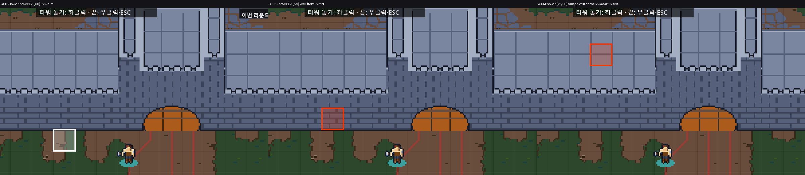
  - 성벽 바로 앞(60행)에 지은 타워 지붕이 성벽 앞면을 약 20px 덮어 «올라간» 것처럼 보이고, 그 윗부분을 누르면 성벽이 골라진다.
    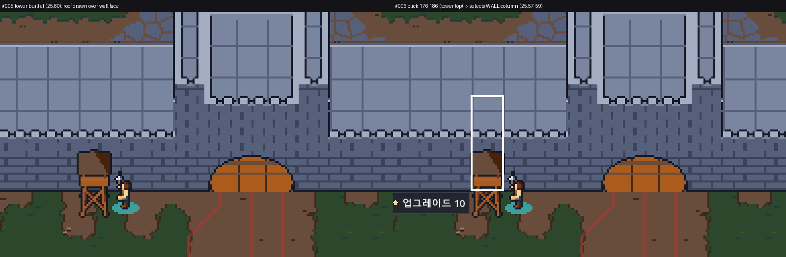
  - 성벽 위 대포는 흰 미리보기 칸보다 약 28px(탑 열은 27px 더) 위에 선다. 미리보기만 올리지 않는다.
    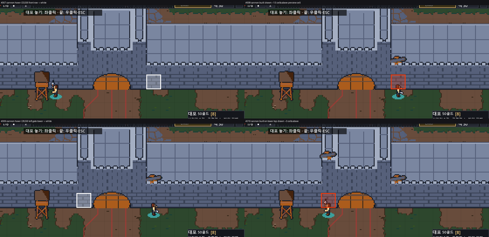
- 성벽 칸에 타워·마법 타워·방벽은 못 짓는다(«성곽에는 대포만»). 대포는 성벽 3줄 어디나 흰 미리보기다. 그런데 가운데 줄(34,58)은 누르면 «닿는 공병 없음»으로 거부된다(실행 확인, 공병 둘이 놀고 골드 90). 공병이 막힌 칸을 지나지 못해 닿지 못하는 줄이 있다(남벽 58행 등, 모서리 8칸은 늘). S217 «세 줄 어디나»와 I125 «닿는 공병만»이 부딪힌다.
  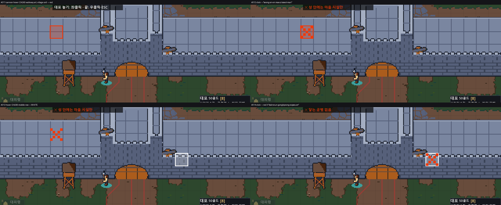

**안**

- **A(추천)** 미리보기를 지어질 그림 자리에 그린다(올림 + 청사진). 판정·저장은 그대로다. SPEC S216 변경, EV444~447·450·451 개정 행.
- B 대포 놓기는 성벽 그림을 누른 자리로 칸을 고른다(S218 방식).
- C «닿는 공병 없음» 칸을 미리보기에서 빨강으로, 또는 성벽 위 공병이 짓게 한다(규칙 결정 필요).

**처리:** place-1(A). B·C는 질문.

## 5. 부서진 성문 잔해

**사용자 말:** «그리고 성벽이 무너졌는데 성문이 부서졌지. 부서졌는데 자네가 몸 위를 덮으니까 이거 또 어색하더라고.» — «자네가»는 «잔해가»의 받아쓰기로 읽었다.

**확인(Claude, 캡처로 확인)**

- 잔해 그림은 성곽 3줄 깊이의 돌 판이다. 그런데 그리는 순서는 앞줄 바닥선 −3 한 값으로 정한다(`src/ui/battle_view.gd:947-948`). 그래서 잔해 칸에 선 유닛을 먼저 그리고 그 위를 판이 덮는다.
  - 가운데 줄은 100%, 앞줄 55~75%, 뒷줄 38~56%가 덮인다.
  - 발밑 팀 색·선택 고리·쓰러진 몸·장판도 판 밑에 깔린다. 영웅 레벨 숫자·마나 막대만 돌 위에 뜬다.
  - 10/26 성곽 3줄(castle-3, 54b932d) 때 생겼다. 1줄 때는 발치만 덮였다.
  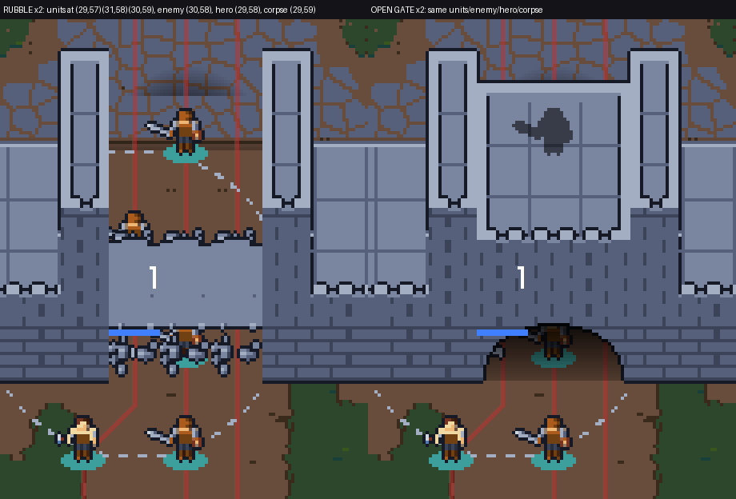
- 성벽 열 하나가 부서지면 위에 있던 병사가 땅으로 내려와 통째로 안 보인다.
  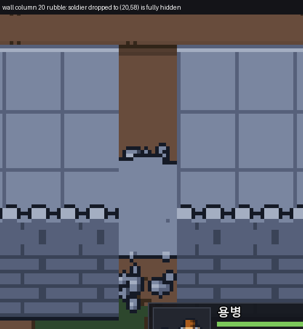
- 부수: 정문이 부서져도 터널 입구 그늘이 마을 박석 위에 홀로 남는다.
  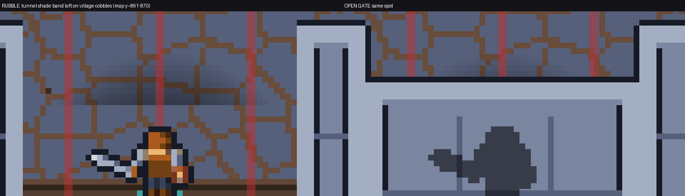
- 열린 정문 안 유닛이 아치에 가리는 것은 다른 일이다(터널 안).

**안**

- **A(추천)** 잔해를 바닥 층으로 그린다(정렬에서 빼고 장판보다 먼저). 몸통·발밑·쓰러진 몸·장판이 한 번에 맞는다. SPEC S170 변경(근거 EV 없음), 새 EV 하나.
- B 정렬 값만 뒷줄 위끝으로(한 줄). 발밑 색·쓰러진 몸은 계속 판 밑이다.
- C 잔해 그림을 낮고 성긴 돌무더기로 다시 굽는다(A와 함께만).

**처리:** rubble-1(A). 그늘 지우기·그림 바꾸기는 질문.

## 6. 전체 화면과 듀얼 모니터 커서

**사용자 말:** «그리고 전체 화면 모드가 필요해 보인다. 내 PC 기준으로 듀얼 모니터를 쓰고 있어서 오른쪽으로 마우스를 이동하다 보면 마우스가 게임 밖으로 벗어나게 되니까 카메라 이동이 부자연스럽거든.»

**확인(Claude)**

- 전체 화면은 이미 있다. F11(S162, `src/main.gd:124-128`)과 설정 «전체화면»(`src/ui/menus.gd:71-72`)이다.
- 오늘 판은 창으로 시작했다. 콘솔판(편집기 빌드)은 저장된 창 모드가 없으면 창으로 시작한다(S163). settings.cfg의 마지막 수정이 10/24라 오늘 전체화면으로 바꾼 적이 없다.
- 게임 안 어디에도 F11 안내가 없다. ESC 메뉴가 열린 동안은 F11이 먹지 않는다.
- 커서 가두기 코드는 없다(mouse_mode 0건). 가장자리 스크롤(S53)은 창 밖 커서도 읽어 계속 흐른다. 그래서 «커서가 게임 밖에 있다»가 문제다.
- [추론] 전체화면이어도 커서는 오른쪽 보조 모니터로 넘어갈 수 있다. 보조 모니터(1920×1080)는 주 모니터 오른쪽 위에 붙어 있어 아래 절반은 Windows 설정에 따라 막힐 수도 있다. 실행으로 확인하지 않았다.
- 같은 계열 두 번째 불만이다. 10/12 R1 «화면 밖으로 마우스를 가져다 두고 이동하려니 인식이 잘 안 된다»(`playtest/2026-10-12_busy_1.md:29`)는 그때 «창 밖에서도 계속 이동»(S53)으로 처리했다.

**안**

- A 안내만: F11을 한 번 누르면 저장되어 콘솔판도 다음부터 전체화면으로 시작한다. 오른쪽 커서 문제는 남는다.
- **B(추천)** 전체화면이면 커서를 화면 안에 가둔다(빌드 구분 없음). 가둔 커서가 오른쪽 끝 버튼에 걸려 스크롤이 멈추지 않게 A·S·H 태그(x 616)와 오른쪽 경보 표식(x 626~)을 안쪽으로 옮긴다. F11 안내를 함께 한다.
- C 설정 «커서 가두기»를 두어 창 모드에서도 가둔다(S184·S53 변경, EV 개정 일곱 이상).

**처리:** cursor-1(B). 가두기 범위·F11 안내 방식은 질문.

## 7. 하단 UI 테두리와 미니맵

**사용자 말:** «마지막으로 하단 UI에 테두리 윤곽선 같은 게 좀 필요해 보여. 미니맵이 바깥 배경과 색상이 겹치다 보니까 미니맵이 뭔지 인지하지 못했거든. 이것도 확인이 필요해 보여.»

**확인(Claude, 캡처·픽셀로 확인)**

- 미니맵 둘레는 1px `#3a3f4b` 하나이고 받침 패널이 없다(`src/ui/hud_minimap.gd:109`, `src/ui/hud.gd:356-357`). 이 테두리와 풀 `#2d472d`의 대비는 1.03:1이다. 미니맵 아래 절반(들판)은 뒤에 보이는 들판과 같은 색이다.
- 기본 시야(정문 앞)에서 미니맵 왼쪽·아래 경계가 녹고 성벽 «U»자만 보인다. 카메라를 맨 아래로 보내거나 1배 줌이면 뒤가 숲 띠라 읽힌다.
  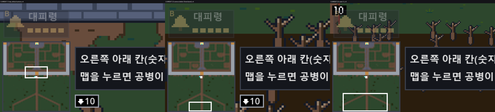
- 직접 계기: 10/25 미니맵 시안 A를 고를 때는 마을 바닥이 흙 갈색이라 들판과 갈렸다. 10/26 마을 바닥이 풀로 바뀌면서(S202) 미니맵이 거의 다 초록이 됐다.
- 하단 패널(건설 격자·선택 패널·정보 칸·힌트 칸) 윤곽선도 같은 `#3a3f4b`라 풀 위에서 거의 안 보인다. 패널은 어두운 몸통으로만 갈린다. 준비 단계 대피령 버튼은 0.35 투명이라 윤곽이 없다시피 하다.
- 시안 비교(스크래치 사본에만 넣고 찍음). 위부터 지금 / 안1 / 안3이다.
  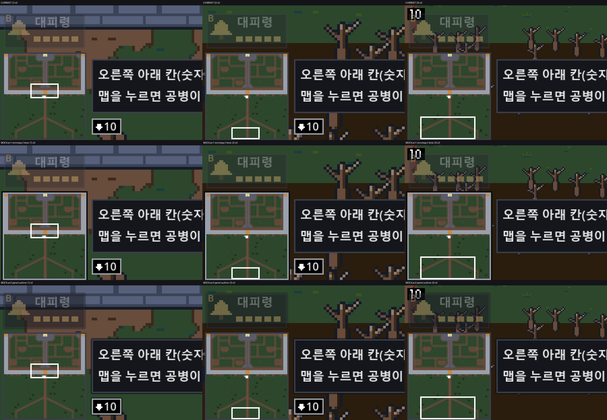
  - 안1(바깥 검정 1px + 안쪽 밝은 회청 1px)은 들판·숲 어디서나 액자 두른 지도로 보인다.
  - 안3(패널마다 1px 어두운 그림자)은 2배 창에서 차이가 미미하다. 하단 패널은 더 굵거나 밝은 선이 필요해 보인다[추론].

**안**

- **안1(추천)** 미니맵 2톤 테두리. 색은 HudTheme 상수 하나로 둔다. SPEC S209 변경, EV431~436 개정 행.
- 안2 미니맵·대피령 뒤 받침 패널.
- 안3 하단 패널 공통 윤곽(밝은 선 + 바깥 검정).

**처리:** hud-frame-1(안1 + 하단 패널 윤곽은 시안을 보고 고름).

## 8. 들판 크기

**사용자 말:** «몬스터가 출현하는곳과 성벽까지의 거리 즉 들판의 크기를 키울 필요가 있어보인다.»

**확인(Claude)**

- 맵은 60×93(`src/main.gd:200`), 출현은 (9,92)·(30,92)·(50,92)(`main.gd:201`)다. 들판은 60~92행, 33줄이다.
- 33줄은 10/23 S203 «들판 33행» 결정을 이어 온 값이다. 10/26 정사각형 성(sq-1)에서 성이 30줄 → 60줄로 커질 때도 «33줄 그대로» 남았다(SPEC S203 10/26 둘째 변경). 맵에서 들판 비율이 52% → 35%로 줄었다.
- 정문까지 32~44칸이다. 첫 접촉 하한(몸싸움 없음 가정):

| 적(칸/초) | 33줄(지금) | 50줄 | 66줄 |
|---|---|---|---|
| 늑대 3.0 | 10.7~14.7초 | 16.3~20.3초 | 21.7~25.7초 |
| 기본 2.0 | 16~22초 | 24.5~30.5초 | 32.5~38.5초 |
| 슬라임 1.5 | 21.3~29.3초 | 32.7~40.7초 | 43.3~51.3초 |
| 빠름 3.5(성벽 오르기) | 9.1초~ | 14초~ | 18.6초~ |

- 다른 코드(카메라·미니맵·바닥·장식·어둠·출현 퍼짐)는 맵 크기에서 셈해 저절로 따라간다. 숫자가 박힌 평가는 일곱이다(EV427·433·434·435·442·453·515).
- [추론] 밤 웨이브는 어둠 시야(S213) 때문에 적이 성문 반경 약 4칸에서 갑자기 보인다. 이것도 «가깝다»는 느낌을 더할 수 있다.

**안**

- **A(추천)** `main.gd`에 들판 줄 수 상수 하나를 두고, 박힌 평가 일곱을 맵 높이에서 셈하게 고친다. 55줄 이하면 미니맵 첫 창에 정문과 출현 줄이 함께 들어간다. 저장 판은 그대로다(줄을 아래에 더함).
- B 66줄(2배). 미니맵 첫 창에서 출현 줄이 빠진다.
- C 맵은 그대로 두고 적 속도를 낮춘다(S106·EV130까지 바뀜). «들판 크기»와는 다르다.
- 위험: 웨이브마다 첫 접촉이 늦어져 판이 길어진다. «120초 안에» 의뢰(swift)가 어려워진다. 적 경로 계산 비용이 늘어난다[추론].

**처리:** field-1(A). 줄 수는 사용자가 정한다.
