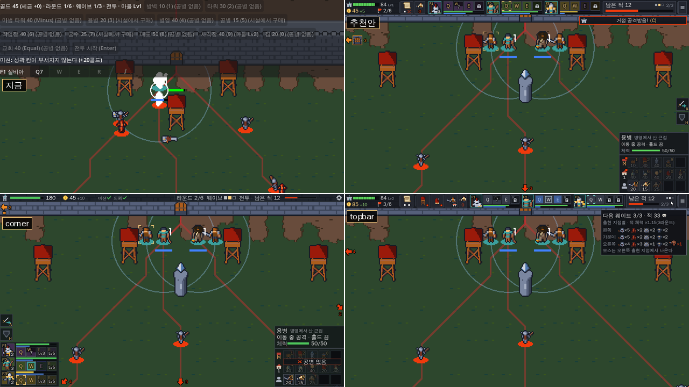
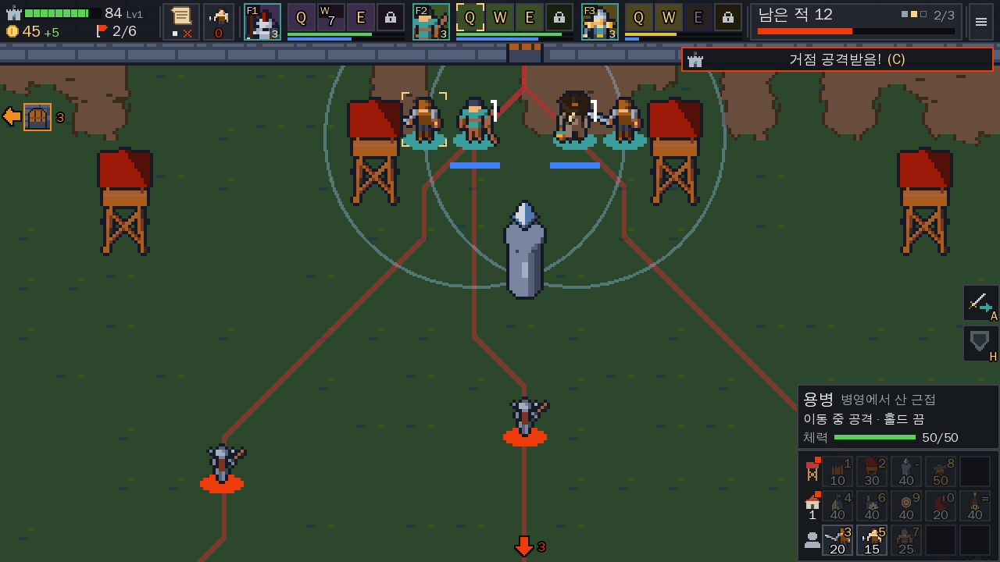
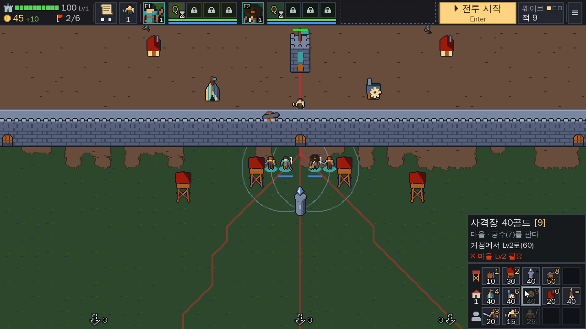
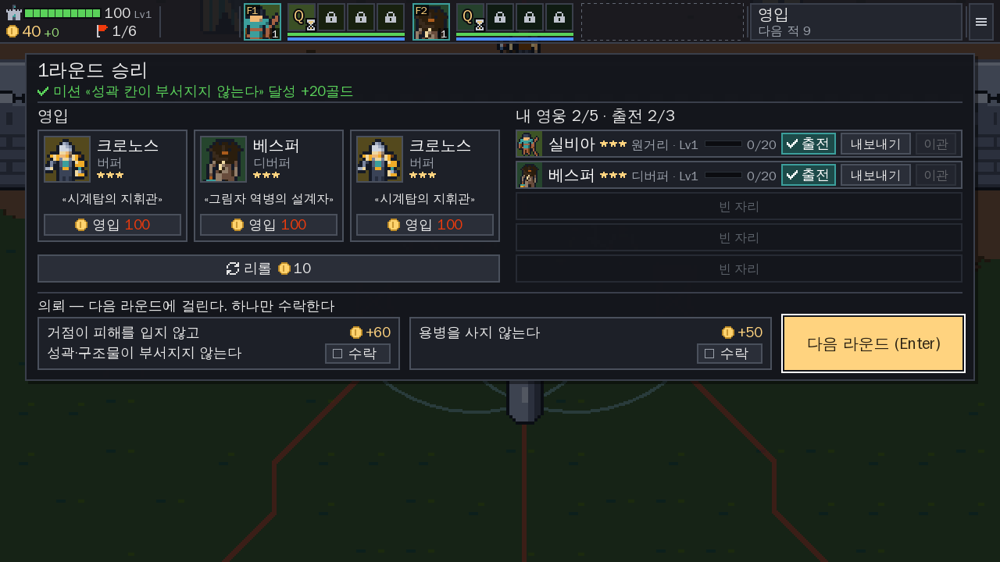

# UI 개선안 — 다른 게임 참조 (2026-10-20)

요청: «UI가 상당히 난잡하다. 다른 게임을 참조해서 개선안을 제시하라.»

쓴 자료:
- 지금 화면 캡처(1280×720, 기준 해상도의 2배)와 HUD를 숨긴 맵 캡처.
- 우리 코드 `src/ui/hud.gd`(481줄), `src/ui/camera.gd`, `src/ui/controls.gd`, `SPEC.md`.
- 웹·GitHub 근거 274개(verified·partly·likely만).
- 오픈소스 게임 코드 근거: Mindustry(M1~M50), OpenRA(O1~O47), Shattered Pixel Dungeon(S1~S45).
- 설계안 세 개(corner·context·topbar), 안마다 시안 3장, 세 관점(플레이어·제약·근거) 심사.

만든 방법(Claude 세션, 2026-10-20):
1. 게임을 띄워 지금 화면을 찍고(커밋 `052daf8`), 설계 조건과 UI 현황을 [00_brief.md](00_brief.md)에 정리했다.
2. 웹 조사: 참조 게임 묶음 10개와 원칙 주제 6개를 조사원 하나씩 맡고, 주장마다 다른 검증자가 따로 검색해 반박을 시도했다. 주장 341개 중 verified 149·partly 64·likely 61·unverified 66·rejected 1. 전체는 [evidence/web.md](evidence/web.md), 요약은 [evidence/web_digest.md](evidence/web_digest.md).
3. 코드 조사: Mindustry·OpenRA·Shattered Pixel Dungeon 공개 저장소를 읽어 `파일:줄`로 근거를 모았다([evidence/mindustry.md](evidence/mindustry.md), [evidence/openra.md](evidence/openra.md), [evidence/spd.md](evidence/spd.md)). 메인 세션이 인용 줄 일부를 직접 열어 대조했다.
4. 설계안 세 개를 따로 만들고 안마다 시안을 그렸다. 세 관점 심사위원이 점수를 매겼다. 이 보고서를 쓴 뒤 검토자가 14개를 지적했고 고쳤다. 마지막으로 추천안 시안을 그렸다.

근거 표기:
- 웹 근거는 `[ID·상태]`로 쓴다. 상태는 verified(독립 확인) / partly(큰 틀은 맞고 일부가 다름) / likely(검증 못 했지만 두 곳 이상).
- 코드 근거는 `MD-M17`(Mindustry), `ORA-O30`(OpenRA), `SPD-S36`(Shattered PD)로 쓴다.
- `SPD-S…`는 Shattered PD 근거 번호다. 우리 SPEC 번호는 접두어 없이 `S105`, `I129`로 쓴다.
- 좌표는 모두 기준 해상도 640×360의 px다. 사각형은 `[x, y, 폭, 높이]`다.

---

## 0. 결론

**추천안: «위 한 줄 띠 + 오른쪽 아래 건설 패널»** (바탕은 설계안 `topbar`)

추천안은 설계안 topbar(높이 28px 위 띠 하나)를 바탕으로, 설계안 corner의 오른쪽 아래 건설 격자와 지연 없는 정보 칸을 얹은 것이다.
위 띠에는 거점 체력·골드·라운드, 임무, 놀고 있는 공병 수, 출전 영웅 셋(초상화와 Q·W·E·R 칸), 전투 시작/웨이브 계기판, 메뉴가 고정 좌표로 들어가고 줄바꿈하지 않는다.
놓기 12종은 위쪽 글자 버튼 줄에서 오른쪽 아래 3줄×5칸 아이콘 격자(130×72)로 옮기고, 이름·비용·못 쓰는 이유는 그 위 정보 칸에 보인다.
늘 떠 있는 HUD가 덮는 넓이는 지금 40%(조준 45%)에서 11.8%(조준 12.9%)로 준다.
영웅 줄은 사용자가 10/19에 고른 대로 위 한 줄에 둔다(I129). 다만 건설 패널이 오른쪽 아래에 늘 떠 있으므로, UI를 위에만 두는 배치는 아니다(8장 1번).
카메라는 아래로 72(기준 px)만큼 맵 밖을 보여서, 맨 아래 출현 지점 줄이 건설 패널 밑에 갇히지 않는다. 위로 28은 선택이다. 거점은 여백이 없어도 1배 맨 위에서 띠 아래에 보이고, 위 여백이 드러내는 것은 마을 맨 위 줄(맵 y 0~28)뿐이다(4.8, 8장 2번).
툴팁(0.2초), 다음 웨이브 미리보기, 거점·성문 경보를 새로 넣는다.
사용자가 정한 S105·S53·S81·S45를 바꾸거나 건드린다. 이 넷은 8장 0번에서 하나씩 묻는다.

**시안:** 추천안 시안은 `../art/trial/preview/hud_final_battle.png`(전투), `hud_final_prep.png`(준비), `hud_final_cleared.png`(라운드 사이)다. 지금 화면·추천안·corner·topbar를 나란히 놓은 그림은 `../art/trial/preview/hud_compare_battle.png`다. 시안을 그리다 찾은 설계 문제는 4.10 끝에 적었다.



**심사 결과:** 관점별 1위는 corner 2표(플레이어 7.1 대 7.0, 근거 8.4 대 8.3)와 topbar 1표(제약 7.3 대 6.0)다. 세 관점 평균은 topbar 7.5, corner 7.2, context 5.1이다. corner의 두 1위는 0.1점 차이고, corner는 I129(영웅 줄 위 한 줄)를 뒤집어야 성립한다. 그래서 topbar를 바탕으로 하고, 플레이어 심사가 권한 대로 corner의 장점을 옮겨 얹었다.

**가장 먼저 할 작업 3개** (그 앞에 SPEC·EVAL 초안을 쓰고 승인받는 0단계를 둔다):
1. HUD 테마·툴팁 바탕·아이콘 대역을 만들고, 단축키 표기 «(Minus)»·«(Equal)»를 «-»·«=»로 고친다. → 6장 1단계
2. 놓기 버튼 12개를 오른쪽 아래 건설 격자와 정보 칸으로 옮긴다. 이때 S105(사용자 2026-10-13)를 지우고, I132·I128을 바꾼다. 지금 덮는 넓이의 약 30%를 차지하는 줄이 위에서 빠진다. 카메라 아래 여백과 «HUD 버튼 위에서는 가장자리 스크롤 멈춤»(S53 변경, 사용자 2026-10-12)을 같이 넣는다. → 6장 2단계
3. 위 띠 골격(고정 좌표, 줄바꿈 없음), 상태 묶음·거점 체력, 토스트 큐, 카메라 `focus()`를 만든다. 카메라 위 여백 28은 8장 2번에서 고르면 여기서 넣는다. → 6장 3단계

---

## 1. 지금 UI가 난잡한 이유

### 1.1 일곱 가지 문제와 빠진 세 가지

| 번호 | 문제 | 지금 화면에서 본 것 | 코드에서 본 원인 |
|---|---|---|---|
| 1 | 글자뿐인 버튼 | 놓기 12개가 «방벽 10 (1) (공병 없음)» 같은 한 줄 글 버튼이다. 아이콘이 없다. | `hud.gd:87`이 `"%s %d (%s)"` 글로 버튼을 만든다. |
| 2 | 단계마다 버튼이 밀린다 | 준비 3줄(play2/003) → 전투 4줄(play1/006). 이유 글이 붙으면 버튼 폭이 바뀌고 줄바꿈이 다시 일어난다. | `hud.gd:76-81` PanelContainer + HFlowContainer(S105). `hud.gd:171`이 이유를 버튼 글 끝에 붙인다. |
| 3 | 회색 버튼이 너무 많고, 회색이 한 가지다 | 전투 1배 화면(play1/006)에서 놓기 12개가 모두 흐리다. 8개 «(공병 없음)», 3개 «(시설에서 구매)», 1개 «(마을 Lv2)». «전투 시작 (Enter)»도 흐린 채 남는다. Lv1 영웅은 W·E·R 셋이 흐리다. | I132·I128(이유를 글 끝에), I129(흐림 0.4 하나). `data/levels.tres`의 해금 레벨이 Q1·W2·E3·R5다. |
| 4 | 다른 종류의 정보가 한 흐름에 섞인다 | 상태 글 → 놓기 12개 → 전투 시작 → 이동 방식·홀드 → 미션 → 영웅 줄 → 안내 줄이 한 VBox 안에 차례로 흐른다. | `hud.gd:76-115`. 놓기 순서는 `controls.gd:19` PLACE_KEYS 순서라 들판·마을·용병이 섞인다. |
| 5 | 위계가 없고 거점 체력이 HUD에 없다 | 정보 줄은 «골드 35 (세금 +0) · 라운드 1/6 · 웨이브 1/3 · 전투 · 마을 Lv1»이 같은 크기·색이다. 거점 체력은 맵 위 작은 막대뿐이다. | `hud.gd:73-74`는 `Theme.new()`에 글꼴 크기 10만 준다. 패널은 Godot 기본 회색 상자다. |
| 6 | 창이 HUD와 겹친다 | 라운드 사이 창(../art/trial/preview/hud_now_cleared.png) 뒤로 놓기 버튼 글과 거점 그림이 비친다. 맵을 어둡게 하지 않는다. | `hud.gd:117-120` `_result`가 위 가운데 offset_top 8, 폭 480이다. |
| 7 | HUD가 화면 40%(조준 45%)를 덮는다 | 위 HUD가 화면 y 0~약 144를 덮는다. 1배 줌에서 거점, 2배 줌 전투(play2/005)에서 성벽·정문이 그 밑에 있다. | 아래 1.2 «카메라». |
| + | 툴팁이 0개다 | 버튼 뜻·비용·이유를 볼 곳이 버튼 글뿐이다. | `hud.gd`에 `tooltip_text`가 없다. |
| + | 다음 웨이브 미리보기가 없다 | 몇 마리가 어디로 오는지 전투가 시작돼야 안다. | — |
| + | 경보가 없다 | 거점·성문이 화면 밖에서 맞아도 알림이 없다. | — |

측정·관찰(설계 조건 문서(00_brief.md) 4절):
- 덮는 넓이 40%(조준 45%) 가운데 약 30%가 3~4줄로 접히는 놓기 버튼 줄이다.
- 10/16 처음 하는 사람 관찰에서 두 판 모두 1라운드에서 졌다. 막힌 곳 대부분이 화면 안내 부족이었다.

**문제와 추천안의 대응**

표의 «단계»와 «검증(EV)»은 6장 표를 가리킨다. 10/16 관찰 번호(N-·B)는 `insights/2026-10-16_first_observation.md`의 번호다.

| 문제 | 추천안 요소 | 단계 | 검증(EV) |
|---|---|---|---|
| 1 글자뿐인 버튼 | 건설 격자 아이콘 칸 + 지연 없는 정보 칸(4.3) | 1·2 | 2단계: 칸 글에 «없음»이 없다 |
| 2 단계마다 버튼이 밀린다 | 띠·격자 고정 좌표, 줄바꿈 없음(규칙 2) | 2·3 | 2단계: 12칸 위치가 단계와 무관하다. 3단계: 띠 칸 사각형이 단계마다 같다 |
| 3 회색이 많고 한 가지다 | 원인마다 다른 상태(규칙 4), 공병 칸 숫자, 전투 중 «전투 시작» 대신 계기판 | 2·4·5 | 5단계: 대기 칸에 올림한 초, 마나 부족 틴트 |
| 3의 일부: Lv1 영웅은 스킬 3칸이 잠김 | **풀리지 않음.** 자물쇠 하나로 덜 어지럽게만 한다. 해금 레벨(`data/levels.tres`)은 8장 5번에서 묻는다 | — | — |
| 4 다른 정보가 한 흐름에 섞인다 | 띠(상태·임무·공병·영웅·진행), 건설 격자, 상황 태그, 안내 칩을 자리로 나눈다 | 2·3·6·9 | 3단계: 띠 칸 사각형. 6단계: 태그 좌표 |
| 5 위계 없음, 거점 체력 없음 | 상태 묶음 첫 칸에 거점 막대 + 숫자, 글자 크기 단계(4.9) | 3 | 3단계: 거점 숫자 = base.hp |
| 6 창이 HUD와 겹친다 | 창 뒤를 50% 어둡게, 조작 패널을 내린다(규칙 11) | 11 | 11단계: 창이 떠 있으면 패널 visible = false |
| 7 HUD가 40%(조준 45%)를 덮는다 | 띠 28 + 격자 130×72 = 11.8%(조준 12.9%) | 2·3·13 | 13단계: 전투 ≤ 12%, 조준 ≤ 13% |
| + 툴팁 0개 | 공용 툴팁(4.7) | 1 | 1단계: 모든 띠 버튼에 툴팁 |
| + 웨이브 미리보기 없음 | 진행 칸, 그 툴팁, 출현 지점 배지 | 4 | 4단계: 지점별 미리보기 수 = 실제 수 |
| + 경보 없음 | 거점 막대 번쩍, 토스트, 가장자리 표식, C 키 | 10 | 10단계: 거점 피해 → 토스트 1개, C → 카메라가 거점 |
| N-1 공병이 없어 말없이 거부됨 | 공병 칸 빨간 0, 1·2줄 머리 빨간 점, 정보 칸 이유 줄 | 2·3 | 2단계: 놀고 있는 공병이 0이면 정보 칸 이유 줄 «✕ 놀고 있는 공병 없음» |
| N-3 이동 방식(A 키)을 몰라 용병을 못 뺌 | 상황 태그 [A]·[H](상태 아이콘 + 키 글자) | 6 | 6단계: 태그 둘이 뜬다 |
| N-5 스킬 대기 표시 없음 | 스킬 칸 상태(4.7) | 5 | 5단계: 대기 칸에 올림한 초 |
| N-6 영웅 다운 표시 없음 | 영웅 칸 초상 회색 + «쓰러짐» + 토스트 | 5 | 5단계: 쓰러진 영웅 칸에 «쓰러짐» |
| N-8 영입 창이 다시 정렬돼 클릭이 빗나감 | 창 윗변 고정, 보유 영웅 5칸 고정(I136) | 11 | 11단계: 영입해도 리롤·진행 버튼 좌표가 같다 |
| N-9 미션 실패가 안 보임 | 임무 칸 빨간 ✕ + 토스트(I122) | 3 | 3단계: 미션이 깨지면 임무 칸에 ✕, 토스트 1개 |
| N-11 잠금 이유가 안 보임 | 정보 칸 이유 + 해결 길 | 2 | 2단계: 사격장 칸에 마우스를 올리면 정보 칸에 «마을 Lv2» |
| B7 닫힌 성문 앞 대기 안내 없음 | **다루지 않음.** 유닛이 닫힌 성문 앞에서 기다릴 때의 표시는 이 안에 없다 | — | — |

10/16 관찰의 나머지(N-2 전투 중 용병 클릭 선택, N-4 칸 강조, N-7 비행 적 대응, N-10 사격 연출)는 조작 규칙·전술·연출 문제다. 이 보고서는 다루지 않는다.

### 1.2 코드에서 본 사실

- **카메라가 거점을 HUD 밑에 가둔다.** `camera.gd:41-44` `pan()`은 카메라 위치를 `[half, map_px − half]`로 가둔다(I50 «카메라는 맵 밖을 보여 주지 않는다»).
  - 1배 줌에서 카메라를 맨 위로 올리면 맵 y 0이 화면 y 0이다.
  - 거점 그림(맵 y 약 31~80)은 위 HUD(화면 y 0~약 144) 안에 든다.
  - 카메라를 더 올릴 수 없어서, 1배 줌에서는 거점을 HUD 밖으로 꺼낼 방법이 없다.
  - HUD를 아래에 두면 맨 아래 출현 지점 줄이 같은 문제를 겪는다.
- **놓기 12종이 한 줄에 흐른다.** `hud.gd:85-89`가 PLACE_KEYS 순서대로 글 버튼을 HFlowContainer 한 줄에 넣는다. 640px에 들어가지 않아 3~4줄로 접힌다(S105).
- **단축키 배치가 범주와 어긋난다.** `controls.gd:19`:
  - 1 방벽, 2 타워, 3 용병, 4 병영, 5 공병, 6 작업장, 7 궁수, 8 대포, 9 사격장, 0 집, - 마법 타워, = 교회.
  - 범주로 보면 들판 1·2·8·-, 마을 4·6·9·0·=, 용병 3·5·7로 흩어져 있다.
  - 버튼 줄도 이 순서라 «방벽·타워·마법 타워·용병·병영·공병·…»처럼 범주가 섞여 보인다.
- **키 이름이 영어로 나온다.** `hud.gd:87`의 `OS.get_keycode_string(key)`가 -·=를 «Minus»·«Equal»로 쓴다. 화면에 «마법 타워 40 (Minus)», «교회 40 (Equal)»으로 나온다.
- **영웅 줄 폭이 글자에 묶여 있다.** `hud.gd:105`가 이름 칸을 «F3 세라피나» 폭으로, `hud.gd:111`이 스킬 버튼을 «W88*» 폭으로 고정한다. 640px에 셋을 넣으려고 마나 숫자를 뺐다(`insights/2026-10-19_hud_zone_options.md`).
- **안내 줄 자리.** `hud.gd:115` 안내 줄(`_hint`)은 영웅 줄 아래에 붙어, 놓기·조준 중에는 HUD가 한 줄 더 내려온다(조준 45%).

### 1.3 글꼴은 원인이 아니다

HUD 벡터 글꼴(화면 해상도 글자)은 사용자 결정이다(S30, 2026-10-19 «HUD만 고해상도»).
Shattered PD도 같은 방식이다. 글자를 «크기 × 배율»로 화면 해상도에서 그린 뒤 줄여서 도트 그림 위에 얹는다(SPD-S8, [p_pixel_ui-12·partly]).
Loop Hero도 고해상도 글꼴을 고를 수 있고, 그때 버튼 판과 아이콘은 도트로 남는다([pixel_minimal-29·verified]).
난잡함의 원인은 글꼴이 아니라 HUD의 양과 배치다.
이 보고서는 S30을 바꾸지 않는다. 아이콘만 도트 그림을 정수배로 키워 쓰자고 덧붙인다.

---

## 2. 다른 게임에서 배운 것

### 2.1 배치

| 무엇을 | 어느 게임이 어떻게 | 근거 ID(상태) |
|---|---|---|
| HUD를 구석에 모으고 가운데를 비운다 | Shattered PD 데스크톱은 상태 칸을 왼쪽 아래(160×39), 도구 막대·가방을 오른쪽 아래, 메뉴를 오른쪽 위에 둔다. 1080p에서 배율 3이면 UI 크기가 640×360과 같다(조사자 계산). | SPD-S13, SPD-S18, SPD-S15 (코드) |
| 위 HUD는 한 줄 | PvZ 전투 화면 위 HUD는 씨앗 바·삽·메뉴 한 줄이고 높이는 화면의 약 15%다. 0 A.D.는 맨 위 자원 줄이 36px다. | [pvz_frostpunk-15·verified], [p_alerts_camera-13·verified] |
| 칸 자리를 고정한다 | PvZ 씨앗 카드 x좌표는 칸 번호와 칸 수로만 정해진다. 해가 모자라거나 재충전 중이어도 자리가 밀리지 않는다. WC3 명령 카드는 3줄×4칸 고정 격자에 내용만 바꿔 채운다. | [pvz_frostpunk-02·verified], [blizzard-01·verified] |
| 건설은 오른쪽 아래 | Mindustry PC 건설 패널은 오른쪽 아래 구석에 붙는다. SC2도 명령 카드가 오른쪽 아래다. | MD-M1, [td_bars-md-01·verified], [blizzard-16·verified] |
| 맵은 창 전체, HUD는 겹쳐 그린다 | OpenRA는 세 모드 모두 세계가 창 전체를 덮고 사이드바를 그 위에 그린다. | ORA-O1 (코드) |

### 2.2 건설 메뉴

| 무엇을 | 어느 게임이 어떻게 | 근거 ID(상태) |
|---|---|---|
| 아이콘 격자 + 위에 붙은 고정 정보 칸 | Mindustry: 글자 없는 아이콘 칸 4열. 칸이 모자라면 빈 칸으로 폭을 지킨다. 정보 칸은 격자 위에 붙고 지연 없이 뜬다(메뉴 위 마우스 > 고른 블록 > 맵 커서 아래 순). | MD-M3, MD-M6, MD-M17, MD-M18, [td_bars-md-02·verified] |
| 칸 모서리에 단축키·비용 | BAR 격자 칸은 오른쪽 위에 단축키, 오른쪽 아래에 비용을 그린다. SC2는 옵션으로 단축키를 버튼 위에 그린다. | [p_cooldown_hotkey-13·verified], [blizzard-20·partly] |
| (반례) 단축키를 정보 칸·툴팁에만 | Mindustry는 정보 칸 이름 아래에만, OpenRA는 툴팁에만 쓴다. | MD-M10, ORA-O25 (코드) |
| 범주로 나눈다 | They Are Billions는 범주 → 건물 2단계다. Mindustry는 격자 옆에 범주 아이콘 탭을 둔다. | [tab-11·verified], MD-M5 |
| 칸 둘레 링 메뉴 | Kingdom Rush는 정해진 건설 자리를 누르면 4종이 뜬다. 자유 배치 맵에 옮긴 사례는 찾지 못했다. Thronefall의 고정 자리 방식은 리뷰가 «큰 한계»로 꼽았다. | [ironhide-01·verified], [p_wave_menu-15·partly] |

### 2.3 못 쓰는 상태

| 무엇을 | 어느 게임이 어떻게 | 근거 ID(상태) |
|---|---|---|
| 원인마다 모양을 나눈다 | 0 A.D.는 조건 미충족을 회색조 + 검정 50%, 자원 부족을 빨간 덮개로 나눈다. WoW는 마나 부족을 파란 틴트(0.5,0.5,1.0), 그 밖을 회색으로 칠한다. WC3도 마나가 모자란 기술이 파랗다. | [p_disabled_modal-05·verified], [p_cooldown_hotkey-03·verified], [blizzard-08·verified] |
| 비용 숫자 색 3단계 | Mindustry 재료 줄: 가진 수가 필요의 절반 미만이면 진홍, 모자라면 강조색(노랑), 충분하면 흰색. | MD-M15, [td_bars-md-04·verified] |
| 이유는 버튼이 아니라 한 줄 | Mindustry는 빨간 ✕와 이유 한 줄을 정보 칸 맨 아래에만 둔다. PvZ 툴팁은 빨간 경고 줄 하나에 이유 하나만 쓴다. | MD-M16, [td_bars-md-05·verified], [pvz_frostpunk-06·verified] |
| 숨길지 흐릴지 | Carbon: 잠시 못 쓰는 것은 남기고, 계속 못 쓰는 것만 숨긴다. OpenRA는 항목마다 데이터로 고른다. Mindustry는 잠긴 블록을 숨긴다. | [p_disabled_modal-01·verified], [p_disabled_modal-02·verified], MD-M11 |
| 흐린 것도 누를 수 있다 | Primer: 흐린 버튼도 클릭을 받아 이유와 해결 길을 보인다. PvZ는 못 쓰는 카드를 누르면 버저와 안내 글을 낸다. OpenRA는 «못 누름» 소리를 낸다. | [p_disabled_modal-03·verified], [pvz_frostpunk-08·verified], ORA-O24 |

### 2.4 툴팁

| 무엇을 | 어느 게임이 어떻게 | 근거 ID(상태) |
|---|---|---|
| 지연 0.2초 | OpenRA는 마우스가 멈춘 뒤 200ms. 0 A.D. 전투 화면은 0.1초. Godot 기본은 0.5초다. | ORA-O30, [p_disabled_modal-11·verified] |
| 이어서 옮기면 바로 | SPD는 0.25초 안에 다른 버튼으로 옮기면 바로 뜬다. | SPD-S36 |
| 조작 위에 고정, 끝에서 뒤집기 | SPD는 툴팁을 버튼 1px 위에 한 번 놓고 마우스를 따라가지 않는다. 화면 끝이면 뒤집는다. | SPD-S35 |
| 내용 | OpenRA: 이름 + 노란 «(키)» + 비용·시간, 모자란 값만 빨강. WC3도 단축키 글자를 노랗게 쓴다. | ORA-O27, ORA-O29, [blizzard-10·partly] |
| 툴팁 위로 옮겨도 남는다 | WCAG 1.4.13: 호버로 뜬 내용은 그 위로 포인터를 옮겨도 사라지지 않아야 한다. | [p_disabled_modal-12·verified] |
| Godot에서 | `tooltip_text`, `_make_custom_tooltip`, `gui/timers/tooltip_delay_sec`. 버튼 단축키는 툴팁에 자동으로 붙는다. | [p_pixel_ui-15·verified] |

### 2.5 영웅·스킬

| 무엇을 | 어느 게임이 어떻게 | 근거 ID(상태) |
|---|---|---|
| 초상화 + F키, 두 번 누르면 카메라 | WC3는 영웅 초상화에 F키를 매기고, 한 번이면 고르고 빠르게 두 번이면 카메라가 간다. | [blizzard-03·verified] |
| 좌클릭 쓰기, 우클릭 자동 시전 | WoW 소환수 단추, WC3 기술 아이콘. 우리 I151과 같다. | [p_cooldown_hotkey-09·verified], [blizzard-05·partly] |
| 자동 시전 표시 | WC3는 자동 시전 기술 아이콘 네 귀퉁이에 노란 꺾쇠를 둔다(켜졌을 때 모양은 근거마다 다르다). | [blizzard-05·partly] |
| 위험한 영웅 | SPD는 체력 33% 밑이면 초상화가 빨갛게 맥박친다. | SPD-S14 |
| 능력 버튼 자리 | BTD6 능력 버튼은 화면 왼쪽 아래 가로 줄이다. | [td_bars-bt-12·verified] |

### 2.6 재사용 대기

| 무엇을 | 어느 게임이 어떻게 | 근거 ID(상태) |
|---|---|---|
| 덮개 + 남은 초 | SC2는 시계 방향 덮개. OpenRA·BAR는 원형 덮개(BAR 불투명도 0.6). PvZ와 SPD는 위에서 덮는 막. | [blizzard-24·verified], [p_cooldown_hotkey-14·verified], [pvz_frostpunk-03·partly], SPD-S32 |
| 숫자 형식 | WoW: 짧게 남으면 소수 한 자리, 아주 짧은 대기는 숫자를 띄우지 않는다. | [p_cooldown_hotkey-06·verified] |
| 못 쓸 때 문구 | Dota 2: «Not Enough Mana (Need N more)», «On Cooldown (N seconds remain)». | [p_cooldown_hotkey-10·verified] |

### 2.7 웨이브 미리보기

| 무엇을 | 어느 게임이 어떻게 | 근거 ID(상태) |
|---|---|---|
| 웨이브 칸 | Mindustry: «Wave 3/30», «N Enemies Remaining», 다음 웨이브 카운트다운. | [td_bars-md-08·verified], MD-M24 |
| 출현 입구 옆 표시 | Kingdom Rush PC: 경로 입구 옆 깃발에 마우스를 올리면 적 이름×수가 뜬다. (모바일의 «한 번=정보, 두 번=호출»은 쓰지 않는다.) | [ironhide-04·partly] |
| 보스 예고 | Mindustry는 수호자가 든 웨이브 10·5·2·1웨이브 전에 토스트를 띄운다. | [td_bars-md-13·verified] |
| 다음 밤 요약 | Thronefall 일시정지 메뉴의 «Upcoming Night Info». 낮에 출현 지점마다 종류·수 아이콘. | [p_wave_menu-05·verified], [minimal-01·likely], [minimal-02·likely] |
| 시작 전에 적 종류 보이기 | PvZ 레벨 시작 컷신이 이번 레벨의 좀비 종류를 길에 세워 보인다. | [pvz_frostpunk-13·partly] |

### 2.8 경보·화면 밖

| 무엇을 | 어느 게임이 어떻게 | 근거 ID(상태) |
|---|---|---|
| 본진 피격 | Mindustry는 코어가 맞으면 «코어가 공격받고 있습니다» 띠를 4초 띄우고, 누르면 카메라가 간다. 코어 체력 막대는 없다. Dome Keeper는 맞으면 체력 막대가 0.2초 하얗게 번쩍인다. | [td_bars-md-12·verified], [p_alerts_camera-12·verified], MD-M30, [pixel_minimal-11·verified] |
| 마지막 경보로 카메라 | WC3(최근 8개 순환)·SC2·OpenRA·Northgard는 Space다. | [blizzard-11·verified], [blizzard-25·verified], [p_alerts_camera-01·verified], [aoe_northgard-24·verified] |
| (참고·반례) C 키의 다른 쓰임 | Rogue Tower의 C는 «카메라 다시 맞춤»이다. 경보로 가는 키가 아니다. Mindustry의 C는 HUD 전체 켜기·끄기다. | [td_bars-rt-06·verified], [td_bars-md-10·verified] |
| 같은 대상은 간격 | OpenRA는 다음 알림까지 30초. BAR는 대상별 10~60초. Stratagus는 같은 구역(±14칸) 2분. | [p_alerts_camera-02·verified], [p_alerts_camera-08·partly], [p_alerts_camera-07·verified] |
| 화면 밖 표시 | BAR는 화면 밖 지도 표시를 화면 가장자리에 붙인다. Mindustry는 유닛 둘레에 짧은 선을 그린다. OpenRA·SPD에는 없다. | [p_alerts_camera-10·verified], MD-M39, ORA-O42, SPD-S28 |
| 토스트 | Mindustry는 최소 3.5초 간격으로 줄을 세운다. OpenRA는 4초, 같은 글은 «글 (n)»으로 합친다. | MD-M37, ORA-O39 |

### 2.9 모달(창)

| 무엇을 | 어느 게임이 어떻게 | 근거 ID(상태) |
|---|---|---|
| 메뉴가 열리면 HUD를 숨긴다 | OpenRA: 입력 모드 취소, HUD 숨김, 세계를 흐리게. | ORA-O46, ORA-O47 |
| HUD를 미끄러뜨려 치운다 | Dome Keeper는 0.3초 트윈으로 HUD를 화면 아래로 내린다. | [pixel_minimal-14·verified] |
| 뒤 어둡게 | Fluent 어두운 테마 50%, Bootstrap 50%, Material 32%. 게임 일시정지 화면은 73~90%. | [p_disabled_modal-14·partly], [p_disabled_modal-15·verified] |
| (반례) 어둡게 하지 않음 | SPD는 창 뒤를 어둡게 하지 않고 창 둘레 그림자만 둔다. | SPD-S39 |
| 못 고르는 항목도 목록에 | Wesnoth 징집 창은 못 뽑는 유닛도 남기고 회색조 + 이유 툴팁. | [p_disabled_modal-10·verified] |

### 2.10 카메라·가림

| 무엇을 | 어느 게임이 어떻게 | 근거 ID(상태) |
|---|---|---|
| 카메라 중심만 가둔다 | OpenRA·0 A.D.는 맵 끝 칸도 화면 가운데까지 끌어온다. | [p_alerts_camera-14·verified] |
| Godot에서 | Camera2D `limit_*`는 화면 가장자리를 막고, `offset`은 그 뒤에 더해져 한계 밖으로 밀 수 있다. | [p_alerts_camera-15·verified] |
| 패널이 열리면 카메라를 민다 | SPD 데스크톱은 가방 칸이 열리면 세계 카메라를 위로 민다. | SPD-S23 |
| HUD가 크면 불만이 나온다 | WC3 아래 콘솔이 화면 높이의 1/3을 덮는다는 지적. | [blizzard-14·partly] |
| 맵 위 글자 | 배경이 복잡하면 숫자가 잘 안 읽힌다(BTD6 OCR 경험). Mindustry는 맵 위 글에 외곽선을 쓴다. | [td_bars-bt-15·verified], MD-M50 |

### 2.11 글자·아이콘 크기

| 무엇을 | 어느 게임이 어떻게 | 근거 ID(상태) |
|---|---|---|
| 640×360에서의 실측 | Loop Hero 게임 화면이 640×360이다. 모드가 넣은 버튼은 25px에 아이콘 13px다. | [pixel_minimal-24·verified], [pixel_minimal-25·verified] |
| 아이콘 16×16 | SPD 아이템 그림 16×16, 보조 아이콘 8×8. Godot 편집기 아이콘도 16×16. | [p_pixel_ui-11·verified] |
| 고해상도 글자 + 도트 그림 | SPD, Loop Hero. | SPD-S8, [p_pixel_ui-12·partly], [pixel_minimal-29·verified] |
| 글자 크기 단계 | SPD는 본문 6·토스트 8·제목 9(UI px). OpenRA는 아이콘 위 글 10px, 툴팁 제목 14px. | SPD-S9, ORA-O19 |
| 강조색 하나 | Mindustry 강조색은 #ffd37f 하나, 패널은 반투명 검정. | MD-M48, MD-M49 |

### 2.12 단계적 공개

| 무엇을 | 어느 게임이 어떻게 | 근거 ID(상태) |
|---|---|---|
| 힌트 | Mindustry: 한 번에 하나, 해내면 사라지고 영구 저장, «건너뛰기», 설정으로 끈다. | MD-M41, MD-M42, [td_bars-md-15·partly] |
| 간단한 명령 카드 | SC2는 초보자용 «간단한 명령 카드» 옵션으로 일부 명령을 뺀다. | [blizzard-21·verified] |
| HUD를 나중에 보이기 | SPD는 튜토리얼 동안 HUD를 숨겼다가 보인다. Dome Keeper는 업그레이드를 사야 HUD 요소가 붙는다. | SPD-S23, [pixel_minimal-07·partly] |

---

## 3. 개선안 세 가지

세 안 모두 같은 방법으로 덮는 넓이를 쟀다: 640×360 격자에 HUD 사각형을 칠하고 합집합 픽셀 수를 230400으로 나눴다. 지금 값 40%·45%를 잰 방법과 같다.

### 3.1 corner — 구석 도킹형

**개념:** 위 16px 상태 줄 하나, 오른쪽 아래 건설 패널(130×72, Mindustry식), 왼쪽 아래 영웅 칸(110×84, Shattered PD·WC3식). 화면 가운데(x 110~510, y 16~276)는 비운다. 카메라를 HUD 두께만큼 네 방향으로 맵 밖까지 민다.

```
K[=====]180 $45+5 M:v Q:v        R1/6 W*oo  x12 [#####......] @
===================={!!!!!!!!!!!!!!!!!!!!!!}====================
================================[ ]=============================
================================[_]=============================
                      T   m h        h m  T
     T                T       /  :   \    T               T
     T                       /   ^     \                  T
                           /     |       \
                         /       :         \
                      /          :            \              3>
                   /             :               \
[A]             /                :                  \  e
[H]           e                  e                     \
.---------.  /                   :                 .-----------.
[1]Q W E R|                      :                 |F 1 2 - 8 .|
[2]Q 7 E R|                      :                 |V 4 6 9 0 =|
[3]Q W e R|                      :                 |M 3 5 7 . .|
'---------'          (....................)        '-----------'
```
2배 줌 전투, 한 글자 = 10×20 기준 px. 0줄 위 띠: 거점 체력·골드와 세금·미션·의뢰·라운드·웨이브·남은 적과 진행·메뉴. `{!!!}` 경보 토스트. `[A][H]` 용병 상황 태그. 왼쪽 아래 영웅 칸(7 = W 대기 7초, 소문자 e = 마나 부족). 오른쪽 아래 건설 격자(F 들판·V 마을·M 용병 줄, 숫자 = 단축키). `(....)` 조준 안내.

시안:
- `../art/trial/preview/hud_corner_battle.png`
- `../art/trial/preview/hud_corner_prep.png`
- `../art/trial/preview/hud_corner_cleared.png`

**덮는 넓이:** 준비 16.4% · 전투 12.5% · 조준 14.0% (전투 중 모두 떠도 18.6%).

**장점**
- 지을 것 12종이 늘 보이는 아이콘 격자와 지연 없는 정보 칸으로 보인다(Mindustry 방식, MD-M17, MD-M18). 처음 하는 사람이 덜 헤맬 것이라는 것은 심사의 판단이다. 코드 근거는 배치만 보여 주고 학습 효과는 보여 주지 않는다. 사람 관찰로 확인하지 않았다(13단계).
- 스킬 칸이 18×18로 세 안 가운데 가장 크다. 용병을 골라도 맵 위 팝업이 뜨지 않아 우클릭 이동을 가로채지 않는다.
- HUD 버튼 위에서는 가장자리 스크롤을 멈춘다.
- 가운데를 비워 2배 줌 정문과 1배 줌 거점이 늘 보인다.
- 큰 결정마다 PC판 코드 근거가 붙어 있다(Shattered PD 데스크톱 SPD-S13·SPD-S18·SPD-S19·SPD-S20, Mindustry MD-M1·MD-M3·MD-M17).

**단점**
- 사용자가 10/19에 고른 «영웅 줄 위 한 줄»(I129)을 왼쪽 아래 구석으로 옮긴다. 이 안 전체가 이 번복에 기댄다. 영웅 줄이 위에 남으면 16px 띠가 성립하지 않는다.
- 카메라 경계를 네 방향 모두 바꿔야 아래 구석이 출현 지점과 좌우 길을 가리지 않는다.
- 시선이 위·왼쪽 아래·오른쪽 아래 세 곳을 오간다. 스킬(왼쪽 아래)과 건설(오른쪽 아래) 사이 마우스 이동이 길다.
- 쪽문 피해 표식이 12×12 주황 하나뿐이라 약하다. 전투 중에는 다음 웨이브를 볼 길이 없다.
- 잠깐 뜨는 것끼리 자리가 겹친다(안내 토스트와 아래 가장자리 표식, 처음 힌트와 왼쪽 표식).

**심사:** 플레이어 7.1(1위) · 제약 6.0(2위) · 근거 8.4(1위) → 평균 7.2. 치명 결함: 조건부 1개(I129 재승인을 못 받으면 핵심이 무너진다).

### 3.2 topbar — 위 한 줄 압축형

**개념:** 높이 28px 위 띠 하나에 왼쪽부터 상태 → 임무 → 건설 범주 3칸 → 공병 → 영웅 3칸 → 진행 칸 → 메뉴. 줄바꿈하지 않고 좌표를 고정한다. 범주 칸을 누르면 띠 바로 아래로 아이콘 격자와 정보 칸이 펼쳐진다. 카메라는 위로만 28px 맵 밖까지 간다.

```
K=====84L1[M]FD*VL*MCe0@1|Q|7|E|R@2|Q|W|#|R( empty )x12 ####--|=
$45+0 f1/6oX              ~~~~~~~   ~~~~~~~         W1/3 o..
%%%%%%%%%%%%%[?Q:L=cast R=x]%%%%%G%%%%%%%%%[!keep hit:SPC] %%%%%
                        T  m  H  .  H  m  T
        T               ..       .       ..               T
<3                    ...       (Y)       ..
                     ..          .          .
                 mmm[A|H]        .           ..
                  .              .            ...
                ..               .             x..
            x ..                 .                ..
            ..                   .                  .
          ...                    x                   ..
        ...                      .                    ...
      ...                        .                   x  ..
     ..   x                      .                        .
   ..                            x                         ..
  .                              .                          ..
```
2배 줌 전투. 0~1줄은 띠 28px를 14px씩 두 줄로 그렸다. `FD·VL·MC` 건설 범주(들판·마을·용병), `*` 공병 없음 빨간 점, `e0` 놀고 있는 공병 0, `@1|Q|7|E|R` 영웅 초상과 스킬 칸, `#` 잠긴 칸, `( empty )` 빈 출전 칸, `x12 ####--` 남은 적과 진행. `[?…]` 안내 칩, `[!…]` 경보 토스트, `<3` 화면 밖 쪽문의 적 3, `mmm[A|H]` 고른 용병과 이동 방식·홀드 팝업.

시안:
- `../art/trial/preview/hud_topbar_battle.png`
- `../art/trial/preview/hud_topbar_prep.png`
- `../art/trial/preview/hud_topbar_cleared.png`

**덮는 넓이:** 준비 12.5%(격자를 연 상태, 닫으면 7.8%) · 전투 7.8% · 조준 8.8%.

**장점**
- 늘 보이는 것이 위 띠 하나라 «위를 한 번 보면 다 읽힌다»(PvZ 위 한 줄 [pvz_frostpunk-15·verified]).
- 아래·옆에 늘 떠 있는 것이 없어 양 끝 쪽문, 맨 아래 출현 지점, 좌우 길이 줌과 상관없이 가려지지 않는다.
- I129의 자리(위 한 줄)를 지킨다.
- 카메라는 위 경계 하나만 바꾼다. 시뮬레이션에는 읽기 함수 하나만 더한다.
- 진행 칸 한 자리가 «다음 할 일»을 보인다(전투 시작 ↔ 남은 적). 전투 중에도 툴팁으로 다음 웨이브 구성을 본다.
- 놀고 있는 공병 수 칸이 «전투 중 왜 못 짓나»를 숫자 하나로 설명한다.
- 근거 ID마다 상태를 붙이고 «근거 없음(설계 판단)»을 따로 적어 가장 투명하다.

**단점**
- 건설이 범주 칸 안에 숨어 있다. 마우스로 지으려면 클릭이 하나 늘고, 처음 하는 사람은 눌러 봐야 안다.
- 2배 기본 시야에서 성벽을 화면 위에 두면 28px 띠가 성벽 윗부분과 정문 머리를 덮는다.
- 용병 A·H 토글이 맵 위 팝업이라 근처 우클릭 이동을 가로챌 수 있다. 펼친 격자는 바깥 클릭을 «닫기»로 먹는다.
- Space가 준비 단계엔 전투 시작, 전투 단계엔 경보 이동이다(I94 변경). «다음 라운드» 버튼을 창 밖 띠로 옮긴다(S117 변경).
- 진행 칸 툴팁과 경보 토스트가 같은 자리에 뜬다.

**심사:** 플레이어 7.0(2위) · 제약 7.3(1위) · 근거 8.3(2위) → 평균 7.5. 치명 결함 없음.

### 3.3 context — 맵 위 문맥형(시계 링과 출현 깃발)

**개념:** 늘 떠 있는 HUD는 위 28px 안 세 덩어리뿐이다. 건설과 대상 행동은 클릭한 맵 칸 둘레의 12자리 링에 뜨고, 숫자 키 줄을 시계 자리에 옮겼다(1키 = 1시 … = 키 = 12시). 전투 시작은 출현 지점 깃발을 0.5초 누르거나 Enter.

```
[♜▰▰82 ●1220 ⚑1/6●○○ 적12 ⚐⚐]      [아Q W5E▒][실Q7W*ER][세Q W e▒] [≡
[병×3 Ⓐ Ⓗ]                          F1▔▔▔▔▔  F2▔▔▔▔▔  F3▔▔▔▔▔
[!거점이 공격받고 있다 (Space)]=========[정문]=============================
===============================[    ]===========================
                     T    h h       h h   T
                          H     |    H
            T           /       |       \                 T
◀♜                    ┌타워 (2)    30골드┐   \
                      │사거리 4칸, 화살  │    [-]  [1]
                      │공병이 와서 짓는다│             [2]
                      └────────────────┘   [ ]
                    /                 [8]
                  /             |                 \
                x               x     들판 · 공병 1명 대기
                                |                     \
                                                        x
              /                 |
            /                   |                          \
```
2배 줌 전투. 위 왼쪽 상태 묶음, 위 오른쪽 영웅 카드 셋, `[병×3 Ⓐ Ⓗ]` 고른 용병 칩, 왼쪽 경보 토스트, `◀♜` 화면 밖 거점 경보. `[ ]` 클릭한 들판 칸과 링 항목(숫자 = 키 = 시계 자리), 왼쪽 상자는 2시 항목 툴팁.

시안:
- `../art/trial/preview/hud_context_battle.png`
- `../art/trial/preview/hud_context_prep.png`
- `../art/trial/preview/hud_context_cleared.png`

**덮는 넓이:** 준비 6.3% · 전투 6.3% · 조준 7.8% (늘 떠 있는 것 5.8%). 링과 툴팁이 뜬 순간은 12% 안팎이다.

**장점**
- 맵을 가장 적게 덮는다. 가운데 기둥(x 289~343)을 비워 1배 거점과 2배 정문이 지나간다.
- 링이 커서 자리에 떠서 건설 이동 거리가 가장 짧다(파이 메뉴 [p_wave_menu-08·verified]).
- 툴팁·경보 설계가 좋다(경보 ±4칸·15초 묶기, 우선순위, 툴팁 위로 옮겨도 남음).

**단점**
- 건설 수단과 전투 시작 수단이 화면에 늘 보이지 않는다. 10/16 초보 관찰의 «화면 안내 부족»을 키운다.
- 전투 중 빈 칸 클릭이 링을 열고, 링 바깥 클릭은 닫기만 하며 클릭을 먹는다.
- 마을(맨 위)·쪽문(양 끝)·출현 지점(맨 아래)이 모두 가장자리라 링이 매번 밀려나 칸과 최대 약 75px 떨어진다. 이웃 항목 사이는 2.8px다.
- 핵심 결정의 근거가 약하다. 링은 정해진 건설 자리 게임의 근거([ironhide-01·verified])를 자유 배치 맵에 옮겼고, Northgard 근거([aoe_northgard-21·partly])는 틀린 부분에 기댄다. «숫자 키 = 시계 자리»는 «화면 칸 배치 = 키보드 배치»라는 격자 키 근거([blizzard-19·verified], [p_wave_menu-13·verified])와 반대다.
- S70·S74·S81·I9·I13·I94의 조작 의미를 바꾼다. 구현 비용이 가장 크다.

**심사:** 플레이어 5.4(3위) · 제약 5.0(3위) · 근거 4.9(3위) → 평균 5.1. 치명 결함: 플레이어 2개, 제약 2개, 근거 3개.

### 3.4 기준별 점수

| 관점 | 기준 | corner | topbar | context |
|---|---|---|---|---|
| 플레이어 | 한눈 위계 | 7 | **8** | 6.5 |
| 플레이어 | 오조작 위험(높을수록 안전) | **8** | 6.5 | 4 |
| 플레이어 | 손 부담(높을수록 가벼움) | 6 | **7** | **7** |
| 플레이어 | 처음 하는 사람 학습 | **8** | 7 | 3 |
| 플레이어 | 수비 핵심 가림(높을수록 덜 가림) | **7.5** | 6.5 | 7 |
| 플레이어 | 전투 중 위협 인지 | 6 | **7** | 5 |
| 플레이어 | **합계** | **7.1** | 7.0 | 5.4 |
| 제약 | 640×360 예산·덮는 넓이 | 7 | 8 | **9** |
| 제약 | 한글 글자가 실제로 들어가는가 | 6 | **7** | 6 |
| 제약 | S30·사용자 결정과의 충돌(높을수록 적음) | 5 | **7** | 4 |
| 제약 | 맵 특성 적합 | 7 | **8** | 4 |
| 제약 | Godot 구현 비용(높을수록 쌈) | 5 | **7** | 3 |
| 제약 | SPEC·EVAL 변경량과 단계적 이행 | 6 | **7** | 4 |
| 제약 | **합계** | 6.0 | **7.3** | 5.0 |
| 근거 | 인용 정확성 | **7.5** | **7.5** | 5 |
| 근거 | partly·likely 처리 | 8.5 | **9** | 5 |
| 근거 | 플랫폼·맥락 이식 | **9** | 8.5 | 4 |
| 근거 | «근거 없음»·반례 표시 | 8 | **9** | 6.5 |
| 근거 | 핵심 결정의 근거 밀도 | **9** | 7.5 | 4 |
| 근거 | **합계** | **8.4** | 8.3 | 4.9 |
| — | **세 관점 평균** | 7.2 | **7.5** | 5.1 |

읽는 법:
- corner와 topbar는 거의 같다. 플레이어·근거 관점은 0.1점 차로 corner, 제약 관점은 1.3점 차로 topbar다.
- corner의 강점은 «늘 보이는 건설 격자·정보 칸»과 «오조작 방지»다. topbar의 강점은 «사용자 결정 유지», «맵 가장자리를 비움», «구현 비용»이다.
- 두 강점은 서로 부딪치지 않는다. 그래서 4장은 topbar에 corner의 강점을 옮겨 얹었다.

---

## 4. 추천안 상세 — «위 한 줄 띠 + 오른쪽 아래 건설 패널»

### 4.1 무엇을 합쳤나

바탕은 topbar다. 아래 표는 다른 안과 심사에서 옮겨 온 것이다.

| 가져온 것 | 어디서 | 이유 |
|---|---|---|
| 위 28px 띠, 고정 좌표, 줄바꿈 없음. 진행 칸·임무 칸·공병 칸. 영웅 칸을 위 한 줄에 | topbar | 제약 심사 1위. I129의 자리(위 한 줄)를 지킨다. 10/19 결정 기록(`insights/2026-10-19_hud_zone_options.md:7-10`)에는 고른 이유가 적혀 있지 않다. |
| 오른쪽 아래 건설 격자(3줄×5칸)와 지연 없는 정보 칸. 띠의 건설 범주 칸 셋은 뺀다 | corner (플레이어 심사 이식안) | 지을 것 12종이 늘 보인다. 마우스 클릭이 한 번 준다. 처음 하는 사람 학습 8점 대 7점. 그 대신 UI가 위에만 있지 않게 된다(8장 1번). |
| 용병 이동 방식·홀드는 맵 위 팝업이 아니라 가장자리 태그 | corner (플레이어 심사) | 용병 근처 우클릭 이동을 가로채지 않는다. |
| HUD 버튼 위에서는 가장자리 스크롤 멈춤(S53 변경 — 사용자 결정, 8장 0번) | corner (플레이어·제약 심사) | 구석 패널과 띠 양 끝 칸이 창 가장자리 스크롤 띠에 걸린다. |
| 마지막 경보로 가는 키는 C. Space는 I94 그대로 | corner (제약 심사) | I94를 건드리지 않는다. «Space 하나에 두 뜻»과 «전투 시작 뒤 0.5초 무시» 규칙이 필요 없다. |
| «1라운드 시작·다음 라운드·새 도전»은 창 오른쪽 아래 그대로 | corner·context (제약 심사) | S117·I110의 `_next`·`_refocus` 포커스 구조를 그대로 쓴다. |
| 출현 지점별 배분은 `battle.gd` 함수 하나로 계산 | 제약 심사 | `_spawn_wave`(battle.gd:1916 `spawns[_spawned % size]`)와 같은 식을 써야 미리보기가 실제와 어긋나지 않는다. |
| 카메라 이동 기준점 = 빈 영역 가운데(320,194) | corner (제약 심사가 띠에 맞춰 고침) | 옮긴 뒤에도 대상이 띠 밑에 들어가지 않는다. |
| 전투 단계 3·5·7 키: 그 용병을 파는 시설 고르기 → 같은 키 다시 = 한 명 구매, Shift+키 = 다음 시설(S81 변경 — 사용자 결정, 8장 0번) | corner + 플레이어 심사 수정 | 시설을 찾아다니지 않는다. «다음 시설»과 «구매»가 한 입력에 겹치던 문제를 푼다. |
| 잠긴 스킬 칸은 «Lv3» 글자 대신 자물쇠 그림 하나. 해금 레벨은 툴팁에 | topbar (플레이어·근거 심사) | Lv1 영웅 칸이 글자 섞인 회색 덩어리가 되지 않는다. |
| 쪽문 경보 강화: 18×18 성문 그림 + 화살 + 때리는 적 수, 쪽문 첫 피격 토스트, 같은 성곽 줄 이웃 칸 묶음 | context·topbar (플레이어·근거 심사) | 시안에서 쪽문 경보가 약하고 거점 경보와 헷갈린다는 지적이 나왔다. |
| 같은 종류 경보는 ±4칸·15초 안이면 묶음. 우선순위 거점 > 성문 > 영웅 > 구조물 | context (제약 심사) | 경보 피로를 줄인다. |
| 철거만 두 번 눌러 확정 | context (플레이어 심사) | 되돌릴 수 없는 유일한 행동이다. 근거는 약하다(두 번째 탭 확정은 Kingdom Rush 모바일판만 확인, [ironhide-02·partly]). |
| 툴팁 위로 마우스를 옮겨도 남는다 | context (근거 심사) | [p_disabled_modal-12·verified] WCAG 1.4.13. |
| 맵 위에 뜨는 글(팝업·토스트·표식 숫자)에 1px 외곽선 | topbar (근거 심사) | [td_bars-bt-15·verified], MD-M50. |
| 영입 카드는 골드만 모자라면 밝게 두고 비용 숫자만 빨강 | 근거 심사 | 비용 숫자 색은 MD-M15. «카드를 밝게 둔다»는 근거 없음(설계 판단). 반례: Wesnoth 징집 창은 초상·비용을 회색으로([p_disabled_modal-10·verified]), 0 A.D.는 자원 부족 아이콘 전체에 빨간 덮개를([p_disabled_modal-05·verified]), Mindustry는 버튼 전체를 회색으로(MD-M12) 칠한다. corner의 두 규칙 충돌(시안 메모 6)을 푼다. |
| 창 안 툴팁은 조작 옆이나 아래에 | 플레이어 심사 | «조작 1px 위»면 창 제목·결과 줄을 덮는다. |
| 툴팁이 떠 있는 동안 토스트 타이머를 멈춘다. 툴팁이 위층 | 제약 심사 | topbar 시안 메모 1(진행 칸 툴팁과 토스트 겹침). |
| 코드보다 SPEC·EVAL 초안을 먼저 승인받는다 | context (제약 심사) | 바뀌는 S·I가 많다. |

### 4.2 와이어프레임(전투, 2배 줌)

```
K====84 L1[M]e0|@1 Q W7E R|@2 Q W E R|@3 Q W e #|x12 *o. 2/3 | =
$45+5 f2/6 ox  |   ~~~~~~~|   ~~~~~~~|   ~~~~~~~| ######---- |
%%%%%%%%%%%%%[?Q aim:L=ok R=x]%%[G]%%%%%%%%%[!keep hit (C)     ]
%%%%%%%%%%%%%%%%%%%%%%%%%%%%%%%%[_]%%%%%%%%%%%%%%%%%%%%%%%%%%%%%
                      T   m  H  .  H  m   T
        T             ..      .      ..                T
                    ..        .        ..
<3                ..         .          ..
                ..          .           .
              x.           .            .                    [A]
            ..            x             ..                   [H]
          ..             .              x
        ..              .               ..         |merc x2 A H |
      ..   x           .                 .         |HP 50/50    |
    ..                x                            .-----------.
   .                 .                             |F 1 2 - 8 .|
  .                  .                             |V 4 6 9 0 =|
 x                  x       3v                     |M 3 5 7 . .|
```
한 글자 = 10 기준 px. 0~1줄은 띠 28px를 두 줄로 그렸고, 2줄부터 한 줄 = 20 기준 px다.
- 띠: `K====84 L1` 거점 막대·체력·마을 Lv1 / `$45+5` 골드와 세금 / `f2/6` 라운드 / `[M] ox` 임무 칸(미션 지키는 중·의뢰 실패) / `e0` 놀고 있는 공병 0 / `@1 Q W7E R` 영웅 초상과 스킬 칸(7 = W 대기 7초, 소문자 e = 마나 부족, `#` = 잠김) / `~` 체력·마나 막대 / `x12 *o. 2/3` 남은 적 12와 웨이브 점 / `######----` 진행 막대 / `=` 메뉴.
- 띠 아래: `[?…]` 안내 칩(조준 «실비아 Q 대상: 좌클릭 · 취소: 우클릭·ESC»), `[!…]` 경보 토스트(«거점 공격받음! (C)»).
- 맵: `%` 성벽, `[G]` 정문, T 타워, H 영웅, m 용병, x 적, `.` 예상 경로(S142), `<3` 화면 밖 왼쪽 쪽문에 적 3, `3v` 화면 밖 아래에 적 3.
- 오른쪽: `[A][H]` 고른 용병의 이동 방식·홀드 태그, `|merc…|` 정보 칸(고른 용병), 아래 건설 격자(F 1줄 공격 시설·방벽, V 2줄 마을 시설, M 3줄 용병, 숫자 = 단축키, `.` = 빈 칸).

**시안 그림:** 추천안 시안은 아래 세 장이다. 4.3 영역 배치표의 사각형 테두리 좌표(띠 구분선 102·153·478·618, 영웅 칸 156·264·372, 건설 격자·정보 칸·태그)에 맞춰 그렸고, 스크립트로 테두리 픽셀 자리와 글자가 칸에 드는지를 확인했다.
- 전투(2배 줌): `../art/trial/preview/hud_final_battle.png` — 놀고 있는 공병 0(공병 칸 빨간 0, 1·2줄 머리 빨간 점, 칸 불투명도 0.35), 용병을 골라 [A]·[H] 태그와 정보 칸, 거점 경보 토스트, 왼쪽 쪽문 표식, 스킬 칸 상태(대기 7초·마나 부족·자동 시전·자물쇠).
- 준비(1배 줌, 위 여백 없음): `../art/trial/preview/hud_final_prep.png` — 잠긴 사격장 칸에 마우스, 정보 칸에 해결 길과 이유, 화면 밖 출현 지점 회색 점선 표식, Lv1 영웅 칸(자물쇠·모래시계).
- 라운드 사이: `../art/trial/preview/hud_final_cleared.png` — 건설 패널을 내리고 맵 50% 어둡게, 영입 카드 3장·리롤·보유 5칸 고정·의뢰 2장·«다음 라운드 (Enter)».







세 설계안 시안은 아래와 같다. 추천안과 다른 점이 있다.
- `../art/trial/preview/hud_topbar_battle.png`: 띠에 건설 범주 칸 셋이 있고, 영웅 칸이 x 234~520이다. 추천안은 범주 칸이 없고 영웅 칸이 x 156~476이다. 띠 아래에 건설 패널이 없다.
- `../art/trial/preview/hud_corner_battle.png`·`../art/trial/preview/hud_corner_prep.png`: 건설 격자 1·2줄 위에 빨간 «공병 없음» 띠를 덮는다. 추천안은 칸 글자를 가리지 않고 줄 머리 빨간 점과 불투명도 0.35만 쓴다(4.5). 영웅 칸이 왼쪽 아래에 있고 위 띠가 16px다.
- 시안 그림은 Pillow 스크립트로 그렸다. 스크립트는 세션 임시 폴더에만 두고 저장소에 넣지 않았다(이 저장소의 시안 관행).

### 4.3 영역 배치표

| 이름 | 사각형 `[x,y,폭,높이]` | 단계 | 내용 |
|---|---|---|---|
| 위 띠 바탕 | [0,0,640,28] | 모든 단계 | #14161c 불투명도 0.92, 아래 1px 선 #3a3f4b. 줄바꿈 없음. 바탕도 클릭을 막아 맵으로 새지 않는다. 구분선 x 102·153·478·618. |
| 상태 묶음 | [4,2,96,24] | 모든 단계 | 1줄: 거점 아이콘 10 + 체력 막대 48×5(10% 칸) + 숫자 9px + «Lv1» 7px. 2줄: 동전 8 + 골드 10px + 세금 «+5» 8px 연두 + 깃발 8 + «2/6» 9px. 맞으면 막대가 0.2초 하얗게 번쩍이고, 50% 밑 노랑, 25% 밑 빨강. |
| 임무 칸 | [104,2,24,24] | 준비·전투 | 두루마리 아이콘 16 + 점 둘(왼쪽 미션·오른쪽 의뢰). 흰 점 = 지키는 중, 빨간 ✕ = 실패, 금색 = 달성. 수락한 의뢰가 없으면 오른쪽 점을 비운다. |
| 공병 칸 | [130,2,20,24] | 준비·전투 | 공병 그림 12 + 놀고 있는 공병 수 8px. 전투 중 0이면 빨강. |
| 영웅 칸 ×3 | [156+108i, 2, 104, 24] → x 156·264·372 | 영입·준비·전투·라운드 사이 | 초상 24×24(왼쪽 위 «F1» 7px, 오른쪽 아래 레벨 숫자), 스킬 칸 18×18 넷(간격 1, y 2~20), 그 아래 체력 막대 75×2(y 21)·마나 막대 75×2(y 24). 출전이 3명보다 적으면 빈 칸은 점선 테두리만 그리고 자리를 지킨다. |
| 진행 칸 | [480,2,136,24] | 모든 단계 | 준비: 금색 버튼 «▶ 전투 시작» [480,2,84,24](2줄 «Enter» 8px) + 다음 웨이브 [566,2,50,24](«웨이브» + 점 셋 / «적 9» + 보스면 빨간 해골). 전투: «남은 적 12» 10px + 진행 막대 + 웨이브 점·«2/3». 영입·라운드 사이: «영입» + «다음 적 N». 승패: «승리»/«패배». |
| 메뉴 칸 | [620,2,16,24] | 모든 단계 | «≡». 누르면 ESC 메뉴(S183). |
| 건설 격자 | [510,288,130,72] | 준비·전투 | 줄 머리 12 + 20×20 칸 3줄×5칸(간격 2, 안쪽 여백 4). 1줄 공격 시설·방벽: 방벽(1)·타워(2)·마법 타워(-)·대포(8)·빈 칸. S45의 «공격 시설» 묶음(타워·대포)을 한 줄에 두고 방벽을 더한다. 대포는 성벽 위에도 지으므로(S43) 이 줄을 «들판»이라 부르지 않는다. 2줄 마을: 병영(4)·작업장(6)·사격장(9)·집(0)·교회(=). 3줄 용병: 용병(3)·공병(5)·궁수(7)을 각자 파는 시설 바로 아래에, 나머지 둘은 빈 칸. 칸 오른쪽 위 노란 단축키 8px, 아래 비용 8px. 마을 줄 머리는 집 아이콘에 마을 레벨 숫자. |
| 정보 칸 | [510,246,130,42] (4줄이면 [510,234,130,54]) | 준비·전투 | 격자 위에 붙고 위로만 자란다. 우선순위: 칸 호버 > 놓기 중 > 고른 것(구조물·성곽·거점·적·용병). 줄: 이름·비용·[키] / 한 줄 설명 / 체력·상태 / 빨간 ✕ 이유. 잠긴 칸이면 상태 줄 자리에 해결 길(«거점에서 Lv2로(60)»). 보일 것이 없으면 숨긴다. 클릭은 받지 않는다. 카메라가 맨 아래(아래 경계에 닿음)이면 격자 왼쪽 [376,306,130,54](맵 밖 어두운 띠) 안으로 옮겨 아래로 붙인다. 오른쪽 출현 지점을 가리지 않게 하려는 것이다(4.8). |
| 상황 태그 | [616,182,24,24] (A), [616,208,24,24] (H) | 준비·전투 | 용병을 골랐을 때만. 아이콘이 상태를 보인다(칼+화살 = 이동 중 공격, 화살만 = 무조건 이동, 반반 = 섞임 / 밝은 방패 = 홀드 켬, 흐린 방패 = 끔). 모서리에 키 글자. |
| 안내 칩 | [134,30,180,14] | 준비·전투 | 놓기·대포 옮기기·조준 중에만. 반투명 검정 0.65, 9px. «타워 놓기: 좌클릭 · 끝: 우클릭·ESC», «실비아 Q 대상: 좌클릭 · 취소: 우클릭·ESC». 띠 칸 툴팁이 떠 있는 동안은 숨긴다(규칙 15의 예외). |
| 경보 토스트 | [436,30,200,16], 둘째 [436,48,200,16] | 준비·전투 | 최대 2개, 하나는 4초, 3.5초 간격으로 줄을 선다. 같은 글은 «(2)»로 합친다. 누르면 그 자리로 카메라. 거점·성문 경보는 빨간 테두리. |
| 툴팁 | 자리 고정 아님 | 모든 단계 | 띠 칸은 칸 바로 아래(y 30), 창 안 조작은 옆이나 아래. 폭 ≤160. 건설 격자·태그는 정보 칸이 대신한다. 띠 칸 툴팁은 안내 칩·위 가장자리 표식·경보 토스트와 같은 띠(y 30~64)에 뜬다. 그래서 툴팁이 가장 위층이고, 떠 있는 동안 안내 칩과 위 가장자리 표식은 숨기고 토스트 타이머는 멈춘다(규칙 15의 예외). |
| 가장자리 표식 | 왼쪽 x 2~14·y 66~296 / 오른쪽 x 626~638·y 66~176 / 아래 x 30~500·y 344~356 / 위 x 320~430·y 32~44 | 준비·전투 | 12×12 화살 + 8px 수(성문은 18×18 성문 그림 + 화살 + 때리는 적 수). 빨강 = 화면 밖 적, 주황 = 성곽·쪽문 피해, 회색 점선 = 준비 단계의 화면 밖 출현 지점. 띠·토스트·태그·건설 패널과 겹치지 않는 띠에만 그린다. 위 표식은 띠 칸 툴팁이 떠 있는 동안 숨긴다. |
| 맵 위 선택 팝업 | 자리 고정 아님 | 준비·전투 | 고른 대상 칸 기준 바깥쪽(화면 가운데 반대편)에 폭 ≤150. 버튼 줄 하나면 높이 18이고, 줄이 늘 때마다 16씩 더한다(두 줄 34, 세 줄 50). 어느 버튼을 몇째 줄에 둘지는 대상 종류마다 정해 두고 상태로 바꾸지 않는다(규칙 2). 성곽은 두 줄(1줄 업그레이드·수리, 2줄 성문), 교회 치료는 영웅마다 한 줄(최대 세 줄, 폭 약 80). 위 띠(y < 30)·건설 패널·정보 칸·태그 사각형과 겹치면 그 밖으로 당긴다. |
| 처음 하는 사람 힌트 | [4,300,200,40] | 준비 | (선택) 한 번에 하나, 두 줄 + «건너뛰기». 해내면 사라지고 user://에 저장. |
| 창 뒤 어둡게 | [0,28,640,332] | 영입·라운드 사이·승패 | 검정 50%. 띠는 덮지 않는다. 맵 클릭을 막는다. |
| 영입·라운드 사이 창 | [16,34,608,약 220] | 영입·라운드 사이 | 윗변 y 34 고정, 아래로만 자란다(I136). 4.5 참고. |
| 결과 창 | [170,110,300,110] | 승리·패배 | «도전 성공!» 또는 «N라운드 패배 — 도전 끝», 미션 결과, «새 도전 (Enter)». |
| ESC 메뉴 | menus.gd 층 2 그대로 | 모든 단계 | 열리면 건설 패널·정보 칸·태그를 숨긴다. |

맵 층(battle_view.gd)에 더하는 것: 준비 단계에 출현 지점 깃발 세 곳 위로 그 지점 적 수 배지(Galmuri7 8px, S167과 같은 글꼴).

### 4.4 덮는 넓이

| 상태 | 더한 사각형 | 넓이 |
|---|---|---|
| 지금 | 위 HUD 3~4줄 | 40% (조준 45%) |
| 늘 떠 있는 것 | 띠 640×28 + 건설 격자 130×72 = 27280px | **11.8%** |
| 준비, 놓는 중 | + 정보 칸 130×42 + 안내 칩 180×14 | 15.3% |
| 준비, 구조물 고름 | + 정보 칸 130×54 + 팝업(가장 큰 두 줄 150×34) | 17.1% |
| 전투 | 늘 떠 있는 것만 | **11.8%** |
| 전투, 모두 뜸 | + 정보 칸 54 + 태그 둘 + 토스트 둘 + 팝업 150×34 | 20.4% |
| 조준 | + 안내 칩 | **12.9%** |
| 조준 + 토스트 | + 토스트 하나 | 14.3% |

- 재는 법은 3장과 같다. 스크립트: `cover_final.py`(세션 임시 폴더, 저장소에 넣지 않음). 이 스크립트는 팝업을 96×34로 둔다. 위 표의 팝업 행은 4.3의 팝업 크기(폭 ≤150, 두 줄 34)에 맞춰 150×34로 다시 잰 값이다. 96×34로 재면 16.3%·19.6%이고, 교회 치료 세 줄(80×50)이면 16.6%·19.9%다.
- 툴팁·가장자리 표식·처음 힌트는 순간적이거나 끌 수 있어 뺐다.
- 창은 일부러 맵을 덮는 모달이라 위 표에 넣지 않았다. 따로 재면 영입·라운드 사이 창 [16,34,608,220]은 58.1%(띠와 합쳐 65.8%), 결과 창 [170,110,300,110]은 14.3%(띠와 합쳐 22.1%)다. 창이 떠 있는 동안에는 띠 아래 맵 전체를 50% 어둡게 덮는다(띠와 합쳐 100%).
- corner(12.5% / 14.0%)와 거의 같고, topbar 원안(7.8% / 8.8%)보다 4%p 크다. 건설 격자 130×72(4.1%)가 늘 보이는 값이다.

### 4.5 단계별 화면

**영입(도전 시작)**
- 띠에는 상태 묶음·영웅 칸·진행 칸(«영입» + 1라운드 첫 웨이브 «적 N»)·메뉴만 보인다. 임무·공병 칸은 숨긴다.
- 건설 패널·정보 칸·태그는 0.2초에 화면 아래로 내려간다([pixel_minimal-14·verified]). 띠 아래 맵은 검정 50%다.
- 창 [16,34,608,약 220]:
  - 왼쪽 «영입»: 카드 3장 가로(각 약 96×72: 초상·이름·역할·★·이명 8px·«영입 100»)와 «리롤 10».
  - 오른쪽 «내 영웅 2/5 · 출전 2/3»: 보유 영웅 줄 5칸 고정(한 줄 20: 초상·이름·★·역할·Lv·경험치·출전 토글·내보내기). 빈 자리는 «빈 자리»로 자리를 지킨다.
  - 오른쪽 아래 «1라운드 시작 (Enter)», 키보드 포커스(I110·I12).
- 골드가 모자란 카드는 밝게 두고 비용 숫자만 빨강, 이유는 툴팁(카드 옆·아래)에. 카드를 밝게 두는 것은 설계 판단이다(근거 없음, 반례는 규칙 4).
- 영입한 카드는 자리를 지킨 채(I136) 초상을 흐리게 하고 «영입함» 표지를 붙인다. 클릭은 받지 않는다(지금 글 «(영입함)»).
- 보유 영웅이 상한이면 리롤 버튼을 흐리게(0.35) 하고, 누르거나 마우스를 올리면 «보유 5/5 — 내보내야 영입할 수 있다»를 보인다(I127).
- 출전 토글을 누르면 띠 영웅 칸이 바로 바뀐다.

**준비**
- 라운드 첫 준비 단계면 «이번 라운드 미션: …» 토스트가 6초 뜬다.
- 진행 칸: 금색 «▶ 전투 시작»과 다음 웨이브(«웨이브 ●○○ / 적 9»). 툴팁에 출현 지점별(왼쪽·가운데·오른쪽) 종류 × 수와 특성(«빠름: 성벽을 오른다», «비행: 길을 무시한다»). 다음 웨이브 부분을 누르면 카메라가 출현 지점 줄로 간다.
- 맵 출현 지점 깃발 위에 그 지점 적 수 배지. 화면 밖이면 아래 가장자리에 회색 점선 표식.
- 보스가 든 웨이브면 진행 칸에 빨간 해골, 준비 단계 시작 때 «다음 웨이브에 보스» 토스트.
- 건설: 격자 칸에 커서를 올리면 정보 칸에 «타워 30골드 [2] / 들판 · 사거리 4칸 / ✕ 골드 10 모자람»이 지연 없이 뜬다. 칸이나 숫자 키를 누르면 놓기 모드(칸에 금색 테두리, 안내 칩 «타워 놓기: 좌클릭 · 끝: 우클릭·ESC»). 다시 누르면 푼다.
- 흐린 칸(사격장, 마을 Lv1)을 누르면 거부 표시(칸 테두리가 0.3초 빨갛게 번쩍)와 함께 거점을 골라 마을 레벨 팝업을 띄운다(해결 길). 소리는 음원이 없어 뒤로 미룬다(4.10).
- 맵에서 구조물·용병·성곽·거점·교회를 누르면 대상 바깥쪽 팝업(판매·완성·성문·업그레이드·수리·복구·마을 레벨·치료)과 정보 칸(이름·체력)이 뜬다.
- 영웅 스킬 칸은 흐리게 하지 않고 오른쪽 아래에 작은 모래시계를 둔다. 누르면 거부 표시와 «스킬은 전투 단계에만» 토스트(S136).
- 전투 시작: 진행 칸 클릭 또는 Enter·Space(I94 그대로).

**전투**
- 진행 칸이 계기판으로 바뀐다: «남은 적 12», 진행 막대, 웨이브 점. 흐린 «전투 시작»은 남지 않는다. 진행 칸을 누르면 거점에 가장 가까운 적에게 카메라가 간다. 툴팁에 다음 웨이브 구성과 보스.
- 스킬 칸이 상태를 그림으로 보인다(4.7).
- 건설: 놀고 있는 공병이 없으면 공병 칸이 빨간 «0», 1·2줄 머리에 빨간 점, 두 줄 칸은 불투명도 0.35. 칸 글자는 가리지 않는다. 정보 칸 이유 줄은 «✕ 놀고 있는 공병 없음», 해결 길 줄은 «작업장에서 공병을 산다»(둘 다 8px, 한 줄 14자 안).
- 흐린 사격장 칸(마을 Lv1)을 전투 중에 누르면: 마을 레벨 팝업은 준비 단계에만 뜬다(`hud.gd:246`). 그래서 전투 중에는 팝업을 띄우지 않고 정보 칸에 «✕ 마을 Lv2 필요»와 해결 길 «준비 단계에 거점에서 올린다(60)»를 보인다.
- 놀고 있는 공병은 있는데 그 칸에 닿는 공병이 없으면(«닿는 공병 없음», I128): 공병 칸 숫자는 0이 아니므로 빨갛지 않다. 팝업 버튼은 어둡게 하고, 이유는 툴팁·정보 칸 «✕ 닿는 공병 없음»이다. 놓기 중 그런 칸을 누르면 지금은 말없이 거부된다(`battle.gd:1406-1408`). 새 안에서는 그 칸에 빨간 ✕를 0.5초 그리고, 안내 칩 글을 1.5초 동안 «✕ 닿는 공병 없음»으로 바꾼다.
- 용병 줄: 칸을 누르거나 3·5·7을 누르면 그 용병을 파는 시설을 고르고 구매 팝업을 띄운다. 같은 키를 다시 누르면 한 명 산다. Shift+키는 다음 시설(S81 변경 — 사용자 결정, 8장 0번). 시설이 없으면 카메라를 옮기지 않고 정보 칸에 «✕ 사격장 없음».
- 용병을 고르면 오른쪽 가장자리에 [A]·[H] 태그가 뜬다. 맵 위 팝업은 뜨지 않는다.
- 경보: 4.7 «경보».
- 고른 구조물에는 바깥쪽 팝업(철거·옮기기·이어 짓기·취소·업그레이드·수리·복구·성문). 맡을 공병이 없으면 버튼을 어둡게 하고 이유는 툴팁·정보 칸.

**조준**
- Q·W·E·R 키나 스킬 칸을 누르면 그 칸에 금색 테두리가 맥박치고, 안내 칩 «실비아 Q 대상: 좌클릭 · 취소: 우클릭·ESC»가 뜬다. 맵에는 지금처럼 범위가 그려진다.
- 좌클릭으로 쓰면 칸에 대기 막이 내려오고 칩이 사라진다. 우클릭·ESC는 취소(S147). 퀵캐스트(I158)는 그대로다.

**라운드 사이**
- 건설 패널·태그가 내려가고 맵이 50% 어두워진다. 띠에는 상태 묶음·영웅 칸·진행 칸(«영입» + 다음 라운드 첫 웨이브)·메뉴가 남는다.
- 창 위: «1라운드 승리» 12px와 결과 줄(«✓ 미션 «…» 달성 +20골드» 초록 / 실패 빨강).
- 왼쪽 영입·리롤, 오른쪽 보유 영웅(출전·내보내기·이관 → «여기로», I116 그대로), 아래 의뢰 카드 2장(수락 토글, 긴 조건은 9px 두 줄)과 그 위 제목 줄 «의뢰 — 다음 라운드에 걸린다. 하나만 수락한다»(9px, 지금 글 그대로), 오른쪽 아래 «다음 라운드 (Enter)» 금색(S117 그대로).

**승리·패배**
- 건설 패널을 내리고 맵을 50% 어둡게 한다. 가운데 [170,110,300,110] 창: «도전 성공!» 또는 «N라운드 패배 — 도전 끝», 미션 결과, «새 도전 (Enter)».
- 띠는 상태 묶음·진행 칸(«승리»/«패배»)·메뉴만 남는다.

**ESC 메뉴**
- 조준·놓기·옮기기 중이 아닐 때 ESC나 띠 «≡»로 연다(S183). 게임이 멈춘다(I11).
- 건설 패널·정보 칸·태그를 숨긴다. 메뉴 넷과 설정(S184), 60% 어둡게는 지금 그대로다.

### 4.6 요소 위치표(지금 → 새 자리)

| 지금 요소 | 새 자리 | 바뀌는 것 |
|---|---|---|
| 정보 줄 — 골드 | 상태 묶음 2줄 | 동전 + 숫자. 바뀌면 옆에 «+30»·«−20»이 잠깐 떠오른다(SPD-S44는 2초). |
| 정보 줄 — 세금 (+N) | 골드 옆 8px 연두 «+N» | 툴팁 «다음 준비 단계 세금: 집 N채 × 5»(I75). |
| 정보 줄 — 라운드 r/6 | 상태 묶음 2줄 깃발 + «r/6» | 툴팁 «6라운드를 이기면 도전 성공». |
| 정보 줄 — 웨이브 w/3 | 진행 칸 웨이브 점 | 지난 웨이브 채움, 지금 웨이브 강조색. |
| 정보 줄 — 단계 글자 | 없앰 | 진행 칸 모양(전투 시작 ↔ 계기판 ↔ 영입)과 창이 단계를 보인다. |
| 정보 줄 — 마을 LvN | 상태 묶음 1줄 «Lv1» + 건설 격자 마을 줄 머리 | 툴팁 «마을 Lv1 — Lv2에 사격장». 준비 단계에 줄 머리를 누르면 거점을 골라 마을 레벨 팝업. 전투 중에는 팝업이 뜨지 않으므로(`hud.gd:246`) 정보 칸에 «준비 단계에 거점에서 올린다». |
| 거점 체력(지금 맵 위 작은 막대뿐) | 상태 묶음 1줄 첫 칸 | 막대 + 숫자, 번쩍임, 클릭하면 카메라가 거점으로. 맵 위 막대도 남긴다. |
| 놓기 — 방벽·타워·마법 타워·대포 | 건설 격자 1줄(공격 시설·방벽) | 아이콘 칸, 모서리에 단축키·비용. S45의 «공격 시설» 묶음(타워·대포)에 방벽이 더해진다(8장 0번). |
| 놓기 — 병영·작업장·사격장·집·교회 | 건설 격자 2줄 | 사격장은 마을 Lv2 전까지 0.35 + 정보 칸 이유. |
| 사격장 칸(마을 Lv1)을 누름 | 같은 칸 | 준비: 거부 표시 + 거점 마을 레벨 팝업(해결 길). 전투: 마을 레벨 팝업은 준비 단계에만 뜨므로(`hud.gd:246`) 정보 칸 «✕ 마을 Lv2 필요» + «준비 단계에 거점에서 올린다(60)». |
| 놓기 — 용병·공병·궁수 | 건설 격자 3줄(각 시설 바로 아래) | 준비: 놓기. 전투: 시설 고르기 → 구매(S81 변경 — 사용자 결정, 8장 0번). |
| 못 쓰는 이유 «(마을 Lv2)»«(병영 없음)»«(시설에서 구매)»«(공병 없음)» | 버튼 글에서 없앰 → 칸 상태(0.35·비용 색) + 정보 칸 빨간 한 줄 + 툴팁 | 공병 없음은 공병 칸 빨간 0과 줄 머리 빨간 점 하나로. «시설에서 구매»는 시설 고르기 기능으로 바뀐다. |
| «(닿는 공병 없음)»(팝업 버튼, I128) | 팝업 버튼 어둡게 + 툴팁·정보 칸 «✕ 닿는 공병 없음» | 놀고 있는 공병이 1명 이상이라 공병 칸 숫자는 빨갛지 않다. 놓기 중 닿지 않는 칸을 누르면 그 칸에 빨간 ✕ 0.5초 + 안내 칩 글 1.5초(4.5 «전투»). |
| «전투 시작 (Enter)» | 진행 칸 금색 버튼(준비만) | 전투 중에는 같은 자리에 «남은 적 N». |
| «이동 중 공격/무조건 이동 (A)» | 오른쪽 가장자리 태그 [616,182] | 아이콘 상태 + 모서리 «A», 툴팁에 상태 글(I139). |
| «홀드 켬/끔 (H)» | 오른쪽 가장자리 태그 [616,208] | 같은 방식. 태그가 사라질 때는 다음 클릭까지 재배치를 미룬다(SPD-S20). |
| 미션 줄 / 의뢰 줄 | 임무 칸(두루마리 + 점 둘) | 전문은 툴팁. 시작 토스트 6초, 깨지면 «미션 실패: …» 토스트(I122). |
| 영웅 줄 «F1 이름» | 영웅 칸 초상 24×24 | 이름·역할·체력·마나 수치는 툴팁. 클릭 = F키, 더블클릭이나 F키 0.4초 안 두 번 = 카메라(새 I164, I108에 잇는다). |
| Q·W·E·R 버튼(«Q7», «*», «▶», «+», 흐림 0.4) | 영웅 칸 스킬 칸 18×18 | 글자 상태를 그림 상태로(4.7 «스킬 칸»). 좌클릭 키·우클릭 자동 시전 그대로(I151). |
| 쓰러짐 «F1 아이아스 쓰러짐» | 그 영웅 칸 | 초상 회색 + 스킬 칸 자리에 빨간 «쓰러짐» 9px, 툴팁에 복귀 때(I28·I93). 쓰러질 때 토스트. |
| 마나(발밑 막대만) | 맵 위 그대로 + 영웅 칸 마나 막대 | 10/19에 뺐던 마나 정보를 막대로 되살린다. 숫자는 툴팁. |
| «— 스킬은 전투 단계에만» 줄 | 없앰 | 준비 단계 스킬 칸 모래시계 + 누르면 토스트. |
| 안내 줄(놓기·대포 옮기기·조준) | 안내 칩 [134,30,180,14] | «끝내기»를 «끝»으로 줄인다. |
| 팝업 — 판매 +N골드 | 대상 바깥쪽 팝업 | [동전] «판매 +30». 닫히는 조건은 그대로(I58). |
| 팝업 — 완성 | 같은 팝업 | [망치] «완성». 툴팁에 남은 비용. |
| 팝업 — 용병 구매 N골드 | 시설 옆 팝업 | [용병 얼굴] «용병 20». 3·5·7 키로도. 집결 지점 우클릭(S82) 그대로. |
| 팝업 — 철거 | 같은 팝업 | 첫 클릭에 빨간 «철거?», 2초 안에 다시 누르면 철거. |
| 팝업 — 옮기기·이어 짓기·취소 | 같은 팝업 | 공병 사정은 버튼 어둡게 + 툴팁. |
| 팝업 — 성문 열기/닫기 | 성곽 칸 옆 팝업 | 쿨타임은 «닫기 13초»로 버튼에 남긴다(I123). «(칸 막힘)»은 어둡게 + 툴팁(I124). |
| 팝업 — 업그레이드·수리·복구 | 같은 팝업 | [↑] «업그레이드 40», [망치] «수리 12», «복구 30». |
| 팝업 — 마을 레벨 올리기 | 거점 옆 팝업 | «마을 Lv2 60». 열리는 시설 이름은 툴팁·정보 칸으로. |
| 팝업 — 교회 치료 | 교회 옆 팝업(영웅마다) | [초상 10px] «실비아 20». 전투 단계엔 어둡게 + 툴팁(I140). |
| 맵 위 표시(경로 선 S142, 사거리 원, 팀 색 타원, 체력바 V S73, 마나 막대, 레벨 숫자 S167) | 그대로 | V 키는 처음 힌트와 툴팁에서 알린다. |
| 영입 창·라운드 사이 창 | 띠 아래 [16,34,608,약 220] 두 칸 | 4.5. |
| 영입 목록 «(영입함)» | 같은 카드 자리 | 자리를 지키고 초상 흐림 + «영입함» 표지. 클릭은 받지 않는다(4.5). |
| 리롤 버튼(상한이면 막힘, I127) | 영입 칸 «리롤 10» 자리 그대로 | 상한이면 흐림 0.35, 누르거나 마우스를 올리면 «보유 5/5 — 내보내야 영입할 수 있다». |
| 의뢰 안내 «의뢰 — 다음 라운드에 걸린다. 하나만 수락한다» | 라운드 사이 창 의뢰 칸 제목 줄 | 9px, 글 그대로. |
| 결과 창 | [170,110,300,110] | 4.5. |
| ESC 메뉴·설정 | 그대로 + 띠 «≡» | 열리면 건설 패널·태그 숨김. |
| 메인 메뉴(검은 바탕에 버튼 넷, 제목 없음) | 그대로 | 이 보고서는 바꾸지 않는다. 1단계 HUD 테마(칸 바탕·테두리·글꼴 크기)만 같이 입힌다. 제목은 게임 이름이 정해지면 넣는다. |
| F11 전체화면(S162) | 그대로(`src/main.gd:120`) | HUD에 칸을 두지 않는다. 설정의 창 모드 항목 툴팁에 «F11»을 적는다. |
| (새) 툴팁 | 모든 HUD 조작 | 4.7. |
| (새) 웨이브 미리보기 | 진행 칸 + 툴팁 + 출현 지점 배지 | 4.5 «준비». |
| (새) 경보 | 거점 막대 번쩍 + 토스트 + 가장자리 표식 + C 키 | 4.7. |
| (새, 선택) 처음 하는 사람 힌트 | [4,300,200,40] | 4.7. |

### 4.7 상호작용

| 대상 | 좌클릭 | 우클릭 | 호버 | 키 |
|---|---|---|---|---|
| 거점 칸(상태 묶음) | 카메라가 거점으로 | — | 툴팁 «거점 84/100 — 0이 되면 도전 끝 · 마을 Lv1» | — |
| 임무 칸 | — | — | 툴팁에 미션·의뢰 전문과 보상 | — |
| 공병 칸 | 다음 놀고 있는 공병으로 카메라 | — | «놀고 있는 공병 2 · 전체 3» | — |
| 영웅 초상 | 그 영웅 고르기(F키와 같음). 더블클릭 = 카메라 | — | 이름·역할·Lv·체력·마나 | F1~F3, 0.4초 안 두 번 = 카메라 |
| 스킬 칸 | 그 키를 누른 것과 같다(즉시 칸은 쓰고, 고르는 칸은 조준) | 자동 시전 켬·끔(자동 시전 칸만) | 스킬 이름 + 노란 «(Q)», 마나·대기, 설명, «우클릭: 자동 시전», 못 쓰면 빨간 한 줄(«마나 45 모자람») | Q·W·E·R(+Shift) |
| 진행 칸 | 준비: 전투 시작(▶)·출현 지점으로 카메라(웨이브 부분). 전투: 거점에 가장 가까운 적으로 카메라 | — | 출현 지점별 종류 × 수, 보스 | Enter·Space(준비, I94) |
| 메뉴 칸 | ESC 메뉴 | — | «메뉴 (ESC)» | ESC |
| 건설 칸 | 놓기 모드 켬/끔. 흐린 칸이면 거부 표시(테두리 빨강 0.3초) + 해결 길(준비: 마을 레벨 팝업, 전투: 정보 칸 글) | — | 정보 칸(지연 없음) | 1~0·-·=(controls.gd PLACE_KEYS 그대로) |
| 건설 칸(전투, 용병 줄) | 그 용병을 파는 시설 고르기 → 다시 = 한 명 구매 | — | 정보 칸 | 3·5·7, Shift+키 = 다음 시설 |
| 상황 태그 | A·H 키와 같다 | — | 지금 상태 글 | A, H |
| 경보 토스트 | 그 자리로 카메라 | — | — | C = 마지막 경보, 다시 = 그 전(최대 5) |
| 가장자리 표식 | 그 자리로 카메라 | — | 무엇이 몇인지 | — |
| 맵 위 팝업 버튼 | 실행(철거만 두 번) | — | 이름·비용·빨간 이유 | — |
| 창 버튼 | 실행 | — | 툴팁(조작 옆·아래) | 방향키·Enter(I12) |

**스킬 칸 상태(18×18)**
- 쓸 수 있음: 칸 글자(스킬 아이콘이 생기면 아이콘), 바탕은 영웅 색(I101)을 엷게.
- 재사용 대기: 위에서 덮는 검정 60% 막이 남은 비율만큼 줄고, 가운데에 올림한 초 8px. 칸 글자는 왼쪽 위 7px로 옮긴다(SPD-S32, [blizzard-24·verified]).
- 마나 부족: 파란 틴트 (0.5,0.5,1.0)([p_cooldown_hotkey-03·verified], [blizzard-08·verified]). 누르면 거부 표시(테두리 빨강 0.3초) + «마나 45 더 필요» 토스트([p_cooldown_hotkey-10·verified]).
- 잠김(레벨 미달): 어둡게 + 자물쇠 그림 하나. 해금 레벨은 툴팁.
- 자동 시전: 네 귀퉁이 금색 꺾쇠([blizzard-05·partly]).
- 조준 중: 금색 테두리 맥박.
- 토글 켬: 청록 안쪽 테두리 2px.
- 준비 단계: 흐리게 하지 않고 오른쪽 아래 작은 모래시계. 누르면 거부 표시 + 토스트.
- 거부 표시는 소리가 아니라 그림이다. 저장소에 음원과 AudioStreamPlayer가 없다(`src/settings.gd:34-36`의 버스 음량뿐). 소리는 음원이 생기면 덧붙인다(4.10).

**툴팁**
- 커서가 멈춘 뒤 0.2초에 뜬다. 0.25초 안에 옆 조작으로 옮기면 바로 뜬다(ORA-O30, SPD-S36).
- 조작에 고정하고 커서를 따라가지 않는다. 화면 끝이면 뒤집는다(SPD-S35).
- 폭 ≤160. 1줄 이름 10px + 노란 «(키)» + 비용, 본문 8~9px 1~3줄, 못 쓰면 모자란 조건만 빨간 한 줄(ORA-O29, [pvz_frostpunk-06·verified]).
- 툴팁 위로 마우스를 옮겨도 남는다([p_disabled_modal-12·verified]).
- 툴팁이 가장 위층이다. 띠 칸 툴팁(y 30~)이 떠 있는 동안 토스트 타이머를 멈추고, 같은 띠에 있는 안내 칩·위 가장자리 표식은 숨긴다(규칙 15의 예외).
- 구현: `gui/timers/tooltip_delay_sec = 0.2`로는 «조작 아래 고정»이 되지 않는다(Godot 기본 툴팁은 커서 옆). HUD가 패널 하나를 직접 띄우고 0.2초 지연도 그 패널이 잰다(`mouse_filter = IGNORE`). 기본 툴팁(`tooltip_text`)은 쓰지 않으므로 `project.godot`의 `tooltip_delay_sec`는 바꾸지 않는다.

**경보**
- 거점: 피해마다 막대가 0.2초 하얗게 번쩍인다([pixel_minimal-11·verified]). 토스트 «거점 공격받음! (C)»를 띄운다. 본진이 맞으면 띠 글을 띄우고 누르면 카메라가 가는 방식은 Mindustry를 따른다(MD-M30, [td_bars-md-12·verified]. 그 띠는 4초 뜨고 간격 규칙은 없다). 같은 토스트를 10초에 한 번만 띄우는 것은 근거 없음(설계 판단)이다.
- 성문(쪽문·정문): 첫 피격 때 토스트 «왼쪽 쪽문 공격받음 (C)», 같은 성문은 20초에 한 번. 화면 밖이면 18×18 성문 그림 + 화살 + 때리는 적 수 표식.
- 성벽 칸: 피해에는 토스트 없이 가장자리 표식만 띄우고, 같은 성곽 줄 이웃 칸은 하나로 묶는다(Stratagus 구역 묶기 [p_alerts_camera-07·verified]). 칸이 부서지면 토스트.
- 영웅 쓰러짐: 초상 회색 + 토스트. 체력 33% 밑이면 초상이 빨갛게 맥박친다(SPD-S14).
- 미션 실패: 임무 칸 빨간 ✕ + 토스트.
- 묶기: 같은 종류가 ±4칸 안에서 15초 안에 또 나면 다시 알리지 않는다. 우선순위는 거점 > 성문 > 영웅 > 구조물.
- C 키: 마지막 경보 자리로 카메라, 다시 누르면 그 전 경보(최대 5). 다른 게임은 이 기능을 Space에 둔다([blizzard-25·verified] 등). 우리는 Space가 I94(전투 시작·창 버튼)에 묶여 있어 C로 한다. C를 경보 이동에 쓰는 근거는 없다. Rogue Tower의 C는 «카메라 다시 맞춤»이고([td_bars-rt-06·verified]), Mindustry의 C는 HUD 숨기기다(반례, [td_bars-md-10·verified]). 키 선택은 설계 판단이다.
- 화면 안 사건에는 가장자리 표식을 띄우지 않는다.

**처음 하는 사람 힌트(선택)**
- 한 번에 하나, 보일 조건과 끝날 조건이 있다. 해내면 사라지고 user://에 저장, «건너뛰기», 설정에서 끈다(MD-M41, MD-M42).
- 예: «오른쪽 아래 칸을 누르면 짓는다», «준비가 끝나면 위 오른쪽 ▶ 전투 시작», «우클릭으로 이동», «V 체력바», «C 마지막 경보», «거점을 누르면 마을 레벨».

### 4.8 카메라

- **I50 변경:** 카메라는 HUD 두께만큼만 맵 밖을 보인다. 아래 72(건설 격자 높이) ÷ 줌. 위 28(띠) ÷ 줌은 선택이다(8장 2번). 옆은 지금처럼 맵 안에 가둔다.
  - `camera.gd` `pan()`의 clamp를 `[half − (0, 28/zoom), map_px − half + (0, 72/zoom)]`로 넓힌다(위 여백을 빼면 앞쪽은 `half` 그대로).
  - 맵 밖은 #0b0c10으로 칠한다(battle_view.gd).
- 계산:
  - 1배 줌 맨 위, 위 여백 없음: 맵 y 0이 화면 y 0이다. 거점 그림(맵 y 약 31~80, 체력 막대는 y 31 근처, `../art/trial/preview/hud_clean_prep_1x_top.png`에서 화면 y 62 근처)은 화면 y 31~80이라 이미 띠(y 0~28) 아래에 보인다. 띠가 덮는 것은 맵 y 0~28, 곧 마을 맨 위 줄(0~1줄)에 지은 시설·집과 그 위를 걷는 주민이다.
  - 1배 줌 맨 위, 위 여백 28: 거점 그림이 화면 y 59~108로 내려가고, 띠는 맵 밖 어두운 띠만 덮는다. 안내 칩·토스트(화면 y 30~64)가 덮는 맵도 y 30~64(집이 서는 2~3줄)에서 y 2~36으로 올라간다. 거점(x 약 318~338)은 칩(x 134~314)·토스트(x 436~636)와 가로로 겹치지 않으므로, 여백이 있으나 없으나 거점은 가리지 않는다.
  - 그래서 위 여백의 쓸모는 «마을 맨 위 줄을 띠 밖으로 꺼낸다» 하나이고 크지 않다. 빼면 I50은 아래만 바꾼다(8장 2번).
  - 1배 줌 맨 아래: 출현 지점 줄(맵 y 496~512)이 화면 y 272~288에 온다. 건설 격자(y 288~)에 가리지 않는다. 1배 줌은 가로로 움직이지 않으므로 오른쪽 출현 지점(맵 x 528~544)은 아래 여백이 없으면 격자 밑에 들어간다.
  - 다만 정보 칸 [510,246,130,42](4줄이면 [510,234,130,54])은 화면 y 234~288을 덮는다. 칸에 마우스를 올리거나, 놓는 중이거나, 용병을 고르면 정보 칸이 뜨고 오른쪽 출현 지점(x 528~544, y 272~288)을 가린다. 그래서 카메라가 맨 아래(아래 경계에 닿음)일 때는 정보 칸을 격자 왼쪽 [376,306,130,54]로 옮기고 아래로 붙인다. 이 자리는 화면 y 288 아래의 맵 밖 어두운 띠라 맵을 가리지 않는다. 아래 가장자리 표식 띠(x 30~500·y 344~356)와 자리가 겹친다. 하지만 카메라가 맨 아래면 화면 밖 아래가 없어서 아래 표식이 뜨지 않는다.
  - 2배·3배 줌 맨 아래에서도 출현 지점 줄 아래 끝이 화면 y 288이다(여백 = 72 ÷ 줌). 정보 칸 옮기기도 같다.
  - 2배 줌 맨 위(위 여백 28 ÷ 2 = 14): 거점 그림이 화면 y 90~188이다. 여백이 없으면 62~160이고, 이때도 띠 아래다.
- **S53 변경(사용자 결정 2026-10-12, 8장 0번에서 묻는다):** 커서가 HUD 버튼(띠 칸·건설 칸·태그) 위에 있는 동안은 가장자리 스크롤을 멈춘다. 위쪽 가장자리는 창 맨 위 4 창 px 안이거나 창 밖일 때만 스크롤한다. 지금 16 창 px면 2배 화면에서 띠 버튼 위쪽 8 기준 px까지 스크롤이 걸린다. S53은 사용자 결정이고, 그 창 밖 동작은 «스크롤이 잘 안 된다»는 사용자 피드백(`camera.gd:29-31`)으로 더한 것이다. 스크롤이 걸리는 자리를 줄이는 이 변경은 사용자 확인이 필요하다.
  - 연결: 카메라는 맵 SubViewport 안에 있고 HUD는 루트 뷰포트에 있다. `camera.gd`가 루트 뷰포트의 호버 컨트롤을 읽어(`get_tree().root.gui_get_hovered_control()`) HUD 버튼 위인지 본다. 이 함수를 쓸 수 없으면 HUD 버튼의 `mouse_entered`·`mouse_exited`로 카메라의 멈춤 값을 켜고 끈다(그때는 `main.gd`가 카메라 참조를 HUD에 넘긴다, 3단계).
- **카메라를 옮기는 새 동작:** 경보 토스트·가장자리 표식 클릭, C 키, 거점 칸 클릭, 초상 더블클릭·F키 두 번, 진행 칸 클릭, 공병 칸 클릭, 전투 중 용병 줄 키.
  - 모두 `camera.gd`의 새 `focus(맵 좌표)`를 부른다. 대상을 화면 가운데(320,180)가 아니라 띠 아래 빈 영역 가운데(320,194)에 놓고 같은 clamp를 거친다.
  - 지금 `src/main.gd:43-46`은 카메라를 `_ready` 안 지역 변수 `cam`으로만 들고 있고, `controls.gd`는 RefCounted라 카메라에 닿지 못한다. 3단계에서 `main.gd`가 카메라를 멤버로 들고 HUD에 넘긴다. C 키 처리를 `controls.gd`에 두면 controls에도 넘긴다.
- 줌 단계(1·2·3배, 기본 2배, S52), 휠 줌, 휠 버튼 드래그(S68)는 그대로다.

### 4.9 크기·색

- 단위는 기준 px. 화면에서는 같은 정수배 크기에 화면 해상도로 그린다(S30).
- 글자: 기본 10(띠 주요 숫자·정보 칸·팝업·툴팁 제목), 9(안내 칩·토스트·라운드 숫자), 8(세금·비용·단축키·툴팁 본문·이유 줄), 7(숫자·라틴만: F1·Lv·칸 모서리), 창 제목 12. **한글은 8 밑으로 쓰지 않는다**(설계 판단, 근거 없음).
- 아이콘: 16px 도트 그림을 정수배·Nearest로. 전용 아이콘 전에는 facility.png·heroes.png를 잘라 대역으로 쓴다. ✓✕▶●⚙ 같은 기호도 글꼴이 아니라 아이콘 텍스처로 그린다(시안에서 wqy-zenhei에 없어 깨졌다).
- 색:
  - 패널 #14161c 92%(띠), 칸 바탕 #23262f, 칸 테두리 #3a3f4b, 마우스 올림 테두리 #6b7280.
  - 강조 #ffd37f 하나: 전투 시작 버튼 채움, 고른 칸·조준 칸 테두리, 단축키 글자, 자동 시전 꺾쇠(MD-M48).
  - 위험·이유 #ef3a0c(적 팀 색), 아군·토글·초상 테두리 #3c9f9c(아군 팀 색), 성곽 피해 주황 #f08a24.
  - 체력 #5ad25a → 50% 밑 #e0c040 → 25% 밑 #ef3a0c. 마나 #4a8cff.
  - 글 #e8e8e8, 보조 글 #9aa0aa.
  - 조건 미충족 칸 불투명도 0.35, 골드 부족 비용 숫자 노랑(모자람)·빨강(절반 미만), 대기 막 검정 60%, 안내 칩 검정 65%, 창 뒤 검정 50%, 맵 밖 #0b0c10.
  - 풀(2d472d·39571c)·흙(684c3c) 색은 UI에 쓰지 않는다.
- 맵 위에 뜨는 글(팝업·토스트·표식 숫자)은 1px 외곽선.

### 4.10 남는 위험

| 위험 | 줄이는 법 |
|---|---|
| 2배 기본 시야에서 성벽을 화면 맨 위에 두면 28px 띠가 성벽 윗부분과 정문 머리를 덮는다. | 카메라를 조금 올리면 드러난다. 2배 정문 시야는 맵 맨 위가 아니므로 지금 경계 안에서도 올릴 수 있다(위 여백과 상관없다). 카메라를 옮기는 동작은 대상을 (320,194)에 놓는다. |
| 기본 2배 정문 시야에서 오른쪽 접근로가 건설 패널·정보 칸 밑을 지난다. | 정보 칸은 보일 것이 없으면 숨긴다. 화면 밖·패널 밑 적은 가장자리 표식으로 알린다. 2배 줌은 가로로 움직여 꺼낼 수 있다. |
| 카메라 맨 아래에서 정보 칸(화면 y 234~288)이 뜨면 오른쪽 출현 지점(x 528~544, y 272~288)을 가린다. 1배 줌은 가로로 움직여 꺼낼 수 없다. | 카메라가 맨 아래일 때는 정보 칸을 격자 왼쪽 [376,306,130,54](맵 밖 어두운 띠)로 옮긴다(4.8). 아래 여백을 정보 칸 높이까지 넓히는 길(72 → 126)은 맵 밖 띠가 화면의 35%가 되어 고르지 않았다. |
| 거부 소리를 낼 음원과 AudioStreamPlayer가 저장소에 없다(`src/settings.gd:34-36`의 버스 음량뿐). | 거부는 칸 테두리 빨강 0.3초 번쩍 같은 그림 표시로 한다. 소리는 음원과 재생기를 만드는 작업을 따로 잡은 뒤 덧붙인다(6장 표 밖). |
| 1배 줌 맨 아래에서 아래 72px가 맵 밖 어두운 띠로 보인다. | 맵 밖 색을 성벽 그림자와 비슷한 어두운 색으로 칠한다. 여백은 HUD 두께만큼만 준다. 그 띠는 정보 칸을 옮겨 두는 자리로도 쓴다. |
| 스킬(위 띠 가운데)과 건설(오른쪽 아래) 사이 마우스 이동이 길다. | 칸 모서리에 단축키를 늘 보인다. 놓기 모드는 놓은 뒤에도 이어진다(지금 동작). |
| 아이콘 대역(48px 시설 그림)이 16~20px 칸에서 알아보기 어렵고, 2배·4배에서 정수배가 아니다. | 첫 판은 정보 칸 이름·툴팁으로 뜻을 메운다. 16px 전용 아이콘(놓기 12·팝업 12·상태 6·범주 3)을 아트 일정(WBS 4.1)에 올린다. |
| 창 배율 1(640×360 창)이면 7~8px 글자가 실제 7~8 화면 px다. | 기본 창은 1280×720이다. 배율 1이면 칸 모서리 비용 숫자를 숨기고 정보 칸·툴팁에 맡긴다. 최소 창 크기를 올릴지는 8장에서 묻는다(S164). |
| Lv1 영웅은 스킬 4칸 가운데 3칸이 잠겨 영웅 칸이 대부분 자물쇠다. | 배치가 아니라 해금 레벨(data/levels.tres) 문제다. 8장에서 묻는다. |
| 정보 칸 글 폭은 122다. 이름 줄(10px)은 한글 약 12자, 설명·상태·이유 줄(8px, 4.9)은 띄어쓰기·기호 몫을 빼고 약 14자다. 긴 이유가 넘친다. | 이유 줄 하나에 모자란 조건 하나만 14자 안으로 쓴다(«✕ 놀고 있는 공병 없음»). 해결 길은 상태 줄 자리에 따로 쓴다(«작업장에서 공병을 산다»). 넘치면 4줄(54)까지 위로만 자란다. |
| 단축키 배치(1·2·8·- / 4·6·9·0·= / 3·5·7)가 격자 읽는 순서와 어긋난다. | 키는 사용자 결정(2026-10-12)이라 바꾸지 않고 칸 모서리 표시로 보완한다. 바꿀지는 8장에서 묻는다. |
| HUD 내부 이름을 바꾸면 `tests/eval/gd/save.gd`(main.hud._process를 부름)와 입력 테스트가 깨질 수 있다. | 단계마다 전체 테스트를 돌리고, 공개 함수(proceed 등) 이름은 지킨다. |
| «HUD 버튼 위에서는 화면이 안 움직인다»를 모를 수 있다. | 예외는 버튼 위로만 좁힌다. 처음 힌트에서 휠 버튼 드래그를 알린다. |

추천안 시안을 그리다 찾은 설계 문제(아직 4.3에 반영하지 않았다):

| 문제 | 시안에서 한 것 / 고칠 방향 |
|---|---|
| 왼쪽 가장자리 표식 띠는 x 2~14(12px)인데, 쪽문 표식(18×18 성문 + 12 화살 + 숫자)은 약 40px가 필요하다. 2배 정문 시야에서 쪽문은 성벽 높이(화면 y 약 15~40)라 띠 윗끝(y 66)보다 위에 있다. | 시안은 [2,66,약 40,18]에 그렸다. 왼쪽 띠 폭을 40으로 넓히거나 성문 표식만 예외로 둔다. |
| 1배 줌에서 오른쪽 출현 지점(x 528~544)은 건설 격자 밑이고, 아래 표식 띠는 x 500에서 끝난다. | 시안은 x 약 486에 아래 화살로 그렸다(방향이 조금 틀리다). 비스듬한 12px 점선 화살은 알아보기 어렵다. 아래 여백(4.8)이 있으면 카메라를 내려 꺼낼 수 있으니 표식은 «아래»로만 알려도 된다. |
| 다음 웨이브 칸 [566,2,50,24]이 꽉 찬다. «웨이브» + 점 셋이 안쪽 46px 중 43.5px를 쓴다. | 보스 해골은 둘째 줄 «적 9» 옆에 둔다. |
| 상태 묶음 1줄 «100 Lv1»이 96px 중 93px를 쓴다. | 거점 체력이 세 자리를 넘거나 마을 Lv가 두 자리가 되면 넘친다. 막대를 44px로 줄이거나 «Lv»를 숫자만 쓴다. |
| 라운드 사이 창의 보유 영웅 줄(폭 286)이 실제 이름·두 자리 레벨이면 경험치 막대와 겹친다(«이그니스(마법사) Lv10»은 약 11px 넘침). | «내보내기» 버튼을 ✕ 아이콘으로 줄이거나(topbar 시안처럼) 경험치 막대를 짧게 한다. |
| 마나 부족 파란 틴트(0.5,0.5,1.0)를 영웅 색이 깔린 칸에 곱하면 짙은 남색이 되어 약하게 읽힌다. | 틴트 대신 칸 테두리를 파랗게 하거나, 아이콘 위에 반투명 파란 막을 덮는다. |

---

## 5. 어느 안을 고르든 지킬 규칙

1. **늘 떠 있는 HUD는 정해진 사각형에만 둔다.** 그 밖(특히 수비가 벌어지는 성벽·정문 앞)에는 팝업·안내·토스트·툴팁처럼 잠깐 뜨는 것만 나온다. — SPD-S13, SPD-S18, [blizzard-16·verified], ORA-O1, [pvz_frostpunk-15·verified]
2. **버튼 자리는 단계·상태와 상관없이 고정이다.** 못 쓰면 자리를 지키고 상태만 바뀐다. 빈 칸도 자리를 지킨다. 글이 바뀌는 칸은 가장 긴 글의 폭으로 고정한다. 줄바꿈하지 않는다. — [pvz_frostpunk-02·verified], [blizzard-01·verified], MD-M3, MD-M6, [pvz_frostpunk-05·partly]. (반례: Mindustry 웨이브 건너뛰기 버튼은 꺼지면 글 칸이 넓어진다, [td_bars-md-09·verified])
3. **못 쓰는 이유는 버튼 글에 붙이지 않는다.** 정보 칸·툴팁에 빨간 ✕ 한 줄로, 모자란 조건 하나만 쓴다. — MD-M16, [td_bars-md-05·verified], [pvz_frostpunk-06·verified], ORA-O29. (OpenRA는 갖춘 조건까지 다 나열해 무엇이 모자란지 구분하지 않는다, ORA-O28 — 따르지 않는다.)
4. **비활성은 원인마다 다르게 그린다.** 조건 미충족 = 칸 불투명도 0.35, 골드 부족 = 칸은 밝게 두고 비용 숫자만 노랑·빨강, 마나 부족 = 파란 틴트, 재사용 대기 = 위에서 덮는 막 + 남은 초, 레벨 미달 = 어둡게 + 자물쇠.
   - 원인마다 모양을 나눈다: [p_disabled_modal-05·verified](0 A.D.는 조건 미충족과 자원 부족을 다른 덮개로 나눈다).
   - 비용 숫자 색 3단계: MD-M15.
   - 마나 부족 파란 틴트: [p_cooldown_hotkey-03·verified], [blizzard-08·verified]. 재사용 대기 막: [blizzard-24·verified], SPD-S32.
   - **골드 부족일 때 칸을 밝게 두는 것은 근거 없음(설계 판단)이다.** 찾은 사례는 모두 반대로 칸 전체를 바꾼다. Mindustry는 버튼 전체를 회색으로 곱한다(MD-M12). 0 A.D.는 아이콘 전체에 빨간 덮개를 씌운다([p_disabled_modal-05·verified]). Wesnoth는 초상과 비용을 회색으로 바꾼다([p_disabled_modal-10·verified]). PvZ는 카드 전체를 어둡게 한다([pvz_frostpunk-05·partly]). BAR는 칸 아이콘을 0.4 밝기로 어둡게 한다([p_cooldown_hotkey-13·verified]). 밝게 두는 이유는 «골드는 곧 모이니 잠깐 못 쓰는 것»과 «조건 미충족(0.35)»을 눈으로 나누려는 것이다.
5. **한 단계 내내 못 쓰는 것은 흐린 버튼으로 두지 않는다.** 그 단계에 맞는 다른 기능으로 바꾸거나(전투 중 «전투 시작» → «남은 적») 표식으로 알린다. 잠깐 못 쓰는 것만 흐리게 남긴다. — [p_disabled_modal-01·verified], [p_disabled_modal-02·verified], [blizzard-23·verified], MD-M11
6. **흐린 칸도 클릭을 받는다.** 누르면 거부 표시(칸 테두리 빨강 0.3초)와 함께 이유와 해결 길을 보인다. — [p_disabled_modal-03·verified], [pvz_frostpunk-08·verified], ORA-O24, [p_disabled_modal-04·partly]. (PvZ·OpenRA는 거부 소리도 낸다. 우리는 음원이 없어 소리를 뒤로 미룬다, 4.10.)
7. **모든 HUD 조작에 툴팁을 단다.** 0.2초, 0.25초 안에 옮기면 바로, 조작에 고정, 끝에서 뒤집기, 폭 ≤160, 이름 + 노란 «(키)» + 비용 + 빨간 이유, 툴팁 위로 옮겨도 남는다. 건설 칸만 지연 없는 정보 칸이 대신한다. — ORA-O30, [p_disabled_modal-11·verified], SPD-S35, SPD-S36, ORA-O27, [p_disabled_modal-12·verified], MD-M17, MD-M18
8. **단축키는 칸 모서리에 늘 보이고 툴팁에도 붙인다.** 10/16 관찰에서 처음 하는 사람은 이동 방식을 바꾸는 A 키를 몰라 교전 중인 용병을 빼지 못했다(N-3). 그 밖의 막힘(N-1·N-5·N-6·N-9·N-11·B7)은 키가 아니라 표시 부족이었다. Mindustry·OpenRA는 툴팁·정보 칸에만 두지만 따르지 않는다. — [p_cooldown_hotkey-13·verified], [blizzard-20·partly], [blizzard-10·partly]. 반례: MD-M10, ORA-O25
9. **강조색은 하나다.** 위험은 적 팀 빨강, 아군·선택은 아군 청록, 패널은 어두운 반투명. 풀·흙 색은 쓰지 않는다. — MD-M48, MD-M49
10. **아이콘은 도트 그림을 정수배·Nearest로, 글자만 화면 해상도로 그린다(S30).** — SPD-S8, [p_pixel_ui-12·partly], [pixel_minimal-29·verified], [p_pixel_ui-11·verified]
11. **창이 뜨면 조작 패널을 내리고 맵을 어둡게 한다.** 판 상태(골드·라운드)는 남긴다. — ORA-O46, ORA-O47, [pixel_minimal-14·verified], [p_disabled_modal-14·partly], [p_disabled_modal-15·verified]. (반례: SPD-S39)
12. **카메라는 HUD 두께만큼 맵 밖을 보인다(추천안은 아래 72, 위 28은 선택).** 카메라를 옮길 때는 대상을 빈 영역 가운데에 놓는다. HUD 버튼 위에서는 가장자리 스크롤을 멈춘다. — [p_alerts_camera-14·verified], [p_alerts_camera-15·verified], SPD-S23
13. **경보는 넷으로 낸다**: HUD 안 표시(막대 번쩍) + 토스트 + 화면 밖 가장자리 표식 + 마지막 경보 키. 같은 대상·같은 구역은 간격을 둔다. — [td_bars-md-12·verified], [pixel_minimal-11·verified], [p_alerts_camera-10·verified], [blizzard-11·verified], [blizzard-25·verified], ORA-O41, [p_alerts_camera-02·verified], [p_alerts_camera-07·verified]
14. **토스트는 짧게, 줄을 세우고, 같은 글은 합친다.** 처음 힌트도 한 번에 하나, 해내면 사라져 저장, 건너뛸 수 있다. — MD-M37, ORA-O39, MD-M41, MD-M42, [td_bars-md-15·partly]
15. **잠깐 뜨는 것끼리도 자리를 나눈다.** 안내 칩·토스트·가장자리 표식·힌트·툴팁의 좌표가 서로 겹치지 않게 정한다. — 설계 판단(세 시안에서 겹침이 실제로 나왔다)
   - 예외: 띠 칸 툴팁은 칸 바로 아래(y 30~)에 떠서 안내 칩 [134,30,180,14], 위 가장자리 표식(x 320~430·y 32~44), 경보 토스트 [436,30,200,16]와 겹친다. 조준 중 영웅 칸(x 156~476)에 마우스를 올리면 바로 칩을 덮는다. 그래서 툴팁이 가장 위층이고, 떠 있는 동안 칩과 위 표식은 숨기고 토스트 타이머는 멈춘다. 툴팁은 사용자가 마우스로 불러낸 것이라 그동안은 칩의 안내보다 앞선다고 본다(설계 판단).
16. **상황 태그는 한쪽 가장자리 고정 칸에 정해진 순서로 쌓고, 사라질 때는 다음 클릭 뒤에 재배치한다.** — SPD-S19, SPD-S20
17. **맵 위 팝업은 대상 칸 바깥쪽에 띄우고 HUD 사각형 밖으로 당긴다.** 누를 것은 팝업, 읽을 것은 정보 칸에 둔다. — 팝업 자리: [td_bars-bt-05·verified], [ironhide-01·verified]. 읽을 것을 정보 칸에: Mindustry는 맵 위 마우스가 가리키는 것(유닛 → 건물 → 바닥)도 고정 정보 칸에 보인다(MD-M17, MD-M21). MD-M21은 팝업 자리와는 관계가 없다.
18. **웨이브 미리보기 수는 실제 출현과 같은 함수로 센다.** — 설계 판단(미리보기가 틀리면 없느니만 못하다)
19. **맵 위에 뜨는 글에는 외곽선을 둔다.** — MD-M50, [td_bars-bt-15·verified], [p_pixel_ui-08·partly]
20. **근거 없는 설계값은 «근거 없음(설계 판단)»으로 적는다.** 수치(0.35, 10초·20초, (320,194), 한글 8px 하한 등)가 근거 있는 것처럼 읽히지 않게 한다.

---

## 6. 구현 순서

원칙:
- 한 단계 = 한 PR 크기. 각 단계는 SPEC 문장을 «→ 2026-10-xx 변경»으로 먼저 고치고, 같은 PR에서 EV와 테스트를 고친다.
- 시뮬레이션(`battle.gd`)은 읽기 함수와 신호만 더하고 규칙은 건드리지 않는다.
- 단계마다 기존 테스트를 모두 돌린다. 특히 `tests/eval/gd/save.gd`(main.hud._process를 부름), `tests/unit/gd/test_place_mode.gd`, `tests/unit/gd/test_map_viewport_input.gd`, `tests/unit/gd/test_camera_zoom_and_bounds.gd`.
- 화면 확인은 `tools/play/play.gd` 하네스로 1배·2배 × 준비·전투·조준·라운드 사이를 찍어 지금 캡처와 나란히 본다. Godot 실행·캡처는 저장소의 godot 스킬 절차를 따른다.

새 SPEC 번호(제안): S185(HUD 자리), S186(건설 패널·정보 칸), S187(툴팁), S188(웨이브 미리보기), S189(경보), S190(거점 체력 표시), I162(토스트), I163(처음 힌트), I164(초상 클릭·두 번 누르기, I108에 잇는다).

사용자 결정을 바꾸는 단계: 2단계(S105 삭제, S53 변경, S45 표현), 8단계(S81 변경). 0단계에서 8장 0번 질문의 답을 받은 뒤에만 그 단계를 한다.

| 단계 | 할 일 | 바꿀 파일 | SPEC | 검증 |
|---|---|---|---|---|
| 0 | SPEC·EVAL 초안을 쓰고 사용자 승인을 받는다. | `SPEC.md`, `EVAL.md` | 아래 단계 전부 | 사용자 확인 |
| 1 | HUD 테마·툴팁 바탕·아이콘 대역. Theme(StyleBoxFlat 띠·칸·칩, 글꼴 크기 변형 10/9/8/7), 공용 툴팁 패널(칸 아래 고정, 0.2초 지연을 패널이 직접 잼, 0.25초 안 이동은 즉시, 폭 160, 빨간 이유 줄, 위로 옮겨도 남음), facility.png·heroes.png·keep.png를 자른 AtlasTexture 사전, ✓✕▶●⚙ 아이콘, 거부 표시(칸 테두리 빨강 0.3초) 공용 함수. 단축키 표기 «Minus»·«Equal» → «-»·«=». 아직 배치는 바꾸지 않는다. Godot 기본 툴팁(`tooltip_text`)은 쓰지 않으므로 `project.godot`의 `tooltip_delay_sec`는 바꾸지 않는다(4.7). | `src/ui/hud_theme.gd`(새), `src/ui/hud_icons.gd`(새), `src/ui/hud_tip.gd`(새), `src/ui/hud.gd`(_ready의 Theme, 87줄 키 글자) | S30 덧붙임, S187 | 아이콘 자르기 단위 테스트, 모든 띠 버튼에 툴팁(EV), 캡처 |
| 2 | 건설 패널과 정보 칸. `_place` 글 버튼 12개를 HFlow 줄에서 빼서 오른쪽 아래 GridContainer(6열 = 줄 머리 1 + 칸 5) 아이콘 칸으로 옮긴다. 1줄 공격 시설·방벽, 2줄 마을 시설, 3줄 용병. 모서리 단축키·비용. `_place_lock`은 이유 글을 붙이지 않고 상태(0.35·비용 색)만 정하고, 이유와 해결 길은 정보 칸으로 보낸다. 공병이 없으면 줄 머리 빨간 점. 흐린 칸 클릭은 거부 표시 + 해결 길(전투 중 사격장은 정보 칸 글만). 카메라가 맨 아래이면 정보 칸을 격자 왼쪽 [376,306,130,54]로 옮긴다. 카메라 아래 여백 72/zoom. HUD 버튼 위 가장자리 스크롤 멈춤: `camera.gd`(맵 SubViewport 안)가 루트 뷰포트의 호버 컨트롤을 읽는다(4.8 «연결»). | `src/ui/hud.gd`, `src/ui/camera.gd`, `src/ui/battle_view.gd`(맵 밖 색), `tests/unit/gd/test_camera_zoom_and_bounds.gd` | S105 삭제(사용자 결정), S186, I132·I128 변경, I50(아래), S53 변경(사용자 결정), S45 표현 변경(묶음에 방벽, 사용자 결정) | EV: 12칸 위치가 단계와 무관하다. 칸 글에 «없음»이 없다. 1배 맨 아래에서 출현 지점 줄 화면 y ≤ 288이고, 정보 칸이 떠도 출현 지점 줄(화면 y 272~288)과 겹치지 않는다. 전투 중 놀고 있는 공병이 0이면 정보 칸 이유 줄 «✕ 놀고 있는 공병 없음»(N-1). 사격장 칸(마을 Lv1)에 마우스를 올리면 정보 칸에 «마을 Lv2»(N-11). HUD 버튼 위에서 가장자리 스크롤이 멈춘다. 덮는 넓이 재측정. |
| 3 | 위 띠 골격·상태 묶음·임무 칸·공병 칸·메뉴 칸, 토스트 큐, 카메라 `focus()`. HFlowContainer를 없애고 띠 칸을 절대 좌표 상수로 놓는다. 거점 막대(battle.base.hp/max_hp, 줄면 0.2초 번쩍). `_start`는 임시로 진행 칸 자리에 둔다. 메뉴 칸 → main.pause(). 위 오른쪽 토스트 큐(4초, 3.5초 간격, 최대 2, 같은 글 합침, 툴팁이 뜨면 타이머 멈춤)를 여기서 만든다. 미션 시작·실패 토스트(I122)가 이 단계부터 쓰기 때문이다. `camera.gd`에 `focus(맵 좌표)`(대상을 (320,194)에 놓고 clamp)를 더하고, `main.gd`가 지역 변수 `cam`을 멤버로 바꿔 HUD에 넘긴다(거점 칸·공병 칸 클릭이 쓴다). 위 가장자리 스크롤 4 창 px. (8장 2번에서 고르면) 카메라 위 여백 28/zoom. | `src/ui/hud.gd`, `src/main.gd`, `src/ui/camera.gd`, `src/sim/battle.gd`(읽기 전용 `remaining()`) | S185, S190, I75, I94(표시만), I122, I162, S53 변경(위 4 창 px, 사용자 결정), I50(위, 고를 때만) | EV: 영입·준비·전투·라운드 사이에서 띠 칸 사각형이 같다. 거점 숫자 = base.hp. 같은 글 토스트 두 번이면 «(2)». 미션이 깨지면 임무 칸에 ✕, 토스트 1개(N-9). 거점 칸 클릭 → `focus(거점)`이 불리고, clamp 안에서 거점이 (320,194)에 가장 가깝게 온다. (위 여백을 넣으면) 1배 맨 위에서 맵 y 0이 화면 y ≥ 28. |
| 4 | 진행 칸과 웨이브 미리보기. `_start`를 진행 칸으로 바꾼다(준비 금색 버튼 + 다음 웨이브, 전투 계기판). `battle.gd`에 `wave_preview(round, wave)`를 더하고 `_spawn_wave`와 같은 배분 함수를 함께 쓴다. 출현 지점 배지, 보스 해골·토스트. | `src/ui/hud.gd`, `src/sim/battle.gd`, `src/ui/battle_view.gd` | I13, S188 | EV: 미리보기의 출현 지점별 수 = 그 웨이브에 실제 나온 수(지점별). 캡처 |
| 5 | 영웅 칸. `_hero_line`·`_hero_rows`·`_heroes`를 영웅 칸 셋으로 바꾼다. 스킬 칸은 `_draw`로 대기 막·숫자·파란 틴트·자물쇠·금색 꺾쇠·테두리·모래시계를 그린다. `_slot_state`가 [글, 흐림] 대신 상태 사전을 돌려준다. 초상 더블클릭·F키 0.4초 안 두 번 → `camera.focus()`(3단계에서 만든 것). 준비 단계 스킬 거부·마나 부족·쓰러짐 토스트는 3단계 토스트 큐를 쓴다. | `src/ui/hud.gd`, `src/ui/skill_cell.gd`(새), `src/ui/controls.gd` | I129·I151 표기 변경, I164, S136(화면) | EV: 대기 칸에 올림한 초, 마나 부족 틴트, F1 두 번이면 카메라 이동. 영웅 칸 x가 출전 수와 무관하다. 쓰러진 영웅 칸에 «쓰러짐»(N-6). |
| 6 | 상황 태그. `_mode`·`_hold`를 오른쪽 가장자리 24×24 태그 둘로. 사라질 때는 다음 클릭까지 재배치를 미룬다. | `src/ui/hud.gd` | I139 | EV: 용병을 고르면 태그 둘이 (616,182)·(616,208)에 뜬다. |
| 7 | 맵 위 팝업 정리. 버튼을 아이콘 + 짧은 글 + 비용으로. «(공병 없음)»·«(칸 막힘)»·«(준비 단계에만)» 꼬리 글을 툴팁·정보 칸으로. 자리는 고른 대상 칸 바깥쪽, clamp를 «화면 − HUD 사각형»으로. 철거 두 번 확정. | `src/ui/hud.gd`, `src/ui/controls.gd`, `tests/unit/gd/test_map_viewport_input.gd`(test_sell_popup_opens_next_to_drag_release_point) | I58·I137·I123·I124·I128·I140, S74 덧붙임 | EV: 팝업 사각형이 HUD 사각형과 겹치지 않는다. 버튼 글에 괄호 꼬리가 없다. |
| 8 | 전투 단계 용병 키. 3·5·7(과 용병 줄 칸)은 그 용병을 파는 시설 고르기 → 같은 키 다시 = 구매, Shift+키 = 다음 시설. `controls.gd:81-83`이 전투 중 용병 placing을 지우는 대신 이 동작을 한다. 시설로 카메라를 옮길 때는 `camera.focus()`를 쓴다. | `src/ui/controls.gd`, `src/ui/hud.gd`, `src/main.gd`(controls에 카메라 참조) | S81 변경(사용자 결정, 8장 0번) | EV: 전투 단계 3 → facility가 병영, 다시 3 → 용병 1명·골드 −20. |
| 9 | 안내 칩. `_hint`를 안내 칩 [134,30,180,14]로. 띠 칸 툴팁이 떠 있는 동안 칩과 위 가장자리 표식을 숨긴다(규칙 15의 예외). 놓기 중 닿는 공병이 없는 칸을 누르면 칩 글을 1.5초 «✕ 닿는 공병 없음»으로. (토스트 큐는 3단계로 옮겼다.) | `src/ui/hud.gd` | S147(화면) | EV: 조준 중 영웅 칸 툴팁이 뜨면 칩이 숨고, 툴팁이 사라지면 다시 뜬다. |
| 10 | 경보. `battle.gd`에 신호 `base_hit`·`gate_hit(칸)`·`fort_broken(칸)`·`hero_down(h)`를 더한다. 가장자리 표식(정해진 띠 안에만), 묶기(±4칸·15초), 우선순위, 최근 5개, C 키. | `src/sim/battle.gd`, `src/ui/edge_marks.gd`(새), `src/ui/hud.gd`, `src/ui/controls.gd` 또는 `src/main.gd`, `src/ui/camera.gd` | S189 | EV: 거점 피해 → 토스트 1개, C → 카메라가 거점, 같은 성문 20초 안 두 번 → 토스트 1개. |
| 11 | 창. 결과·영입 창을 [16,34,608] 두 칸 배치로. 창이 뜨면 건설 패널·정보 칸·태그를 0.2초에 내리고 띠 아래를 검정 50%로. 진행 버튼은 창 오른쪽 아래 그대로. 창 안 툴팁은 옆·아래. ESC 메뉴에서도 패널을 숨긴다. | `src/ui/hud.gd`(또는 `src/ui/hire_window.gd`로 나눔), `src/ui/menus.gd`, `src/main.gd` | S117·S122·I110·I136(자리만), S183 덧붙임 | EV: 창이 떠 있으면 패널 visible = false. 보유 5명·의뢰 2개에서 창 아래 끝 ≤ 356. 영입해도 리롤·진행 버튼 좌표가 같다(N-8). 상한이면 리롤이 흐리고 누르면 이유가 뜬다(I127). 포커스 규칙 그대로. |
| 12 | (선택) 처음 하는 사람 힌트. | `src/ui/hints.gd`(새), `src/settings.gd`, `src/ui/menus.gd` | I163 | EV: 끝낸 힌트는 다시 시작해도 안 뜬다. |
| 13 | 측정·관찰. 하네스로 1·2·3배 × 준비·전투·조준·라운드 사이를 찍는다. HUD Control의 `get_global_rect` 합집합으로 덮는 넓이를 다시 잰다(목표: 전투 ≤ 12%, 조준 ≤ 13%). 10/16 방식의 처음 하는 사람 관찰을 다시 한다. | `tools/play/play.gd`, `insights/`(새 기록), `EVAL.md` | — | 캡처 비교, 관찰에서 1라운드 막힘이 줄었는지 |

순서의 이유:
- 1단계(테마·아이콘)가 2단계 건설 칸의 그림을 만든다.
- 2단계를 먼저 하면 가장 큰 덩어리(놓기 줄, 약 30%)가 바로 빠지고, 놓기 버튼이 비는 중간 빌드가 없다.
- 카메라 여백은 그 여백을 만드는 HUD와 같은 단계에 넣는다(아래는 2단계, 위는 고를 때 3단계). corner 구현안처럼 여백을 맨 뒤에 두면 중간 빌드에서 출현 지점이 가린다.
- 토스트 큐, `camera.focus()`, `main.gd`의 카메라 참조 넘기기는 3단계에서 만든다. 3단계(미션 실패 토스트, 거점·공병 칸 클릭)부터 쓰고, 4단계(보스 토스트, 진행 칸 클릭)와 5단계(스킬 거부 토스트, 초상 두 번)가 그 위에 얹힌다.
- 거부 소리는 단계에 넣지 않았다. 음원과 재생기가 없어서다. 1단계의 거부 표시(그림)로 대신하고, 소리는 따로 잡는다(4.10).

---

## 7. 근거의 한계

- **웹 검색 한도 소진.** 조사 중 WebSearch 한도(200회)가 바닥났다. 뒤쪽 조사(원칙 주제·PvZ 등)는 GitHub 1차 자료로 바꿨다: 디자인 시스템 문서, 오픈소스 게임 코드, 커뮤니티 디컴파일·모드 코드. 블로그·리뷰 본문을 확인하지 못한 주장이 있다(예: [ironhide-02·partly]의 Emily Miles 블로그).
- **출처 성격.**
  - Mindustry·OpenRA·Shattered PD는 공식 저장소 코드다(커밋 84fd6bf, 1f594e32, 57a4e06에 고정). 판이 바뀌면 다를 수 있다.
  - PvZ는 커뮤니티 디컴파일(Patoke/re-plants-vs-zombies 등), Dome Keeper도 디컴파일(Kupie/DK_DECOMP)이다.
  - Kingdom Rush는 Steam판 Love2D 코드를 읽은 것이다.
  - Loop Hero 25px 버튼은 모드가 넣은 버튼이고 좌표도 모드가 하드코딩한 값이다([pixel_minimal-25·verified]).
  - BTD6 좌표는 봇·모드 코드의 OCR 영역이다([td_bars-bt-06·partly]).
  - 원작 개발사가 «이렇게 설계했다»고 밝힌 문서가 아니다. 코드는 «무엇을 하는지»는 보여 주지만 «왜 그렇게 했는지»는 보여 주지 않는다.
- **조사 공백.** The Last Spell·Into the Breach는 근거를 모으지 못했다. 우리와 가장 비슷한 «영웅이 있는 성 방어» 장르 사례가 빠졌다.
- **partly·likely에 기댄 곳.**
  - 출현 입구 옆 웨이브 툴팁: [ironhide-04·partly] — PC 코드로 확인된 부분(입구 옆 깃발, 적 이름×수)만 썼다.
  - 철거 두 번 확정: [ironhide-02·partly] — 두 번째 탭 확정은 모바일판에서만 확인됐다. PC판은 한 번 클릭으로 짓는다. 근거가 약하다.
  - 자동 시전 꺾쇠: [blizzard-05·partly] — 켜졌을 때 모양은 근거와 다르다.
  - 노란 단축키 글자: [blizzard-10·partly] — Reforged 부분은 확인 못 했다.
  - 버튼 위 단축키 글자: [blizzard-20·partly] — 옵션 이름·메뉴 위치는 확인 못 했다.
  - 위에서 덮는 재충전 막: [pvz_frostpunk-03·partly].
  - 창 뒤 어둡게 수치: [p_disabled_modal-14·partly].
  - 힌트: [td_bars-md-15·partly](MD-M41·M42 코드 근거가 따로 있다).
  - 경보 간격: [p_alerts_camera-08·partly].
  - 출현 지점 종류×수 아이콘: [minimal-01·likely], [minimal-02·likely] — 보조로만 쓰고 결정은 verified·partly로 했다.
- **가장자리 화살표 근거가 약하다.** 화면 밖 표식을 화면 가장자리에 붙이는 근거는 BAR 하나뿐이다([p_alerts_camera-10·verified]). Mindustry는 유닛 둘레의 선이고(MD-M39), OpenRA·SPD에는 없다(ORA-O42, SPD-S28). 부분 근거로 본다.
- **근거 없는 설계값.** 띠 높이 28, 칸 좌표, 건설 패널 130×72, 조건 미충족 0.35, 거점 10초·성문 20초 간격, ±4칸·15초 묶기의 우리 값, C 키, 카메라 기준점 (320,194), 아래 여백 72, 한글 8px 하한은 우리가 정한 값이다.
- **측정의 한계.** 덮는 넓이는 패널 사각형 합집합이다. 반투명·잠깐 뜨는 것은 반영하지 않는다.
- **시안의 한계.** 시안은 Pillow로 그린 그림이지 게임 화면이 아니다. 대체 글꼴(wqy-zenhei)에 ✓✕⚙ 글자가 없었다. 아이콘은 기존 그림을 잘라 썼다. 추천안 시안 3장은 심사가 끝난 뒤에 그렸다. 그래서 세 관점 심사는 추천안 시안을 보지 않았다(심사는 세 설계안 시안 9장으로 했다).
- **심사의 한계.** 세 관점 심사도 Claude가 했다. 처음 하는 사람 관찰을 대신하지 못한다. 13단계에서 사람 관찰로 다시 확인한다.

---

## 8. 사용자가 정할 것

0. **사용자 결정을 바꾸는 항목 — 하나씩 승인이 필요하다.** 추천안은 아래 넷을 바꾸거나 건드린다. 0단계(SPEC·EVAL 초안 승인)에서 하나씩 묻는다.
   - **S105 삭제**(사용자 2026-10-13, `SPEC.md:155` «윗줄 버튼이 화면 너비를 넘으면 다음 줄로»): 640px에서 «대포»부터 잘리던 것을 고치려고 정한 것이다. 추천안은 놓기 버튼을 건설 격자로 옮기고 띠를 고정 좌표·줄바꿈 없음으로 한다. 잘림 문제는 격자로 풀리지만, 문장은 지워야 한다.
   - **S53 변경**(사용자 2026-10-12, `SPEC.md:162`): 위쪽 가장자리 스크롤 폭을 16 창 px에서 4 창 px로 줄이고, HUD 버튼 위에서는 스크롤을 멈춘다(4.8). S53의 «창 밖으로 나가도 계속 이동»은 «스크롤이 잘 안 된다»는 사용자 피드백으로 정한 것이다. 이 변경은 스크롤이 걸리는 자리를 줄이므로 같은 불만이 다시 나올 수 있다.
   - **S81 변경**(사용자 2026-10-13 «전투 중 용병 구매는 시설 팝업의 구매 버튼으로»): 전투 중 3·5·7 키(지금은 아무 일도 안 함)가 그 용병을 파는 시설을 고르고, 같은 키를 다시 누르면 산다. Shift+키는 다음 시설이다. 팝업 버튼 말고 키로도 사게 되므로 S81 문장이 바뀐다.
   - **S45 표현**(사용자 2026-10-12, `SPEC.md:137` «건설 메뉴에서 타워와 대포는 "공격 시설" 한 묶음»): 건설 격자 1줄이 타워·마법 타워·대포를 한 줄에 두어 묶음은 지킨다. 하지만 같은 줄에 방벽(공격 시설이 아님)을 더하고, «건설 메뉴»가 펼치는 묶음 메뉴가 아니라 늘 보이는 격자가 된다(S92가 묶음 메뉴 대신 단축키를 고른 것과도 이어진다). 이 줄을 «공격 시설·방벽»이라 부르고 S45 문장을 그에 맞게 고칠지 묻는다. 방벽을 다른 줄로 빼면 S45를 그대로 둘 수 있지만, 방벽을 둘 알맞은 줄이 없다(2줄은 마을 시설 다섯으로 차 있고, 3줄은 용병 줄이다).
1. **추천안으로 갈까?** 위 띠(영웅 줄 포함) + 오른쪽 아래 건설 패널이다. **추천안은 UI를 위에만 두지 않는다.** 건설 패널(130×72)이 오른쪽 아래에 늘 떠 있다. 10/19 결정 기록에는 안3을 고른 이유가 적혀 있지 않다. 다만 그 기록의 관찰 칸은 안3을 «UI가 위에만 모인다»고 적었다(`insights/2026-10-19_hud_zone_options.md:29`). 그 점이 고른 이유였다면 topbar 원안이 그 뜻에 맞다. 대안은 둘이다.
   - corner: 영웅 칸을 왼쪽 아래 구석으로 옮긴다(10/19 I129 결정을 바꿈). 위 띠가 16px로 얇아진다.
   - topbar 원안: 건설도 위 띠 범주 칸으로 접어 UI를 위에만 모은다(늘 7.8%). 건설에 클릭이 하나 늘고, 처음에는 눌러 봐야 안다.
2. **카메라 경계를 넓혀도 될까?** (I50) 아래 72(기준 px)는 필요하다. 넓히지 않으면 1배 줌 맨 아래에서 오른쪽 출현 지점(맵 x 528~544)이 건설 격자 밑에 남는다. 위 28은 선택이다. 거점은 여백이 없어도 1배 맨 위에서 화면 y 31~80으로 띠(0~28) 아래에 보인다. 위 여백이 드러내는 것은 마을 맨 위 줄(맵 y 0~28)에 지은 시설·집뿐이다. 쓸모가 작으므로 빼도 된다. 빼면 I50은 아래만 바꾼다. 넓히면 그만큼 맵 밖 어두운 띠가 보인다.
3. **마지막 경보로 가는 키를 C로 할까?** 다른 RTS는 Space다. 전투 단계에서만 Space도 묶을 수 있다(준비 단계 Space = 전투 시작, I94는 그대로). 대신 «Space 하나에 두 뜻»이 생긴다.
4. **영웅 칸 표기를 바꿔도 될까?** 자리(위 한 줄)는 그대로다. 이름 글자 → 초상화, «W7»·«*»·흐림 → 칸 그림 상태, 체력·마나 막대 추가. 이름은 툴팁으로 간다.
5. **스킬 해금 레벨을 그대로 둘까?** Q1·W2·E3·R5라서 Lv1 영웅은 4칸 중 3칸이 잠겨 있다. 첫 판 영웅 칸이 대부분 자물쇠다. 배치가 아니라 `data/levels.tres` 문제다.
6. **단축키 배치를 격자 순서로 바꿀까?** 지금은 1줄(공격 시설·방벽) 1·2·8·-, 마을 4·6·9·0·=, 용병 3·5·7(2026-10-12 결정)이다. 바꾸면 «1줄 = 1~4, 2줄 = 5~9, 3줄 = 0·-·=»처럼 칸과 키가 맞는다. 이미 익숙해졌다면 두는 것이 낫다.
7. **배속(빨리 감기)을 넣을까?** 지금 없다. BTD6는 Space 하나가 시작과 빨리 감기를 맡고 기본 3배다([td_bars-bt-08·verified], [td_bars-bt-09·verified]). 넣는다면 진행 칸 안에 자리를 둔다.
8. **링 메뉴(맵 칸 둘레 메뉴)는 쓰지 않는다.** context 안은 평균 5.1점이었고, 우리 맵(가장자리에 마을·쪽문·출현 지점)과 맞지 않았다. 다시 검토하고 싶은지?
9. **창 배율 1(640×360 창)에서 작은 글자를 어떻게 할까?** 최소 창 크기를 1280×720으로 올릴지(S164 변경), 배율 1에서 8px 이하 글자를 숨길지.
10. **처음 하는 사람 힌트를 넣을까?** (선택 단계 12) 넣는다면 설정에 «힌트» 끄기를 둔다.
11. **철거를 두 번 눌러 확정할까?** 실수로 지운 구조물을 되살릴 길이 없어서 넣자고 했지만, 근거는 모바일판 사례뿐이다.
12. **16px 전용 아이콘을 언제 그릴까?** 놓기 12·팝업 12·상태 6 정도다. 그 전에는 시설·영웅 그림을 잘라 쓴다.

---

## 9. 출처

### 9.1 우리 코드·문서

| 무엇 | 파일:줄 |
|---|---|
| HUD 테마(글꼴 크기만) | `src/ui/hud.gd:73-74` |
| 위 띠 PanelContainer + HFlowContainer(S105) | `src/ui/hud.gd:76-81` |
| 놓기 버튼 12개 생성, 키 이름 «Minus»·«Equal» | `src/ui/hud.gd:85-89`(키 글자 `:87`) |
| 영웅 줄 폭 고정(«F3 세라피나», «W88*») | `src/ui/hud.gd:105`, `src/ui/hud.gd:111` |
| 안내 줄 자리 | `src/ui/hud.gd:115` |
| 결과·영입 창 자리(위 가운데, 폭 480) | `src/ui/hud.gd:117-120` |
| 못 쓰는 이유를 버튼 글 끝에(I132) | `src/ui/hud.gd:171`, `src/ui/hud.gd:401`(`_place_lock`) |
| 마을 레벨 팝업은 준비 단계에만 | `src/ui/hud.gd:246` |
| 영입함·리롤 상한(I127)·의뢰 안내 글 | `src/ui/hud.gd:318`, `src/ui/hud.gd:325`, `src/ui/hud.gd:141` |
| 카메라 clamp(I50), 가장자리 스크롤 폭 16(S53)과 그 이유(사용자 피드백) | `src/ui/camera.gd:41-44`, `src/ui/camera.gd:6`, `src/ui/camera.gd:38-39`, `src/ui/camera.gd:29-31` |
| 카메라를 `_ready` 지역 변수로만 듦 | `src/main.gd:43-46` |
| F11 전체화면(S162) | `src/main.gd:120` |
| 소리: 버스 음량만 있음(음원·AudioStreamPlayer 없음) | `src/settings.gd:34-36` |
| 놓기 단축키 배치(PLACE_KEYS) | `src/ui/controls.gd:19` |
| 전투 단계 용병 놓기 해제(S81) | `src/ui/controls.gd:81-83` |
| 전투 중 닿는 공병이 없으면 짓기를 말없이 거부 | `src/sim/battle.gd:1406-1408` |
| 출현 지점 배분 `spawns[_spawned % size]` | `src/sim/battle.gd:1916` |
| 스킬 해금 레벨 Q1·W2·E3·R5 | `data/levels.tres`(unlock) |
| S30 HUD 고해상도(사용자 2026-10-19) | `SPEC.md:97` |
| S45 건설 메뉴 «공격 시설» 묶음(사용자 2026-10-12) | `SPEC.md:137` |
| S81 전투 중 용병 구매는 시설 팝업(사용자 2026-10-13) | `SPEC.md:82` |
| S105 버튼 줄바꿈(사용자 2026-10-13) | `SPEC.md:155` |
| S53 가장자리 스크롤(사용자 2026-10-12) | `SPEC.md:162` |
| S117 라운드 사이 창 | `SPEC.md:345` |
| I94 라운드 표시·Enter·Space | `SPEC.md:510` |
| I129 영웅 줄 «위 한 줄 압축»(결정은 사용자 2026-10-19, SPEC 반영은 2026-10-20 변경) | `SPEC.md:534` |
| I50 카메라는 맵 밖을 보이지 않는다 | `SPEC.md:605` |
| 영웅 줄 자리 결정 기록(안3 위 한 줄. 결정 줄에는 이유가 없고, «UI가 위에만 모인다»는 관찰 칸 문장) | `insights/2026-10-19_hud_zone_options.md:7-10`, `:29` |
| 10/16 처음 하는 사람 관찰(N-1~N-11, B7) | `insights/2026-10-16_first_observation.md:147-157`, `:255`, `:372-377` |
| 테스트(고칠 것) | `tests/unit/gd/test_camera_zoom_and_bounds.gd:41`, `tests/unit/gd/test_map_viewport_input.gd:90` |

화면 캡처(1280×720, 2026-10-20 커밋 `052daf8`): `../art/trial/preview/hud_now_battle_1x.png`(전투 1배), `../art/trial/preview/hud_now_battle_2x.png`(전투 2배), `../art/trial/preview/hud_now_sell_popup.png`(준비, 판매 팝업), `../art/trial/preview/hud_now_cleared.png`(라운드 사이 창), `../art/trial/preview/hud_clean_battle_2x_gate.png`·`../art/trial/preview/hud_clean_prep_1x_top.png`·`../art/trial/preview/hud_clean_battle_1x_bottom.png`(HUD 없는 맵).

### 9.2 코드 근거(오픈소스 게임 저장소)

- Mindustry: `Anuken/Mindustry` 커밋 84fd6bf. 파일 이름만 적은 것은 그 저장소 안 파일이다.
- OpenRA: `OpenRA/OpenRA` 커밋 1f594e32.
- Shattered PD: `00-Evan/shattered-pixel-dungeon` v4.0.2 57a4e06. `C/` = `core/src/main/java/com/shatteredpixel/shatteredpixeldungeon/`, `N/` = `SPD-classes/src/main/java/com/watabou/noosa/`.

| ID | 내용(줄임) | 파일:줄 |
|---|---|---|
| MD-M1 | 건설 메뉴는 화면 오른쪽 아래에 붙은 틀 하나다 | `PlacementFragment.java:280` |
| MD-M3 | 블록 격자는 4열(`rowWidth = 4`), 버튼 46×46 단위, 아이콘 32단위 | `PlacementFragment.java:38, :296, :310-311, :332-336` |
| MD-M5 | 범주는 격자 오른쪽의 2열 아이콘 토글 버튼(50×50, 글자·툴팁 없음) | `PlacementFragment.java:695-737` |
| MD-M6 | 열린 블록이 없는 범주도 자리를 지키되 빈 검은 칸으로 끝에 둔다 | `PlacementFragment.java:709-712, :720-722` |
| MD-M10 | 격자 버튼에는 단축키 표기가 없다 | `PlacementFragment.java:372-387, bundle_ko.properties:1553` |
| MD-M11 | 잠긴 블록(연구 안 됨·환경 안 맞음)은 격자에서 숨긴다(회색·자물쇠로 그리지 않음) | `PlacementFragment.java:294-295, :771-782` |
| MD-M12 | 재료가 모자란 블록은 버튼 전체를 회색(Color.gray)으로 곱해 칠하고, 가능하면 흰색 | `PlacementFragment.java:313-316` |
| MD-M15 | 재료 줄은 «가진 것/필요한 것». 절반 미만이면 진홍, 모자라면 강조색(노랑), 충분하면 흰색 | `PlacementFragment.java:402-419` |
| MD-M16 | 막히는 이유(건설 불가 유닛, 환경, 금지, 개수 상한)는 빨간 ✕ 아이콘 + 이유 한 줄로 정보 패널에 | `PlacementFragment.java:423-431, :753-761` |
| MD-M17 | 블록 정보는 떠다니는 툴팁이 아니라 건설 메뉴 위에 붙은 고정 패널 | `PlacementFragment.java:347, :438, :784-787` |
| MD-M18 | 지연 없음 | `PlacementFragment.java:324-329, :351-359` |
| MD-M21 | 맵 위 마우스: 유닛 → 건물 → 바닥 순서 | `PlacementFragment.java:433-436, :790-816` |
| MD-M24 | 웨이브 글: «웨이브 N» 또는 «웨이브 N/M», «남은 적 N», «다음 웨이브까지 N» 또는 «웨이브 진행 중» | `HudFragment.java:884-905, bundle.properties:457-466` |
| MD-M30 | 코어 체력 막대는 없다. 코어가 맞으면 자원 아래에 «코어가 공격받고 있습니다!» 띠가 주황↔빨강으로 깜박이며 4초(240틱) 뜬다. 간격 규칙은 없다 | `HudFragment.java:596-624, bundle.properties:106` |
| MD-M37 | 토스트: 위에서 1초 미끄러져 내려와 2.5초 머물고 1초 올라간다 | `HudFragment.java:729-779` |
| MD-M39 | 화면 밖 표시는 화면 가장자리 화살표가 아니라 내 유닛 주변 14단위 거리에 적 방향으로 그리는 짧은 선(팀 색) | `OverlayRenderer.java:24, :93-121` |
| MD-M41 | 힌트는 한 번에 하나, 왼쪽 가운데, 반투명 검정(50%) 상자 폭 400, «건너뛰기» 버튼 | `HintsFragment.java:42-45, :118-159` |
| MD-M42 | 힌트마다 (보일 조건, 끝날 조건) | `HintsFragment.java:46-69, :105-116, :334-375` |
| MD-M48 | 강조색은 하나(#ffd37f). 위험은 #ff341c·scarlet, 구분선 #454545, 보조 글은 lightgray | `Pal.java:59-86` |
| MD-M49 | 패널은 대부분 반투명 검정(30·50·60·80·90%) | `Styles.java:106-148, :260-323` |
| MD-M50 | 맵 위에 뜨는 글(일시정지·유닛 툴팁 등)은 외곽선 글꼴로 배경과 상관없이 읽힌다 | `Styles.java:385-388` |
| ORA-O1 | 세 모드 모두 세계(맵)는 창 전체를 덮고, 사이드바는 그 위에 겹쳐 그린다(시야를 줄이지 않는다) | `mods/common/chrome/ingame.yaml:41-46` |
| ORA-O19 | HUD 글꼴: 아이콘 위 글·시간은 TinyBold 10px, 돈·전력·툴팁 제목은 Bold 14px | `mods/ra/mod.yaml:232-247` |
| ORA-O24 | 좌클릭 = 대기열에 넣기·재개(Shift = 5개), 우클릭 = 멈춤·취소, 실패하면 «못 누름» 소리 | `ProductionPaletteWidget.cs:272-443` |
| ORA-O25 | 칸 단축키는 «보이는 N번째 아이콘»에 붙는다(Production01~24) | `ProductionPaletteWidget.cs:155, :177-178, :445-459, ProductionTooltipLogic.cs:89-97` |
| ORA-O27 | 생산 툴팁: 왼쪽에 이름·노란 «(단축키)»·«Requires: …»·설명, 오른쪽에 아이콘+값으로 비용·만드는 시간·전력 | `ProductionTooltipLogic.cs:35-168, mods/common/chrome/tooltips.yaml:253-311` |
| ORA-O28 | «Requires»는 갖춘 것과 못 갖춘 것을 같은 모양으로 다 나열한다(무엇이 모자란지 구분하지 않는다. 조사자는 약점으로 봤다) | `ProductionTooltipLogic.cs:23-24, :100-118` |
| ORA-O29 | 문제는 값을 빨갛게 바꿔 알린다: 돈 모자라면 비용 빨강, 전력이 음수가 되면 전력 빨강, 전력 부족으로 느려지면 시간 빨강 | `ProductionTooltipLogic.cs:126-146` |
| ORA-O30 | 모든 툴팁은 마우스가 멈춘 뒤 200ms에 커서 + (0,20) 자리에 뜬다. 오른쪽 끝을 넘으면 왼쪽으로 밀고, 아래 끝을 넘으면 커서 위로 뒤집는다 | `TooltipContainerWidget.cs:23-27, :40, :96-105` |
| ORA-O39 | 잠깐 뜨는 알림 글: 왼쪽 아래, 4초, 최대 5줄, 같은 글은 «글 (n)»으로 합침 | `IngameTransientNotificationsLogic.cs:48-60` |
| ORA-O41 | «마지막 사건으로 이동» 단축키(ToLastEvent)는 카메라를 마지막 핑 자리로 옮긴다 | `JumpToLastEventHotkeyLogic.cs:34-41` |
| ORA-O42 | 화면 가장자리 표시 위젯은 없다(찾지 못함). | `(화면 가장자리 표시 위젯 없음 — 체크아웃에서 찾지 못함)` |
| ORA-O46 | 메뉴를 열면 입력 모드 취소, HUD 전체 숨김, 싱글은 일시정지, 소리 끔 | `MenuButtonsChromeLogic.cs:89-114` |
| ORA-O47 | 메뉴 뒤 세계는 위젯 알파가 아니라 후처리 효과로 흐리게(페이드) 하고 화면 테두리 그림을 두른다 | `IngameMenuLogic.cs:188-189, :292-298` |
| SPD-S8 | 산문 글자는 실제 화면 해상도로 래스터화한 뒤 줄여서 또렷하게 한다(크기 × 배율로 그리고 1/배율로 줄임) | `C/scenes/PixelScene.java:334-341, N/RenderedText.java:125` |
| SPD-S9 | 글자 크기 쓰임: 6 본문(툴팁·창 본문 등), 8 토스트·행동 버튼, 9 제목, 7 보조, 5 깨알 설명, 12 큰 제목 | `C/ui/GameLog.java:98, C/ui/Tooltip.java:79, C/windows/IconTitle.java:37, C/ui/RedButton.java:28-30` |
| SPD-S13 | 상태 칸은 왼쪽 아래(높이 39, 배경 폭 160): 초상화, 체력 막대 128×9, 경험치 128×7, «lv. N», 버프 16px 아이콘 | `C/scenes/GameScene.java:488, C/ui/StatusPane.java:137-231` |
| SPD-S14 | 체력 막대는 체력·보호막·지속 피해 예정분(검정 25%)을 겹쳐 보인다 | `C/ui/StatusPane.java:145-149, :290-343` |
| SPD-S15 | 메뉴 칸은 오른쪽 위(폭 31×21): 버전, 층 숫자, 도전 수, 일지 버튼, 메뉴 버튼 | `C/ui/MenuPane.java:72-255` |
| SPD-S18 | 데스크톱은 도구 막대를 오른쪽 아래에 모으고 그 밑에 가방 칸(187×82) | `C/ui/Toolbar.java:519-644, C/ui/InventoryPane.java:83-87` |
| SPD-S19 | 상황 «태그»는 화면 오른쪽 끝의 24×24 고정 칸, 도구 막대 위로 정해진 순서(공격 → 줍기 → 행동 → 재개)로 쌓인다 | `C/ui/Tag.java:38-106, C/scenes/GameScene.java:1002-1047` |
| SPD-S20 | 태그가 생기면 바로 다시 배치하지만, 사라질 때는 주인공이 행동할 때까지 배치를 미룬다(«갑자기 자리가 바뀌지 않게») | `C/scenes/GameScene.java:926-952` |
| SPD-S23 | HUD가 시야를 덜 가리게: 데스크톱 가방 칸이 열리고 화면이 작으면(460×300 미만) 세계 카메라를 위로 민다 | `C/scenes/GameScene.java:989-994, :553-562, :1331-1342, C/ui/Toolbar.java:712` |
| SPD-S28 | HUD의 화살표는 출구를 가리키는 나침반 하나뿐(초상화 둘레를 돈다) | `C/ui/Compass.java:33-69` |
| SPD-S32 | 버프 재사용 대기는 회색(0xCC666666) 덮개가 위에서부터 남은 비율만큼 덮는다(기기 픽셀 단위) | `C/ui/BuffIndicator.java:248-304` |
| SPD-S35 | 툴팁은 hoverText가 있는 버튼마다 뜬다. 글자 6, 최대 폭 80, 노란 «(키)». 버튼 1px 위에 한 번 놓고 화면 끝이면 뒤집는다 | `C/ui/Button.java:88-202, C/ui/Tooltip.java:76-116` |
| SPD-S36 | 툴팁은 0.5초 뒤 0.1초에 걸쳐 나타나고, 0.25초 안에 다른 버튼으로 옮기면 바로 뜬다 | `C/ui/Tooltip.java:34-37, :58-98` |
| SPD-S39 | 창은 화면 전체를 어둡게 하지 않는다. 창 둘레에 16px 부드러운 그림자(불투명도 0.5)만 | `C/ui/Window.java:87-91, C/effects/ShadowBox.java:30-51` |
| SPD-S44 | 골드 변화를 가방 버튼 위에 2초 띄움 | `C/ui/CurrencyIndicator.java:32-120, C/ui/Toolbar.java:933-993` |

### 9.3 웹·GitHub 근거

상태와 검증 메모 전문은 `evidence/web.md`에 있다.

| ID·상태 | 게임·자료 | 출처 |
|---|---|---|
| aoe_northgard-21·partly | Northgard | <https://ag.hyperxgaming.com/article/2726/northgard---how-to-build-your-first-settlement>, <https://www.gameskinny.com/tips/northgard-guide-tips-and-tricks-for-getting-started-with-your-first-settlement/> |
| aoe_northgard-24·verified | Northgard | <https://strategywiki.org/wiki/Northgard/Controls>, <https://www.magicgameworld.com/northgard-controls-for-keyboard-and-mouse/> |
| blizzard-01·verified | Warcraft III (Classic·Reforged) | <https://www.hiveworkshop.com/threads/the-big-ui-frame-tutorial.335296/>, <https://us.forums.blizzard.com/en/warcraft3/t/ui-bottom-bar-customization/1080> |
| blizzard-03·verified | Warcraft III (Classic·Reforged) | <http://classic.battle.net/war3/basics/herocontrol.shtml>, <https://wowpedia.fandom.com/wiki/Warcraft_III:_Hotkeys> |
| blizzard-05·partly | Warcraft III (Classic·Reforged) | <https://liquipedia.net/warcraft/Autocast>, <https://classic.battle.net/war3/basics/spellbasics.shtml> |
| blizzard-08·verified | Warcraft III (Classic·Reforged) | <https://thegenmaps.forumotion.net/t19-the-warcraft-iii-ability-guide-targets>, <https://www.hiveworkshop.com/threads/detect-for-not-enough-mana-before-cast.373345/> |
| blizzard-10·partly | Warcraft III (Classic·Reforged) | <https://classic.battle.net/war3/basics/specialcommands.shtml>, <https://github.com/jcfieldsdev/warcraft3-hotkey-editor> |
| blizzard-11·verified | Warcraft III (Classic·Reforged) | <https://wowpedia.fandom.com/wiki/Warcraft_III:_Hotkeys>, <https://classic.battle.net/war3/basics/specialcommands.shtml> |
| blizzard-14·partly | Warcraft III (Classic·Reforged) | <https://us.forums.blizzard.com/en/warcraft3/t/ui-size-too-big/13798>, <https://www.nexusmods.com/warcraft3/mods/36> |
| blizzard-16·verified | StarCraft II | <https://liquipedia.net/starcraft2/Hotkeys>, <https://eu.forums.blizzard.com/en/sc2/t/patrol-shortcut-key-missing-whilst-in-grid-controls/1095> |
| blizzard-19·verified | StarCraft II | <https://tictactactics.wordpress.com/2015/07/18/the-beginners-guide-to-starcraft-2-part-ii-hotkeys/>, <https://tl.net/forum/starcraft-2/513298-grid-hotkeys-and-the-spaceship-grid> |
| blizzard-20·partly | StarCraft II | <https://learningsc2.com/tag/hotkeys/>, <https://tictactactics.wordpress.com/2015/07/18/the-beginners-guide-to-starcraft-2-part-ii-hotkeys/> |
| blizzard-21·verified | StarCraft II | <https://news.blizzard.com/en-us/article/8724162/starcraft-ii-wings-of-liberty-patch-2-0-4>, <https://eu.forums.blizzard.com/en/sc2/t/patrol-shortcut-key-missing-whilst-in-grid-controls/1095> |
| blizzard-23·verified | StarCraft II | <https://s2editor-guides.readthedocs.io/New_Tutorials/04_Data_Editor/075_Buttons/> |
| blizzard-24·verified | StarCraft II | <https://liquipedia.net/starcraft2/Cooldown> |
| blizzard-25·verified | StarCraft II | <https://news.blizzard.com/en-us/article/6640645/game-guide-simplified-controls>, <https://liquipedia.net/starcraft2/Hotkeys> |
| ironhide-01·verified | Kingdom Rush (원작) | <https://sports.yahoo.com/2014-07-30-kingdom-rush-tips-and-tricks.html>, <https://videogamegeek.com/thread/1079989/a-video-game-review-kingdom-rush> |
| ironhide-02·partly | Kingdom Rush 시리즈 (KR·Frontiers·Origins 모바일) | <https://emilym.space/thumbelina-hurts-mobile-ui-blog/2018/6/26/kingdom-rush-a-tower-defense-trilogy-with-ui-design-approaching-perfection-and-entertainment-worth-missing-bedtime-for>, <https://emily-montecalvo-xagh.squarespace.com/thumbelina-hurts-mobile-ui-blog/tag/KingdomRush> |
| ironhide-04·partly | Kingdom Rush Frontiers / Alliance | <https://addictedgamewise.com/kingdom-rush-frontiers-reference-theft/>, <https://jayisgames.com/review/kingdom-rush-frontiers.php> |
| minimal-01·likely | Thronefall | <https://checkpointgaming.net/features/2023/08/thronefall-hands-on-preview-a-small-game-packing-a-big-punch/>, <https://www.siliconera.com/review-thronefall-is-a-beautifully-simplistic-rts-game/> |
| minimal-02·likely | Thronefall | <https://www.siliconera.com/review-thronefall-is-a-beautifully-simplistic-rts-game/>, <https://checkpointgaming.net/features/2023/08/thronefall-hands-on-preview-a-small-game-packing-a-big-punch/> |
| p_alerts_camera-01·verified | OpenRA (C&C·Red Alert 오픈소스 재구현) | <https://github.com/OpenRA/OpenRA/blob/1f594e32065615ed1847962c80ecfe6e868a11c3/mods/common/hotkeys/game.yaml#L6-L9>, <https://github.com/OpenRA/OpenRA/blob/1f594e32065615ed1847962c80ecfe6e868a11c3/mods/common/fluent/hotkeys.ftl#L87> |
| p_alerts_camera-02·verified | OpenRA (Red Alert 모드) | <https://github.com/OpenRA/OpenRA/blob/1f594e32065615ed1847962c80ecfe6e868a11c3/OpenRA.Mods.Common/Traits/Player/DamgeNotifier.cs#L30-L37>, <https://github.com/OpenRA/OpenRA/blob/1f594e32065615ed1847962c80ecfe6e868a11c3/mods/ra/rules/player.yaml#L147-L154> |
| p_alerts_camera-07·verified | Stratagus (Warcraft II 데이터용 오픈소스 엔진) | <https://github.com/Wargus/stratagus/blob/master/src/unit/unit.cpp#L2688-L2714>, <https://github.com/Wargus/stratagus/blob/master/src/stratagus/player.cpp#L1392-L1413> |
| p_alerts_camera-08·partly | Beyond All Reason (Recoil·Spring 엔진 RTS) | <https://github.com/beyond-all-reason/Beyond-All-Reason/blob/02e48d62bbcf4048a506ad9f3e599a5800b6cd06/sounds/voice/config.lua#L264-L300>, <https://github.com/beyond-all-reason/Beyond-All-Reason/blob/02e48d62bbcf4048a506ad9f3e599a5800b6cd06/luarules/gadgets/snd_notifications.lua#L254-L291> |
| p_alerts_camera-10·verified | Beyond All Reason (Point Tracker·Mapmark Ping 위젯) | <https://github.com/beyond-all-reason/Beyond-All-Reason/blob/02e48d62bbcf4048a506ad9f3e599a5800b6cd06/luaui/Widgets/gui_point_tracker.lua#L165-L184>, <https://github.com/beyond-all-reason/Beyond-All-Reason/blob/02e48d62bbcf4048a506ad9f3e599a5800b6cd06/luaui/Widgets/gui_point_tracker.lua#L58-L62> |
| p_alerts_camera-12·verified | Mindustry | <https://github.com/Anuken/Mindustry/blob/master/core/src/mindustry/ui/fragments/HudFragment.java#L596-L621>, <https://github.com/Anuken/Mindustry/blob/master/core/assets/bundles/bundle.properties#L106> |
| p_alerts_camera-13·verified | 0 A.D. HUD 크기 (비교: OpenRA RA 사이드바, BAR) | <https://github.com/0ad/0ad/blob/master/binaries/data/mods/public/gui/session/session.xml#L80-L113>, <https://github.com/0ad/0ad/blob/master/binaries/data/mods/public/gui/session/TopPanel.xml#L5> |
| p_alerts_camera-14·verified | RTS 카메라 경계 (OpenRA, 0 A.D., BAR) | <https://github.com/OpenRA/OpenRA/blob/1f594e32065615ed1847962c80ecfe6e868a11c3/OpenRA.Game/Graphics/Viewport.cs#L350-L373>, <https://github.com/OpenRA/OpenRA/blob/1f594e32065615ed1847962c80ecfe6e868a11c3/OpenRA.Game/Graphics/Viewport.cs#L172-L177> |
| p_alerts_camera-15·verified | Godot 4 Camera2D (우리 엔진) | <https://github.com/godotengine/godot/blob/master/doc/classes/Camera2D.xml#L150-L169>, <https://github.com/godotengine/godot/blob/master/scene/2d/camera_2d.cpp#L166-L190> |
| p_cooldown_hotkey-03·verified | World of Warcraft (리테일·클래식) | <https://raw.githubusercontent.com/Gethe/wow-ui-source/live/Interface/AddOns/Blizzard_ActionBar/Shared/ActionButton.lua>, <https://raw.githubusercontent.com/Gethe/wow-ui-source/classic_era/Interface/AddOns/Blizzard_ActionBar/Shared/ActionButton.lua> |
| p_cooldown_hotkey-06·verified | World of Warcraft Cooldown 위젯 API | <https://raw.githubusercontent.com/Gethe/wow-ui-source/live/Interface/AddOns/Blizzard_APIDocumentationGenerated/FrameAPICooldownDocumentation.lua> |
| p_cooldown_hotkey-09·verified | World of Warcraft 소환수 행동 단추 | <https://raw.githubusercontent.com/Gethe/wow-ui-source/live/Interface/AddOns/Blizzard_ActionBar/Shared/PetActionBar.lua> |
| p_cooldown_hotkey-10·verified | Dota 2 | <https://raw.githubusercontent.com/SteamDatabase/GameTracking-Dota2/master/game/dota/pak01_dir/resource/localization/dota_english.txt> |
| p_cooldown_hotkey-13·verified | Beyond All Reason (오픈소스 RTS) | <https://raw.githubusercontent.com/beyond-all-reason/Beyond-All-Reason/master/luaui/Widgets/gui_gridmenu.lua>, <https://raw.githubusercontent.com/beyond-all-reason/Beyond-All-Reason/master/luaui/configs/gridmenu_layouts.lua> |
| p_cooldown_hotkey-14·verified | OpenRA·Beyond All Reason | <https://raw.githubusercontent.com/OpenRA/OpenRA/bleed/OpenRA.Mods.Common/Widgets/ProductionPaletteWidget.cs>, <https://raw.githubusercontent.com/OpenRA/OpenRA/bleed/OpenRA.Mods.Common/Widgets/SupportPowersWidget.cs> |
| p_disabled_modal-01·verified | IBM Carbon Design System «Disabled states» 패턴 | <https://raw.githubusercontent.com/carbon-design-system/carbon-website/main/src/pages/patterns/disabled-states/index.mdx>, <https://raw.githubusercontent.com/w3c/wcag/main/guidelines/sc/20/contrast-minimum.html> |
| p_disabled_modal-02·verified | OpenRA (오픈소스 C&C·Red Alert 엔진) 생산 팔레트 | <https://raw.githubusercontent.com/OpenRA/OpenRA/bleed/OpenRA.Mods.Common/Traits/Buildable.cs>, <https://raw.githubusercontent.com/OpenRA/OpenRA/bleed/OpenRA.Mods.Common/Traits/Player/TechTree.cs> |
| p_disabled_modal-03·verified | GitHub Primer·GOV.UK·Shopify Polaris 버튼 지침 | <https://raw.githubusercontent.com/primer/design/main/content/components/button.mdx>, <https://raw.githubusercontent.com/alphagov/govuk-design-system/main/src/components/button/index.md> |
| p_disabled_modal-04·partly | OpenRA·Wesnoth (못 쓰는 항목을 누를 때 반응) | <https://raw.githubusercontent.com/OpenRA/OpenRA/bleed/OpenRA.Mods.Common/Widgets/ProductionPaletteWidget.cs>, <https://raw.githubusercontent.com/wesnoth/wesnoth/master/src/menu_events.cpp> |
| p_disabled_modal-05·verified | 0 A.D. 건설 패널 | <https://raw.githubusercontent.com/0ad/0ad/master/binaries/data/mods/public/gui/session/selection_panels.js>, <https://raw.githubusercontent.com/0ad/0ad/master/binaries/data/mods/public/gui/session/selection_panels_helpers.js> |
| p_disabled_modal-10·verified | The Battle for Wesnoth 징집 창 | <https://raw.githubusercontent.com/wesnoth/wesnoth/master/src/gui/dialogs/units_dialog.cpp>, <https://raw.githubusercontent.com/wesnoth/wesnoth/master/src/units/helper.cpp> |
| p_disabled_modal-11·verified | 툴팁 표시 지연 값 (Godot 4·0 A.D.·OpenRA·Carbon·Material) | <https://raw.githubusercontent.com/godotengine/godot/master/doc/classes/ProjectSettings.xml>, <https://raw.githubusercontent.com/godotengine/godot/master/doc/classes/Control.xml> |
| p_disabled_modal-12·verified | 고정·중첩 가능한 툴팁 (WCAG 1.4.13·Material·Polaris) | <https://raw.githubusercontent.com/w3c/wcag/main/guidelines/sc/21/content-on-hover-or-focus.html>, <https://raw.githubusercontent.com/material-components/material-components-web/master/packages/mdc-tooltip/README.md> |
| p_disabled_modal-14·partly | 모달 스크림 불투명도 (Material 2·3·Fluent 2·Bootstrap 5.3) | <https://raw.githubusercontent.com/material-components/material-components-web/master/packages/mdc-dialog/_variables.scss>, <https://raw.githubusercontent.com/material-components/material-components-web/master/packages/mdc-drawer/_variables.scss> |
| p_disabled_modal-15·verified | 게임 일시정지 화면 배경 (0 A.D.·Mindustry·Godot 공식 데모) | <https://raw.githubusercontent.com/0ad/0ad/master/binaries/data/mods/public/gui/session/PauseOverlay.xml>, <https://raw.githubusercontent.com/0ad/0ad/master/binaries/data/mods/public/gui/session/sprites.xml> |
| p_pixel_ui-08·partly | 도트 글꼴 외곽선·그림자 (Godot) | <https://raw.githubusercontent.com/godotengine/godot-docs/master/tutorials/ui/gui_using_fonts.rst>, <https://github.com/godotengine/godot/issues/88373> |
| p_pixel_ui-11·verified | 도트 아이콘 크기 관행 (16×16) | <https://raw.githubusercontent.com/00-Evan/shattered-pixel-dungeon/master/core/src/main/java/com/shatteredpixel/shatteredpixeldungeon/sprites/ItemSpriteSheet.java>, <https://raw.githubusercontent.com/00-Evan/shattered-pixel-dungeon/master/core/src/main/java/com/shatteredpixel/shatteredpixeldungeon/ui/BuffIndicator.java> |
| p_pixel_ui-12·partly | Shattered Pixel Dungeon 글자 렌더링 (고해상도 글자 섞어 쓰기) | <https://raw.githubusercontent.com/00-Evan/shattered-pixel-dungeon/master/core/src/main/java/com/shatteredpixel/shatteredpixeldungeon/scenes/PixelScene.java> |
| p_pixel_ui-15·verified | Godot 4 툴팁·단축키 표시 | <https://raw.githubusercontent.com/godotengine/godot/master/doc/classes/Control.xml>, <https://raw.githubusercontent.com/godotengine/godot/master/doc/classes/BaseButton.xml> |
| p_wave_menu-05·verified | Thronefall | <https://github.com/Ghenghis/ThroneFall-Coach/blob/main/reference/data_steam/localization_en.csv>, <https://github.com/Ghenghis/ThroneFall-Coach/blob/main/reference/maps/il/Assembly-CSharp/NightPreviewElement.il> |
| p_wave_menu-08·verified | 파이 메뉴 연구 (Callahan 외 1988) | <https://github.com/boudinfl/acm-cr/blob/master/data/acm-dl/chi/chi-1988.bib>, <https://github.com/SimHacker/MicropolisCore/blob/main/documentation/designs/pie-menus-fitts-law.md> |
| p_wave_menu-13·verified | Beyond All Reason | <https://github.com/beyond-all-reason/Beyond-All-Reason/blob/master/luaui/Widgets/gui_gridmenu.lua>, <https://github.com/beyond-all-reason/Beyond-All-Reason/blob/master/common/configs/keybind_defaults.json> |
| p_wave_menu-15·partly | Thronefall | <https://github.com/weskor/post-frontier/blob/3db7b88dea7d1c31df7ad188352df46befa81eaf/Docs/Research/opening.md>, <https://www.newgamenetwork.com/article/2820/thronefall-review/> |
| pixel_minimal-07·partly | Dome Keeper | <https://github.com/Kupie/DK_DECOMP/blob/main/upgrades.yaml> |
| pixel_minimal-11·verified | Dome Keeper | <https://github.com/Kupie/DK_DECOMP/blob/main/content/hud/healthmeter/HealthMeter.gd>, <https://github.com/HammadArifeen/Dome-Keeper/blob/bd0f4db5a0f6bc1727075e50101ea3d1f122a928/content/hud/healthmeter/HealthMeter.gd> |
| pixel_minimal-14·verified | Dome Keeper | <https://github.com/Kupie/DK_DECOMP/blob/main/content/hud/Hud.gd>, <https://github.com/Kupie/DK_DECOMP/blob/main/stages/level/LevelStage.gd> |
| pixel_minimal-24·verified | Loop Hero | <https://github.com/sam-k0/LoopHero-Advanced/blob/master/Features/PinFilter/PinFilter.cpp>, <https://github.com/GarrettGunnell/CRT-Shader/blob/main/their_crt.png> |
| pixel_minimal-25·verified | Loop Hero | <https://github.com/sam-k0/LoopHero-Advanced/blob/master/Features/PinFilter/PinFilter.cpp>, <https://github.com/sam-k0/LoopHero-Advanced> |
| pixel_minimal-29·verified | Loop Hero | <https://github.com/GarrettGunnell/CRT-Shader/blob/main/their_crt.png>, <https://github.com/sam-k0/LoopHero-Explorer/blob/master/Assets/demo.png> |
| pvz_frostpunk-02·verified | Plants vs. Zombies (PC GOTY, 디컴파일 소스) | <https://github.com/Patoke/re-plants-vs-zombies/blob/main/Lawn/Board.cpp> |
| pvz_frostpunk-03·partly | Plants vs. Zombies (PC GOTY, 디컴파일 소스) | <https://github.com/Patoke/re-plants-vs-zombies/blob/main/Lawn/SeedPacket.cpp> |
| pvz_frostpunk-05·partly | Plants vs. Zombies (PC GOTY, 디컴파일 소스) | <https://github.com/Patoke/re-plants-vs-zombies/blob/main/Lawn/SeedPacket.cpp> |
| pvz_frostpunk-06·verified | Plants vs. Zombies (PC GOTY, 디컴파일 소스) | <https://github.com/Patoke/re-plants-vs-zombies/blob/main/Lawn/Board.cpp>, <https://github.com/Patoke/re-plants-vs-zombies/blob/main/Lawn/ToolTipWidget.cpp> |
| pvz_frostpunk-08·verified | Plants vs. Zombies (PC GOTY, 디컴파일 소스) | <https://github.com/Patoke/re-plants-vs-zombies/blob/main/Lawn/SeedPacket.cpp> |
| pvz_frostpunk-13·partly | Plants vs. Zombies (PC GOTY, 디컴파일 소스) | <https://github.com/Patoke/re-plants-vs-zombies/blob/main/Lawn/CutScene.cpp> |
| pvz_frostpunk-15·verified | Plants vs. Zombies (PC GOTY, 디컴파일 소스) | <https://github.com/Patoke/re-plants-vs-zombies/blob/main/Lawn/Board.cpp> |
| tab-11·verified | They Are Billions | <https://en.namu.wiki/w/They%20Are%20Billions/%EA%B1%B4%EB%AC%BC>, <https://www.neoseeker.com/they-are-billions/guide/Getting_Started> |
| td_bars-bt-05·verified | Bloons TD 6 | <https://github.com/j-miet/BTD6bot/blob/main/README.md#L713-L716>, <https://github.com/j-miet/BTD6bot/blob/main/btd6bot/bot/locations.py#L73-L78> |
| td_bars-bt-06·partly | Bloons TD 6 | <https://github.com/j-miet/BTD6bot/blob/main/btd6bot/bot/locations.py#L125-L137> |
| td_bars-bt-08·verified | Bloons TD 6 | <https://github.com/linus-jansson/btd6farmer/blob/main/src/Bot.py#L392-L396>, <https://github.com/j-miet/BTD6bot/blob/main/btd6bot/Files/hotkeys.json#L142-L145> |
| td_bars-bt-09·verified | Bloons TD 6 | <https://github.com/doombubbles/FasterForward/blob/main/README.md#L12>, <https://github.com/linus-jansson/btd6farmer/blob/main/src/Bot.py#L383-L390> |
| td_bars-bt-12·verified | Bloons TD 6 | <https://github.com/linus-jansson/btd6farmer/blob/main/src/static.py#L64-L65>, <https://github.com/j-miet/BTD6bot/blob/main/btd6bot/Files/hotkeys.json#L146-L185> |
| td_bars-bt-15·verified | Bloons TD 6 | <https://github.com/j-miet/BTD6bot/blob/main/README.md#L674-L680> |
| td_bars-md-01·verified | Mindustry | <https://github.com/Anuken/Mindustry/blob/master/core/src/mindustry/ui/fragments/PlacementFragment.java#L276-L282>, <https://github.com/Anuken/Mindustry/blob/master/core/src/mindustry/ui/fragments/PlacementFragment.java#L677-L765> |
| td_bars-md-02·verified | Mindustry | <https://github.com/Anuken/Mindustry/blob/master/core/src/mindustry/ui/fragments/PlacementFragment.java#L284-L336>, <https://github.com/Anuken/Mindustry/blob/master/core/src/mindustry/ui/fragments/PlacementFragment.java#L38> |
| td_bars-md-04·verified | Mindustry | <https://github.com/Anuken/Mindustry/blob/master/core/src/mindustry/ui/fragments/PlacementFragment.java#L346-L420> |
| td_bars-md-05·verified | Mindustry | <https://github.com/Anuken/Mindustry/blob/master/core/src/mindustry/ui/fragments/PlacementFragment.java#L421-L431>, <https://github.com/Anuken/Mindustry/blob/master/core/src/mindustry/ui/fragments/PlacementFragment.java#L753-L761> |
| td_bars-md-08·verified | Mindustry | <https://github.com/Anuken/Mindustry/blob/master/core/src/mindustry/ui/fragments/HudFragment.java#L1132-L1150>, <https://github.com/Anuken/Mindustry/blob/master/core/assets/bundles/bundle.properties#L458-L466> |
| td_bars-md-09·verified | Mindustry | <https://github.com/Anuken/Mindustry/blob/master/core/src/mindustry/ui/fragments/HudFragment.java#L493-L509>, <https://github.com/Anuken/Mindustry/blob/master/core/src/mindustry/ui/fragments/HudFragment.java#L1234-L1236> |
| td_bars-md-12·verified | Mindustry | <https://github.com/Anuken/Mindustry/blob/master/core/src/mindustry/ui/fragments/HudFragment.java#L596-L625>, <https://github.com/Anuken/Mindustry/blob/master/core/assets/bundles/bundle.properties#L106> |
| td_bars-md-13·verified | Mindustry | <https://github.com/Anuken/Mindustry/blob/master/core/src/mindustry/ui/fragments/HudFragment.java#L240-L256>, <https://github.com/Anuken/Mindustry/blob/master/core/src/mindustry/ui/fragments/HudFragment.java#L627-L652> |
| td_bars-md-15·partly | Mindustry | <https://github.com/Anuken/Mindustry/blob/master/core/src/mindustry/ui/fragments/HintsFragment.java#L42-L135>, <https://github.com/Anuken/Mindustry/blob/master/core/src/mindustry/ui/fragments/HintsFragment.java#L189-L192> |
| td_bars-rt-06·verified | Rogue Tower | <https://github.com/whatdidyousayme/Rogue-Tower-Russian/blob/main/translations.json#L1869>, <https://github.com/whatdidyousayme/Rogue-Tower-Russian/blob/main/screenshots/gameplay_towers.png> |
